# Parchmap - Architecture (UML companion)

<!-- CHAPTER-CHECK:START version=1 -->
## Chapter Check: Read This First

This reference layer is maintained inside this document. No external index, bus history,
agent memory, or helper script is required. Companion: [PRODUCTION_PLAN.md](PRODUCTION_PLAN.md). Read this layer before interpreting the
historical body below. Older headings saying "current", "shipped", "ready", or "verified"
describe their recorded scope and date; they do not certify today's code.

**Reference revision:** 3, 2026-09-29. **Runtime audit:** D201 implemented and live-browser verified across desktop/mobile and same-format controls.
The local manifest below records the indexed body fingerprint and coverage. If it differs
from the current body, the index is stale: inspect the changed/unregistered material before
relying on it. A matching fingerprint establishes indexing freshness, not technical truth.

### Required Chapter-Check Procedure

When asked to "chapter check", perform these steps before proposing or applying a fix:

1. State the requested behavior, symptoms, affected files/functions, platforms, and engine
   families. Read this document's system directory and the companion's read-first section.
2. Read the local contract summaries, relevant registered sections/decision rows, and their
   follow-ups. Expand through dependencies until no relevant linked rule remains unread.
   Read scoped supersession notes; a higher decision number alone is not precedence.
3. Search the ENTIRE historical body in BOTH documents for the affected symbols, filenames,
   feature names, aliases, decision IDs, rejected alternatives, and related systems.
   Index hits are starting points, never proof that unmatched sections are irrelevant.
   For a broad request spanning all systems, cover every system-directory row.
4. Compare the applicable rules to current code and the relevant tests. A historical test
   result is evidence about that recorded test/run, not proof of current implementation,
   all modules, all rooms, desktop, or a native Android device.
5. Report: request/scope; sections and decision IDs consulted in each document; existing
   solution or prior rejected approach; constraints and affected parallel strategies;
   conflicts/open questions; proposed change; focused verification needed.
6. Give one verdict: **covered already**, **compatible change**, **conflict requiring
   resolution**, or **insufficient evidence**. Explain the evidence. Never claim a complete
   compatibility check after a truncated read, an index-only read, or an unresolved conflict.
   Update affected contracts, links, evidence, and the register with any authorized change.

Use bounded reads: locate an explicit anchor, then read through the next heading of the
same or higher level; subordinate sections belong to the chapter. Decision-row anchors
identify individual table records. Long records may need several reads. Preserve their
qualifiers and later amendments. Search commands such as
`rg -n -o "symbol|filename|D184" PRODUCTION_PLAN.md ARCHITECTURE_UML.md` are discovery aids;
line numbers are temporary, not permanent citations.

### Bounded Full-Body Search

An external claim-only index is optional and cannot replace this check. A topic may appear
only inside a long decision row or a subsection with a generic title. Avoid printing whole
matching lines: some historical rows exceed 20,000 characters. Use `rg -n -o` for compact
locations, or run this embedded JavaScript through `node - DOCUMENT QUERY [SKIP]`.
It searches the entire body, returns at most 30 short excerpts with stable section IDs,
and prints the next offset when more hits remain. Repeat for aliases and both documents.
A hit is not a complete section read; retrieve its registered chapter and amendments.

<!-- CHAPTER-SEARCH:START -->
```javascript
const fs = require("fs");
const [file, query, skipArg = "0"] = process.argv.slice(2);
const skip = Number(skipArg);
if (!file || !query || !Number.isSafeInteger(skip) || skip < 0)
  throw new Error("Usage: node - DOCUMENT QUERY [SKIP]");
const text = fs.readFileSync(file, "utf8").replace(/\r\n/g, "\n");
const body = text.split("<!-- CHAPTER-BODY:START -->\n")[1];
if (body === undefined) throw new Error("Missing body marker");
const anchors = [...body.matchAll(/<a id="([^"]+)" data-chapter-id="\1"><\/a>/g)];
const haystack = body.toLowerCase(), needle = query.toLowerCase();
let count = 0, shown = 0, unit = 0;
for (let at = haystack.indexOf(needle); at !== -1;
     at = haystack.indexOf(needle, at + needle.length)) {
  if (count++ < skip) continue;
  while (unit + 1 < anchors.length && anchors[unit + 1].index <= at) unit++;
  const owner = anchors[unit] && anchors[unit].index <= at ? anchors[unit] : null;
  if (shown++ === 30) {
    console.log(JSON.stringify({ more: true, nextSkip: skip + 30 }));
    break;
  }
  console.log(JSON.stringify({
    id: owner ? owner[1] : "body-preamble",
    offsetInUnit: at - (owner ? owner.index : 0),
    excerpt: body.slice(Math.max(0, at - 70), at + Math.min(needle.length, 80) + 110)
      .replace(/\s+/g, " ")
  }));
}
if (shown <= 30) console.log(JSON.stringify({ more: false, totalMatches: count }));
```
<!-- CHAPTER-SEARCH:END -->


### Authority, Status, and Evidence

Direct operator instructions govern the task. The production plan defines intended product
rules; architecture explains implementation contracts. A contradiction is reported and
reconciled in both, not silently resolved by deleting a parallel strategy or treating
observed code as permission to change intent. Code establishes actual behavior; tests
establish only what they exercise. Neither makes an obsolete document claim current.

The register's **Record** status means preserved source material requiring a scope check,
not a claim that its feature is unimplemented. Lifecycle fields, when explicitly reviewed,
use: **Proposed**, **Implemented**, **Partial**, **Superseded**, **Rejected**, **Historical**,
or **Unresolved**. Implementation status and verification are separate. Keep platform,
engine/module scope, evidence command/path, date, limitations, and superseding scope nearby.
Do not mechanically infer lifecycle status from a heading or from the word "PASS".

For new or substantively changed sections, record this small contract block:

- Stable ID and lifecycle status.
- Scope: behavior, platforms, engine/capability boundaries.
- Contract: required behavior and forbidden behavior.
- Implementation: owning files/functions and dependent consumers.
- Relationships: extends / supersedes / superseded-by, with exact rule scope and links.
- Evidence: tests and observed result/date; remaining unverified cases and open issues.

### Maintenance and Self-Check

- All material below `CHAPTER-BODY:START` is the preserved source body. Every Markdown
  heading outside fenced code, other than the document title, has an explicit local anchor
  and a register entry. Every decision-table row also has its own anchor and entry.
- IDs are permanent. On insertion allocate the next unused local numeric ID; never renumber
  existing sections because they moved. Preserve decision IDs and explicit aliases.
  On split/merge, retain the old anchor as a redirect/tombstone pointing to its replacements.
- Update the system directory and contract summaries when a system changes. Add newly
  touched file/function names as search terms. Follow both direct and transitive dependencies.
  Update the companion where a change affects its contract; do not duplicate its full history.
- Record precisely which earlier rule changes. Leave unaffected requirements and compiler/
  engine-specific strategies in force. Preserve rejected designs and the reason for rejection.
- Reconcile the register against ALL headings and decision rows, excluding fenced examples.
  Require unique anchors, one primary entry per body unit, valid local/cross-document links,
  and no unregistered appendices/addenda. Check the companion's links after anchor changes.
- Recompute the manifest only AFTER reconciling contracts, directory, register, and links.
  Fingerprint = SHA-256 of the exact UTF-8 body following the BODY marker newline, with CRLF
  normalized to LF. This includes anchors. Record unit counts and the final unit ID.
  Changing prose without new headings still invalidates the fingerprint.
- An agent can calculate and compare this using standard Node.js `crypto`/`fs` or a standard
  SHA-256 tool. No project-specific utility is required. A stale manifest requires a
  full heading/row scan plus relevant changed-body review, not merely a new hash.
- Before finalizing, exercise retrieval for the changed topic plus at least one dependent
  system; report consulted IDs, unresolved conflicts, and verification limits. Documentation
  indexing alone must not mark an implementation issue resolved or an APK verified.

### System Directory and Contract Summaries

These are retrieval contracts, not replacements for the linked detailed text. Each row
names search aliases/files and adjacent systems that must be checked. Follow all referenced
decisions and their later mentions, not only the first matching record.

| System / search aliases | Architecture starting sections; plan follow-ups | Contract and dependent systems |
|---|---|---|
| Engine/provider; RAM, compiler, ZRamReader, WorldModel | Sections [2](#ar-ch2), [3](#ar-ch3), [4](#ar-ch4), [5](#ar-ch5), [15](#ar-ch15), [22](#ar-ch22), [23](#ar-ch23), [24](#ar-ch24), [27](#ar-ch27), [28](#ar-ch28), [29](#ar-ch29), [64](#ar-ch64), [65](#ar-ch65); [D134](PRODUCTION_PLAN.md#pl-d134)/[D151](PRODUCTION_PLAN.md#pl-d151)/[D158](PRODUCTION_PLAN.md#pl-d158)/[D170](PRODUCTION_PLAN.md#pl-d170)-[D171](PRODUCTION_PLAN.md#pl-d171)/[D198](PRODUCTION_PLAN.md#pl-d198)/[D201](PRODUCTION_PLAN.md#pl-d201) | Keep structural identity and capability-selected parallel providers; check commands, mapping and caches. |
| Commands/actionables; inspect, parser nouns, spells; Actionable, ActionSynth, SemanticActions | Sections [23](#ar-ch23), [28](#ar-ch28), [42](#ar-ch42), [59](#ar-ch59), [64](#ar-ch64), [65](#ar-ch65); [D141](PRODUCTION_PLAN.md#pl-d141)-[D148](PRODUCTION_PLAN.md#pl-d148)/[D184](PRODUCTION_PLAN.md#pl-d184)/[D198](PRODUCTION_PLAN.md#pl-d198)/[D201](PRODUCTION_PLAN.md#pl-d201)/[D205](PRODUCTION_PLAN.md#pl-d205) | Evidence and scope govern exact parser commands; dictionary words alone are not semantic proof. Check inventory, radials and calibration. |
| Mapping/travel; room ID, exits; MapTopology, Navigator, ExitCalibrator | Sections [8](#ar-ch8), [25](#ar-ch25), [26](#ar-ch26), [29](#ar-ch29), [46](#ar-ch46), [64](#ar-ch64), [65](#ar-ch65), [66](#ar-ch66); [D134](PRODUCTION_PLAN.md#pl-d134)/[D138](PRODUCTION_PLAN.md#pl-d138)-[D140](PRODUCTION_PLAN.md#pl-d140)/[D155](PRODUCTION_PLAN.md#pl-d155)/[D161](PRODUCTION_PLAN.md#pl-d161)-[D165](PRODUCTION_PLAN.md#pl-d165)/[D170](PRODUCTION_PLAN.md#pl-d170)-[D171](PRODUCTION_PLAN.md#pl-d171)/[D198](PRODUCTION_PLAN.md#pl-d198)/[D201](PRODUCTION_PLAN.md#pl-d201)/[D202](PRODUCTION_PLAN.md#pl-d202) | Preserve identities, non-compass commands and path transitions. Check providers, notes, restore and directional consumers. |
| Radials/arrow pad; native HELP, usage; DirectionalRadial, CharKeys, Qol | Sections [40](#ar-ch40), [44](#ar-ch44), [45](#ar-ch45), [51](#ar-ch51), [52](#ar-ch52), [53](#ar-ch53); [D120](PRODUCTION_PLAN.md#pl-d120)/[D161](PRODUCTION_PLAN.md#pl-d161)/[D205](PRODUCTION_PLAN.md#pl-d205) | Separate travel and character-key modes, preserve lifecycle/exclusion and exactly-once activation. Check input, settings, startup and tutorial. |
| Input/layout; keyboard, character cell, status banner; MobileLayout, Input | Sections [30](#ar-ch30), [31](#ar-ch31), [32](#ar-ch32), [33](#ar-ch33), [36](#ar-ch36), [37](#ar-ch37), [38](#ar-ch38), [39](#ar-ch39), [40](#ar-ch40), [50](#ar-ch50), [53](#ar-ch53), [55](#ar-ch55), [67](#ar-ch67); [D137](PRODUCTION_PLAN.md#pl-d137)/[D156](PRODUCTION_PLAN.md#pl-d156)/[D166](PRODUCTION_PLAN.md#pl-d166)/[D168](PRODUCTION_PLAN.md#pl-d168)/[D172](PRODUCTION_PLAN.md#pl-d172)/[D203](PRODUCTION_PLAN.md#pl-d203) | Respect VM-owned grid cells and input intent; check sheets, overlays, narrator, side rails and desktop/mobile geometry. |
| Narrator/mic; speech, TTS; ReadAloud, VoiceInput | Sections [32](#ar-ch32), [39](#ar-ch39), [43](#ar-ch43); [D109](PRODUCTION_PLAN.md#pl-d109)/[D133](PRODUCTION_PLAN.md#pl-d133)/[D159](PRODUCTION_PLAN.md#pl-d159)/[D166](PRODUCTION_PLAN.md#pl-d166)-[D167](PRODUCTION_PLAN.md#pl-d167) | Spoken text and display differ deliberately; preserve complete-turn and voice-mode contracts. Check tutorial, auto-travel and native/web adapters. |
| Restore/storage; undo, new game; UndoRestoreSync | Sections [31](#ar-ch31), [35](#ar-ch35), [41](#ar-ch41); [D178](PRODUCTION_PLAN.md#pl-d178)/[D180](PRODUCTION_PLAN.md#pl-d180)-[D183](PRODUCTION_PLAN.md#pl-d183) | Restore synchronizes dependent state; cached readings cannot masquerade as current facts. Check map, notes, narration, calibration and tracking. |
| Notes/equipment; inventory, Known Rooms; Map, EquipmentUI | Sections [5](#ar-ch5), [26](#ar-ch26), [46](#ar-ch46), [56](#ar-ch56), [59](#ar-ch59), [66](#ar-ch66); [D125](PRODUCTION_PLAN.md#pl-d125)-[D128](PRODUCTION_PLAN.md#pl-d128)/[D131](PRODUCTION_PLAN.md#pl-d131)/[D148](PRODUCTION_PLAN.md#pl-d148)/[D168](PRODUCTION_PLAN.md#pl-d168)-[D169](PRODUCTION_PLAN.md#pl-d169)/[D174](PRODUCTION_PLAN.md#pl-d174)/[D184](PRODUCTION_PLAN.md#pl-d184)/[D205](PRODUCTION_PLAN.md#pl-d205) | Preserve identity-scoped notes and nested inventory; check commands, sheets, stats and saves. |
| Tutorial/library; onboarding, favorites; Tutorial, MainMenu, ModuleLibrary | Sections [35](#ar-ch35), [38](#ar-ch38), [54](#ar-ch54), [57](#ar-ch57); [D130](PRODUCTION_PLAN.md#pl-d130)/[D132](PRODUCTION_PLAN.md#pl-d132)/[D136](PRODUCTION_PLAN.md#pl-d136)/[D149](PRODUCTION_PLAN.md#pl-d149)/[D160](PRODUCTION_PLAN.md#pl-d160)/[D166](PRODUCTION_PLAN.md#pl-d166)-[D167](PRODUCTION_PLAN.md#pl-d167) | Sections [57](#ar-ch57) revises section 54's isolated lifecycle. Check readiness, speech, settings, sheets and splash. |
| Character/status; score, health, level, strength, weight, badge; StatTracker | Sections [60](#ar-ch60), [65](#ar-ch65), [68](#ar-ch68); [D157](PRODUCTION_PLAN.md#pl-d157)/[D167](PRODUCTION_PLAN.md#pl-d167)/[D169](PRODUCTION_PLAN.md#pl-d169)/[D173](PRODUCTION_PLAN.md#pl-d173)-[D176](PRODUCTION_PLAN.md#pl-d176)/[D178](PRODUCTION_PLAN.md#pl-d178)/[D180](PRODUCTION_PLAN.md#pl-d180)-[D183](PRODUCTION_PLAN.md#pl-d183)/[D201](PRODUCTION_PLAN.md#pl-d201)/[D204](PRODUCTION_PLAN.md#pl-d204) | Baseline diagram requires later plan amendments; preserve provenance, fallback and reset rules. Check inventory, VM grid and persistence. |
| Packaging/navigation/export; APK, Back, PC; Global, ProductInfo, make-dist | Sections [30](#ar-ch30), [34](#ar-ch34), [35](#ar-ch35), [47](#ar-ch47), [48](#ar-ch48), [49](#ar-ch49), [53](#ar-ch53), [55](#ar-ch55), [58](#ar-ch58); [D99](PRODUCTION_PLAN.md#pl-d99)/[D119](PRODUCTION_PLAN.md#pl-d119)/[D121](PRODUCTION_PLAN.md#pl-d121)/[D129](PRODUCTION_PLAN.md#pl-d129) | Respect runtime allowlists, intentional navigation and current native-save contract. Check caches, startup and native integrations. |
| Verification/open questions; evidence, regression | Sections [7](#ar-ch7), [12](#ar-ch12), [13](#ar-ch13), [17](#ar-ch17), [24](#ar-ch24) and each topic's evidence | Diagrams and old PASS counts are not current runtime verification; compare code and targeted tests. |

### Scoped Corrections and Known Documentation Gaps

- **Tutorial lifecycle:** [D124](PRODUCTION_PLAN.md#pl-d124) replaces [D120](PRODUCTION_PLAN.md#pl-d120)'s isolated-route behavior with a live tour.
  [D130](PRODUCTION_PLAN.md#pl-d130)/[D132](PRODUCTION_PLAN.md#pl-d132)/[D136](PRODUCTION_PLAN.md#pl-d136) and later tutorial corrections refine timing/placement. Preserve unrelated
  [D120](PRODUCTION_PLAN.md#pl-d120) behavior only where not replaced. The old standalone tutorial plan is historical
  input, not authority to undo the shipped live-tour decision.
- **Directional/arrow UI:** [D118](PRODUCTION_PLAN.md#pl-d118) merges [D111](PRODUCTION_PLAN.md#pl-d111)'s rendering shell; [D119](PRODUCTION_PLAN.md#pl-d119) corrects lifecycle,
  settings, startup, and desktop behavior. [D117](PRODUCTION_PLAN.md#pl-d117)'s original prototype/deferred statements
  are historical for those implemented portions. Later [D120](PRODUCTION_PLAN.md#pl-d120)/[D161](PRODUCTION_PLAN.md#pl-d161) refinements also apply.
- **Export:** read [D114](PRODUCTION_PLAN.md#pl-d114) together with [D121](PRODUCTION_PLAN.md#pl-d121) and [D129](PRODUCTION_PLAN.md#pl-d129) (Storage Access Framework); do not
  restore an older sharing-only assumption over the later device-save path.
- **Tracking:** architecture section 60 is the [D149](PRODUCTION_PLAN.md#pl-d149) baseline, not a complete account of
  [D167](PRODUCTION_PLAN.md#pl-d167)/[D169](PRODUCTION_PLAN.md#pl-d169)/[D173](PRODUCTION_PLAN.md#pl-d173)-[D176](PRODUCTION_PLAN.md#pl-d176)/[D178](PRODUCTION_PLAN.md#pl-d178)/[D180](PRODUCTION_PLAN.md#pl-d180)-[D183](PRODUCTION_PLAN.md#pl-d183). Read those plan amendments before changing score,
  weight/value, persistence, badges, or restore behavior.
- **Commands/room discovery:** read the foundational deterministic contracts together with
  [D134](PRODUCTION_PLAN.md#pl-d134)/[D138](PRODUCTION_PLAN.md#pl-d138)-[D148](PRODUCTION_PLAN.md#pl-d148)/[D151](PRODUCTION_PLAN.md#pl-d151)-[D165](PRODUCTION_PLAN.md#pl-d165)/[D170](PRODUCTION_PLAN.md#pl-d170)-[D171](PRODUCTION_PLAN.md#pl-d171)/[D184](PRODUCTION_PLAN.md#pl-d184) where relevant. This is an extends relationship,
  not blanket permission to replace compiler-specific paths.
- **Tracker corrections are scoped:** [D175](PRODUCTION_PLAN.md#pl-d175) corrects
  [D173](PRODUCTION_PLAN.md#pl-d173)'s baseline/replay handling; [D176](PRODUCTION_PLAN.md#pl-d176)
  then corrects the low baseline introduced by D175. [D181](PRODUCTION_PLAN.md#pl-d181)
  corrects restore-related scoring after [D180](PRODUCTION_PLAN.md#pl-d180), and
  [D183](PRODUCTION_PLAN.md#pl-d183) refines badge suppression. Read the whole relevant
  chain; do not treat the earlier intermediate behavior as a parallel requirement.
- **Unnamed-object actions:** [D185](PRODUCTION_PLAN.md#pl-d185) repairs the missing
  consumers of [D184](PRODUCTION_PLAN.md#pl-d184)'s `examineOnly` flag. Promotion alone
  is not a functioning primary action or safe radial; follow both entries, including
  their remaining inventory/scope limitations.
- **First-query capabilities:** [section 61](#ar-ch61) / [D186](PRODUCTION_PLAN.md#pl-d186)
  adds compiled attribute declarations ahead of the existing after-use learners;
  it also tightens inspect-only actions and stats lifecycle rules.
- **Inform Z3 declaration layouts:** [section 63](#ar-ch63) /
  [D200](PRODUCTION_PLAN.md#pl-d200) extends that same reader with a bounded V3
  layout while preserving the Inform gate, optional-name omission and every
  existing fallback provider.
- **ZIL/Infocom composition:** [section 64](#ar-ch64) /
  [D198](PRODUCTION_PLAN.md#pl-d198) is implemented behind default-off independent valves and separately classifies
  grammar families, capability evidence, and rollout. It reuses the Z3 base but
  does not infer ZIL from a failed Inform gate or turn D200 declaration coverage
  into grammar/action coverage.
- **Unnamed early-Inform identity:** [section 65](#ar-ch65) /
  [D201](PRODUCTION_PLAN.md#pl-d201) separates structural player/room/item identity
  from status and parser-derived labels. Blank labels are not blank identities, but
  only containment-proven rooms and held items may use the recovery path.
- **Yourself hold RPG radial:** [section 69](#ar-ch69) / [D205](PRODUCTION_PLAN.md#pl-d205) implements dictionary-gated inventory/RPG verbs on long-hold over Yourself (submit-ready vs Enter:false; Z-only); short drop remains take. Bounded exact-form AttrCalibrator persistence for non-rules verbs; no invented verbs. Independent audit pending.
- **Original map controls:** [section 66](#ar-ch66) / [D202](PRODUCTION_PLAN.md#pl-d202) retains the original local-room renderer. The withdrawn overview/LOD implementation is removed; independent Center, gestures, path alignment and room-click fixes remain.
- Some earlier status banners and diagrams describe old builds. This indexing change
  preserves them as records; it does not claim to reconcile every historical runtime claim.
  Unlisted conflicts discovered during chapter checks must be recorded explicitly.

**Local manifest:** 113 headings; 0 decision rows; 113 registered units.
**Last registered unit:** `ar-s113`. **Body SHA-256 (LF):**
`a9016bba4af05032a3242ece65208b27b01a894851aebdf88bcd12a659ada024`

Register status is deliberately **Record** until a scoped technical review establishes lifecycle.
This manifest covers the entire preserved body, including unheaded prose and later addenda.
A new heading/row must receive a new ID even if appended under an existing chapter.
### Embedded Integrity Check

Run the following JavaScript with standard Node.js, supplying this document's path as the
first argument (for example, `node - PRODUCTION_PLAN.md` with the block on standard input).
It is intentionally stored here rather than in a separate maintenance script. It checks
freshness, coverage, duplicate anchors and explicit chapter links; it cannot prove semantic
agreement with code. Do not update the manifest merely to silence a failure.

<!-- CHAPTER-CHECK-VALIDATOR:START -->
```javascript
const fs = require("fs");
const crypto = require("crypto");
const path = require("path");
const file = process.argv[2];
if (!file) throw new Error("Supply the document path");
const text = fs.readFileSync(file, "utf8").replace(/\r\n/g, "\n");
const marker = "<!-- CHAPTER-BODY:START -->\n";
if (text.split(marker).length !== 2) throw new Error("Missing/duplicate body marker");
const [front, body] = text.split(marker);
const fail = message => { throw new Error(message); };
const digest = crypto.createHash("sha256").update(body, "utf8").digest("hex");
const recorded = front.match(/Body SHA-256 \(LF\):\*\*\n`([a-f0-9]{64})`/);
if (!recorded || recorded[1] !== digest) fail("Stale body fingerprint");
const anchors = [...text.matchAll(/<a id="((?:pl|ar)-[a-z0-9-]+)"/g)].map(m => m[1]);
if (new Set(anchors).size !== anchors.length) fail("Duplicate anchor");
const units = [...body.matchAll(/data-chapter-id="([^"]+)"/g)].map(m => m[1]);
const register = front.split("\n<!-- LOCAL-REGISTER:START -->\n")[1];
if (!register) fail("Missing register");
const refs = [...register.matchAll(/^\| \[([^\]]+)\]\(#([^)]*)\)/gm)];
if (refs.length !== units.length || refs.some(m => m[1] !== m[2])
    || new Set(refs.map(m => m[1])).size !== units.length
    || units.some(id => !refs.some(m => m[1] === id))) fail("Register mismatch");
let fence = null, headings = 0, rows = 0;
const lines = body.split("\n");
for (let i = 0; i < lines.length; i++) {
  const line = lines[i], f = line.match(/^\s{0,3}(`{3,}|~{3,})/);
  if (f) {
    if (!fence) fence = f[1];
    else if (f[1][0] === fence[0] && f[1].length >= fence.length) fence = null;
    continue;
  }
  if (fence) continue;
  if (/^#{2,6}\s/.test(line)) {
    headings++;
    if (!/data-chapter-id=/.test(lines[i - 1] || "")) fail("Unregistered heading: " + line);
  }
  if (/^\|\s*(?:<a[^>]*><\/a>)*D\d+\s*\|/.test(line)) {
    rows++;
    if (!/data-chapter-id=/.test(line)) fail("Unregistered decision row");
  }
}
const counts = front.match(/Local manifest:\*\* (\d+) headings; (\d+) decision rows; (\d+) registered units/);
if (!counts || +counts[1] !== headings || +counts[2] !== rows
    || +counts[3] !== units.length || headings + rows !== units.length) fail("Coverage mismatch");
for (const m of text.matchAll(/\]\(([^)\s]*?)#((?:pl|ar)-[^)\s]+)\)/g)) {
  const target = m[1] ? path.resolve(path.dirname(file), m[1]) : file;
  const targetText = fs.readFileSync(target, "utf8");
  if (!targetText.includes('<a id="' + m[2] + '"')) fail("Broken chapter link: " + m[0]);
}
console.log(JSON.stringify({ file, headings, rows, units: units.length, integrity: "PASS" }));
```
<!-- CHAPTER-CHECK-VALIDATOR:END -->


<!-- CHAPTER-CHECK:END -->

<!-- LOCAL-REGISTER:START -->
<a id="ar-register"></a>
## Local Chapter and Decision Register

Read the system directory first, then only the relevant entries. Every preserved heading and
decision-table row appears here; headings inside code fences are examples and are excluded.

| Stable reference | Source heading or decision | Unit | Status |
|---|---|---|---|
| [ar-s001](#ar-s001) | September 16 Repair State | H2 | Record |
| [ar-s002](#ar-s002) | Audit note | H3 | Record |
| [ar-s003](#ar-s003) | 1. Current vs target stack | H2 | Record |
| [ar-s004](#ar-s004) | 2. Layer + Translator components | H2 | Record |
| [ar-s005](#ar-s005) | 3. Per-turn sequence (Translator-centric) | H2 | Record |
| [ar-s006](#ar-s006) | 4. Provider ladder (capability) | H2 | Record |
| [ar-s007](#ar-s007) | 5. Containment matrix (structural providers only) | H2 | Record |
| [ar-s008](#ar-s008) | 6. Keep / replace / eliminated (D24) | H2 | Record |
| [ar-s009](#ar-s009) | 7. DevKit & harness | H2 | Record |
| [ar-s010](#ar-s010) | 8. UIPayload contract | H2 | Record |
| [ar-s011](#ar-s011) | 9. Protocol-first integration | H2 | Record |
| [ar-s012](#ar-s012) | 10. Original module migration (O1-O5) | H2 | Record |
| [ar-s013](#ar-s013) | 11. L3 geometry contract (GUI baseline) | H2 | Record |
| [ar-s014](#ar-s014) | 12. Decision anchors (must match plan section 11) | H2 | Record |
| [ar-s015](#ar-s015) | 13. Open questions (Phase 0-2) | H2 | Record |
| [ar-s016](#ar-s016) | 14. Dual-host runtime (BUILD 41) | H2 | Record |
| [ar-s017](#ar-s017) | 15. Provider map (implemented vs target) | H2 | Record |
| [ar-s018](#ar-s018) | 16. Probe ABI (shipped WASM) | H2 | Record |
| [ar-s019](#ar-s019) | 17. Open questions (updated) | H2 | Record |
| [ar-s020](#ar-s020) | 18. BUILD 45 chrome consumers (corrected, D24) | H2 | Record |
| [ar-s021](#ar-s021) | 19. Emglken entry (BUILD 45) | H2 | Record |
| [ar-s022](#ar-s022) | 20. Product rule (D15) | H2 | Record |
| [ar-s023](#ar-s023) | 21. Visible UI rule (D16) | H2 | Record |
| [ar-s024](#ar-s024) | 22. Deterministic RAM-primary contract (D17-D20, corrected by D24) | H2 | Record |
| [ar-s025](#ar-s025) | Provider precedence (field-level, D24: no P1 fallback for these fields) | H3 | Record |
| [ar-s026](#ar-s026) | Guide gaps mapped into architecture | H3 | Record |
| [ar-s027](#ar-s027) | Explicit non-goals retained | H3 | Record |
| [ar-s028](#ar-s028) | 23. Deterministic click / input commands (D21) | H2 | Record |
| [ar-s029](#ar-s029) | 24. Universal coverage contract (D22) | H2 | Record |
| [ar-s030](#ar-s030) | 25. Non-compass topological mapping (D23) | H2 | Record |
| [ar-s031](#ar-s031) | 26. Map Beautification Engine (Phase 6, D30) | H2 | Record |
| [ar-s032](#ar-s032) | 27. Live opcode calibration for attribute semantics (D73) | H2 | Record |
| [ar-s033](#ar-s033) | 28. Semantic action dialect and command resolution (D88) | H2 | Record |
| [ar-s034](#ar-s034) | Core records | H3 | Record |
| [ar-s035](#ar-s035) | Deterministic resolution | H3 | Record |
| [ar-s036](#ar-s036) | Evidence and persistence boundary | H3 | Record |
| [ar-s037](#ar-s037) | Mobile and out-of-sample gate | H3 | Record |
| [ar-s038](#ar-s038) | 29. RAM-reading recovery: scope/attribute/exit walk (D89) | H2 | Record |
| [ar-s039](#ar-s039) | 30. Mobile: portrait-primary shell, PWA shell, and native Android conversion (D93, supersedes D92's landscape framing) | H2 | Record |
| [ar-s040](#ar-s040) | Post-D93 operator follow-ups: input, dialogs, mic (partly superseded) | H3 | Record |
| [ar-s041](#ar-s041) | 31. VM restore hooks and the truthful character cell (D94) | H2 | Record |
| [ar-s042](#ar-s042) | 32. Voice input state machine (D95) | H2 | Record |
| [ar-s043](#ar-s043) | 33. Bottom Menu handle and right-edge Map tab (D96) | H2 | Record |
| [ar-s044](#ar-s044) | 34. ParchLock release and documentation architecture (D99 -- implementation in progress) | H2 | Record |
| [ar-s045](#ar-s045) | 35. Module library (D98 -- implemented) | H2 | Record |
| [ar-s046](#ar-s046) | 36. Display text scaling and menu de-duplication (D101) | H2 | Record |
| [ar-s047](#ar-s047) | 37. Mobile menu reachability (D102) | H2 | Record |
| [ar-s048](#ar-s048) | 38. First-install mobile gesture tutorial (D103) | H2 | Record |
| [ar-s049](#ar-s049) | 39. Read-aloud pipeline (D104, supersedes the D100 delta design) | H2 | Record |
| [ar-s050](#ar-s050) | 40. Mobile input contract: keyboard intent, character prompts and the arrow pad (D105) | H2 | Record |
| [ar-s051](#ar-s051) | 41. Post-restore visible-state contract (D106) | H2 | Record |
| [ar-s052](#ar-s052) | 42. Parser-owned command descriptor pipeline (D107) | H2 | Record |
| [ar-s053](#ar-s053) | 43. Complete-turn narrator pipeline (D108) | H2 | Record |
| [ar-s054](#ar-s054) | D109 pronunciation hints | H3 | Record |
| [ar-s055](#ar-s055) | 44. Adaptive radial ordering (D110) | H2 | Record |
| [ar-s056](#ar-s056) | 45. Automatic native-menu arrow pad (D111) | H2 | Record |
| [ar-s057](#ar-s057) | 46. Map panel: search, collapsible controls, unified notation (D112) | H2 | Record |
| [ar-s058](#ar-s058) | 47. App-wide navigation guard (D113) | H2 | Record |
| [ar-s059](#ar-s059) | 48. Real file export on Android (D114) | H2 | Record |
| [ar-s060](#ar-s060) | 49. Hardware back button never exits silently (D115) | H2 | Record |
| [ar-s061](#ar-s061) | 50. Top compass strip clears the real occupied top region (D116) | H2 | Record |
| [ar-s062](#ar-s062) | 51. Programmable directional radial overlay (D117) | H2 | Record |
| [ar-s063](#ar-s063) | 52. Merging D111's arrow pad into the DirectionalRadial widget (D118) | H2 | Record |
| [ar-s064](#ar-s064) | 53. D117/D118 audit fixes (bus #786) + merged-settings gap + desktop arrow overlay (D119) | H2 | Record |
| [ar-s065](#ar-s065) | 54. Non-live adaptive tutorial + phone-landscape portrait prompt (D120) | H2 | Record |
| [ar-s066](#ar-s066) | 55. Top reflow band, and real file export on Android (D121) | H2 | Record |
| [ar-s067](#ar-s067) | 55.1 `ParchLockQol.DownloadText` handed native a `Blob` | H3 | Record |
| [ar-s068](#ar-s068) | 55.2 The top chrome is a reflow band, not an overlay | H3 | Record |
| [ar-s069](#ar-s069) | 56. Equipment sheet (D122) | H2 | Record |
| [ar-s070](#ar-s070) | 57. Live tutorial restored (D124) | H2 | Record |
| [ar-s071](#ar-s071) | 58. Save to device via the Storage Access Framework (D129) | H2 | Record |
| [ar-s072](#ar-s072) | 59. Commanding non-standard items: spells, instruments, and held containers (D146-D148) | H2 | Record |
| [ar-s073](#ar-s073) | The dictionary as the single arbiter | H3 | Record |
| [ar-s074](#ar-s074) | Instrumental verbs | H3 | Record |
| [ar-s075](#ar-s075) | Qualifiers from the printed name | H3 | Record |
| [ar-s076](#ar-s076) | Descending into a held container whose bits do not decode | H3 | Record |
| [ar-s077](#ar-s077) | Marks versus commands (D146) | H3 | Record |
| [ar-s078](#ar-s078) | 60. Character tracker (D149) | H2 | Record |
| [ar-s079](#ar-s079) | Source precedence | H3 | Record |
| [ar-s080](#ar-s080) | Why globals are a candidate and not a source | H3 | Record |
| [ar-s081](#ar-s081) | The v3 seeding path | H3 | Record |
| [ar-s082](#ar-s082) | Deaths | H3 | Record |
| [ar-s083](#ar-s083) | Audio | H3 | Record |
| [ar-s084](#ar-s084) | Relevance gating, generalised | H3 | Record |
| [ar-s085](#ar-s085) | Custom status windows | H3 | Record |
| [ar-s086](#ar-s086) | 61. Compiled attribute declarations and audit corrections (D186) | H2 | Implemented |
| [ar-s087](#ar-s087) | 62. Attribute audit coverage and remaining decoder gaps | H2 | Verified / Partial |
| [ar-s088](#ar-s088) | 63. Inform Z3 declaration layout (D200) | H2 | Implemented |
| [ar-s089](#ar-s089) | 64. D198 ZIL/Infocom composition architecture | H2 | Implemented / valves default off |
| [ar-s090](#ar-s090) | 65. Unnamed early-Inform identity composition (D201) | H2 | Implemented / live-browser verified |
| [ar-s091](#ar-s091) | 66. Original Map Controls (D202) | H2 | Original map retained / overview withdrawn |
| [ar-s092](#ar-s092) | 67. Mobile side-rail readable-content geometry (D203) — IMPLEMENTED | H2 | Implemented / live-browser verified |
| [ar-s093](#ar-s093) | 68. Holistic statistics evidence ledger (D204) - IMPLEMENTED | H2 | Implemented / validation pending |
| [ar-s094](#ar-s094) | 69. Yourself hold radial for inventory/RPG verbs (D205) | H2 | Implemented; audit pending |
| [ar-s095](#ar-s095) | 70. Learned words display and shared-copy repairs (2026-10-04) | H2 | Implemented |
| [ar-s096](#ar-s096) | Observed item descriptor precedence - regression correction (2026-10-04) | H2 | Record |
| [ar-s097](#ar-s097) | 71. Status probes, time games and the score alias (D207-D209) | H2 | Implemented / audited |
| [ar-s098](#ar-s098) | 72. Hold selection ownership, voice input lifecycle and speech (D210-D212) | H2 | Implemented / audited |
| [ar-s099](#ar-s099) | 73. In-room steps and combat actions (D213) | H2 | Part A implemented |
| [ar-s100](#ar-s100) | 74. Underline lifetime, reply observation and Yourself breadth (D214) | H2 | Agreed; implementation in progress |
| [ar-s101](#ar-s101) | 75. Save-tied state, authored endings and the rotating icon (D215) | H2 | Implemented / audited (icon start timing: issue 1) |
| [ar-s102](#ar-s102) | 76. Internal-named rooms, positional suffixes and measured player facts (D216) | H2 | Implemented / audited |
| [ar-s103](#ar-s103) | 77. Library-compass lane for exit labels (D217) | H2 | Implemented / audited |
| [ar-s104](#ar-s104) | 78. Inform 7 bookkeeping properties are not exits (D218) | H2 | Implemented / audited |
| [ar-s105](#ar-s105) | 79. DarkScope: one heuristic darkness verdict per tick (D221) | H2 | Scoped-accepted (Codex #2702) |
| [ar-s106](#ar-s106) | 80. Inform 7 Map_Storage look-ahead lane (D223) | H2 | Scoped-accepted (Codex #2804) |
| [ar-s107](#ar-s107) | 81. Measured location fact and dark-admitted naming (D224) | H2 | Scoped-accepted (Codex #3175); gate closeout pending |
| [ar-s108](#ar-s108) | ZIL semantic-flag ownership (2e1455e scoped closure; Codex #3442, carried by grok2 2026-10-11) | H3 | Audit pending / record |
| [ar-s109](#ar-s109) | ZIL constant-actor player root: playerObject (2026-10-11, grok2; Codex AUDIT PASS #3504) | H2 | Audit pending / record |
| [ar-s110](#ar-s110) | ZIL v4/v5 room: locationGlobal (2026-10-12, grok2, 5348c0f; Codex post-hoc audit pending) | H2 | Audit pending / record |
| [ar-s111](#ar-s111) | 82. Mark coverage and inventory label admission (D225) | H2 | Audit pending / record |
| [ar-s112](#ar-s112) | 83. Inventory holder authority and recovery (D226) | H2 | Audit pending / record |
| [ar-s113](#ar-s113) | 84. Read-only pass pool and static dictionary cache (D227) | H2 | Implemented (f76d29f) |
<!-- LOCAL-REGISTER:END -->

<!-- CHAPTER-BODY:START -->


<a id="ar-s001" data-chapter-id="ar-s001"></a>
## September 16 Repair State

Implementation and validation are complete and ready for review; see the production
plan's audit section for evidence. Room display text, including Wumpus's D80
descriptor, is not an identity key. CurrentRoomId stores the RAM ObjectId;
DisplayedRoomId refers to the map-array entry. Graph exit targets remain array IDs.

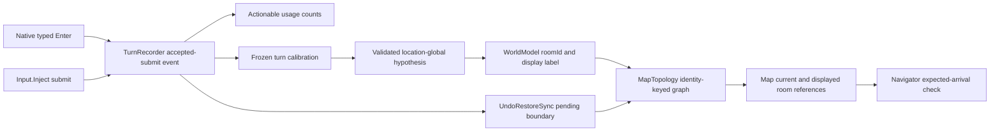

Calibration cache version 2 invalidates earlier location and bit conclusions that
could be supported by constant globals or incidental mutations. Attribute-bit
promotion requires a unique candidate across complementary mutations. Import
validation is shared through WorkspaceUI.ValidateMap; failed writes must restore
prior persisted data, and corrupt startup maps are preserved rather than overwritten.

> Companion to [`PRODUCTION_PLAN.md`](PRODUCTION_PLAN.md).  
> Related: [`GUI_BASELINE.md`](GUI_BASELINE.md).  
> The plan is prose authority; this is the picture. **If they disagree, the plan wins.**

**Status:** Audited 2026-09-11 (updated BUILD 41 dual-host + RemGlk + portable probe); **corrected 2026-09-12: D24-D30 (no heuristic fallback for actionable/map/radial, real attribute-bit schema, deterministic input-line radial, real-gameplay verification, non-Inform formats committed not deferred, docs-completeness gate, full map-beautification mechanics restored) - see PRODUCTION_PLAN.md decision log for full text.** **Holistic live-audit in progress 2026-09-12 (D52-D57 and ongoing): operator-directed real-gameplay audit of Anchorhead + wump2ka.z5.js (Z-machine only for now; Glulx/D38 paused not cancelled), Grok's seat currently exhausted (resumes 2026-09-18) so claude is running it solo, finding and generically fixing real bugs (nested inventory, map identity/dedup, numbered-exit commands, room display names, takeable/room-scope-leak attribute bugs) as they surface - not per-story patches, see decision log.**  
**Rendering:** Mermaid (GitHub / VS Code)

| Legend | Meaning |
|---|---|
| [yes] | exists now |
| [~] | partial / wrong backend |
| [ ] | target |
| [!] | risk seam |

<a id="ar-s002" data-chapter-id="ar-s002"></a>
### Audit note
Updated for **BUILD 41**: L2.5 Translator (D12), dual-host Emglken opt-in, RemGlk/GlkTap providers, portable `pm_vm_probe` + `DISTRIBUTE.md` (D13). Default product host remains Quixe/ZVM (`play.html`). Emglken host is `play-emglken.html`.
- D14 BUILD 45 O1-O4 chrome complete; HEAP optional

---

<a id="ar-s003" data-chapter-id="ar-s003"></a><a id="ar-ch1"></a>
## 1. Current vs target stack

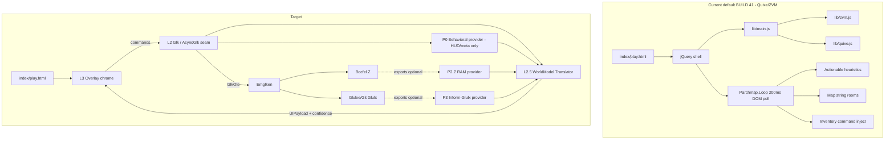

Target has no P1 Heuristic provider feeding the Translator (D24) - the TODAY subgraph's `ACT[Actionable heuristics]` above is what gets replaced, not carried into TARGET.

---

<a id="ar-s004" data-chapter-id="ar-s004"></a><a id="ar-ch2"></a>
## 2. Layer + Translator components

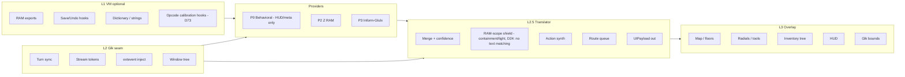

P1 Heuristic is not part of the actionable/map/radial provider set (D24) - dropped from this diagram accordingly.

---

<a id="ar-s005" data-chapter-id="ar-s005"></a><a id="ar-ch3"></a>
## 3. Per-turn sequence (Translator-centric)

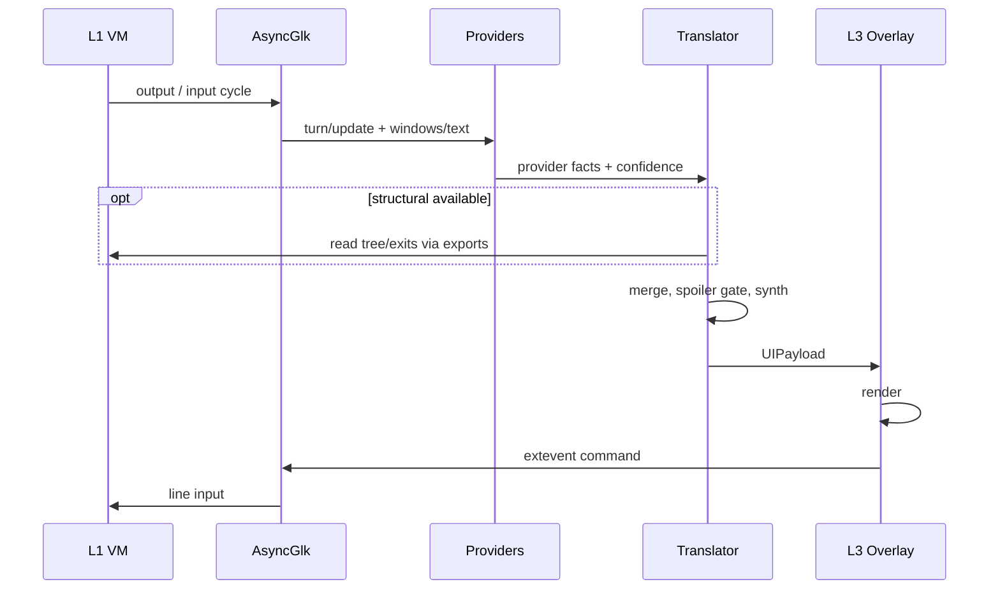

---

<a id="ar-s006" data-chapter-id="ar-s006"></a><a id="ar-ch4"></a>
## 4. Provider ladder (capability)

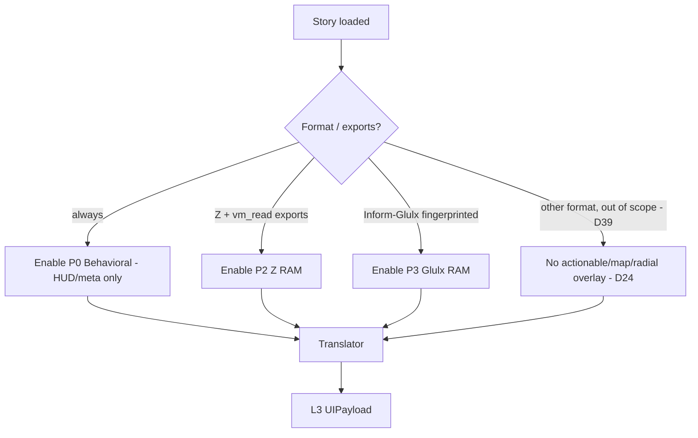

P1 Heuristic is not part of this ladder for actionable/map/radial (D24) - it has been removed as a source for those three fields. A format that reaches `NONE` gets HUD/meta from P0 only and no actionable/map/radial overlay until a real structural provider exists for it.

---

<a id="ar-s007" data-chapter-id="ar-s007"></a><a id="ar-ch5"></a>
## 5. Containment matrix (structural providers only)

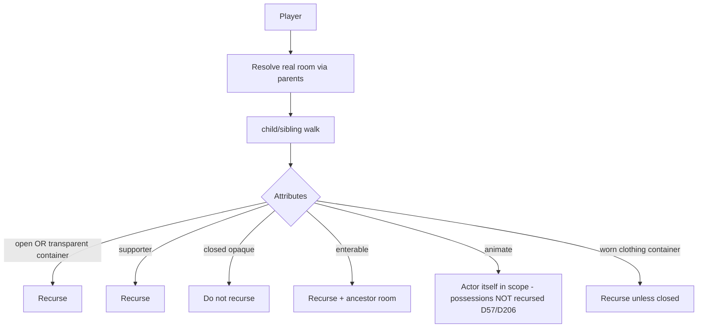

**D206 reconciliation.** This matrix once read "animate -> Recurse held/worn". That predated
D57/D68 and was never implemented. An actor is itself in scope: a named actor is a room
child, and an unnamed actor is a D184 vocabulary candidate. Its possessions are not walked
into room scope, and its held items never gain a room Take. Exposing actor-held items would
need RAM evidence of a held parser object and a separate decision.

Full Inform light/scope (`OffersLight`, `thedark`) is Phase 8 - this is containment only.

---

<a id="ar-s008" data-chapter-id="ar-s008"></a><a id="ar-ch6"></a>
## 6. Keep / replace / eliminated (D24)

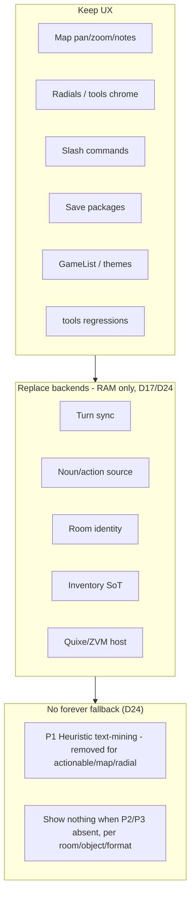

P0 Behavioral remains for HUD/meta telemetry only (Phase 7) - it was never the actionable/map/radial source and is unaffected by D24.

---

<a id="ar-s009" data-chapter-id="ar-s009"></a><a id="ar-ch7"></a>
## 7. DevKit & harness

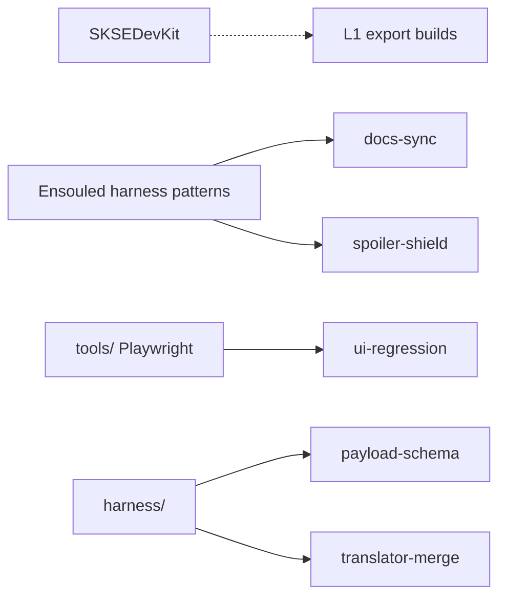

---

<a id="ar-s010" data-chapter-id="ar-s010"></a><a id="ar-ch8"></a>
## 8. UIPayload contract

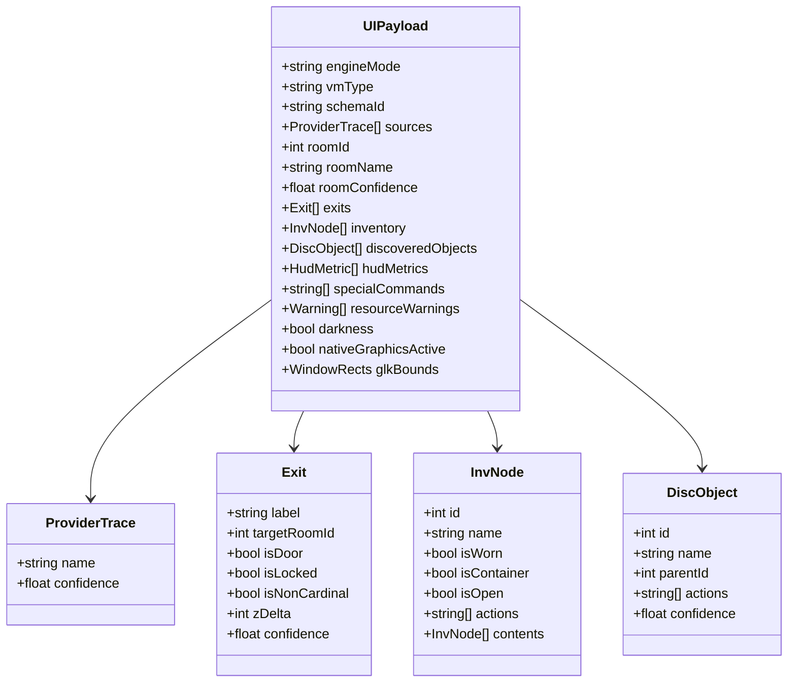

HUD / resourceWarnings / some specialCommands are heuristic-labeled even when present.

---

<a id="ar-s011" data-chapter-id="ar-s011"></a><a id="ar-ch9"></a>
## 9. Protocol-first integration

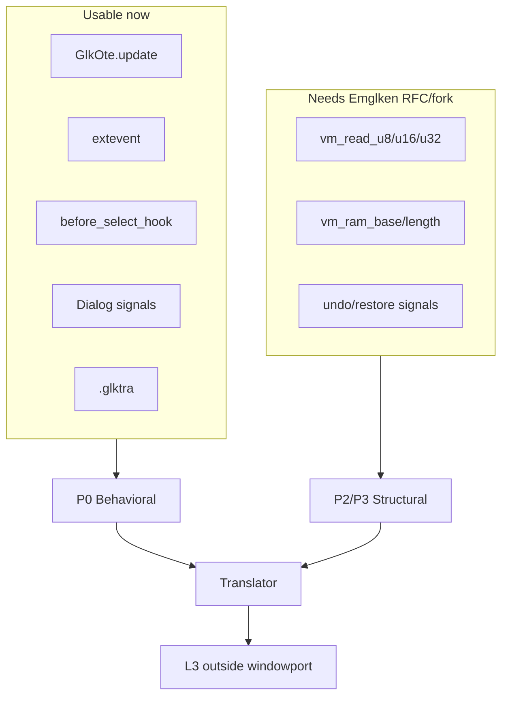

---

<a id="ar-s012" data-chapter-id="ar-s012"></a><a id="ar-ch10"></a>
## 10. Original module migration (O1-O5)

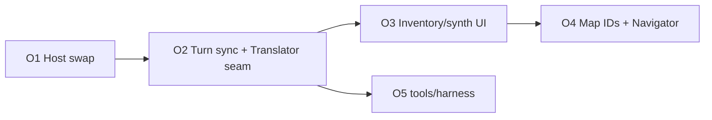

---

<a id="ar-s013" data-chapter-id="ar-s013"></a><a id="ar-ch11"></a>
## 11. L3 geometry contract (GUI baseline)

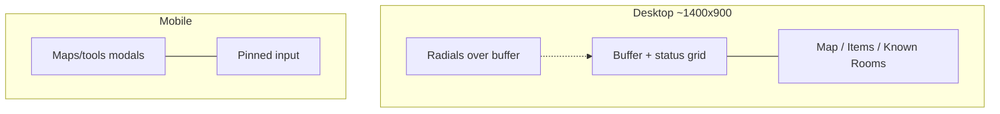

Preserve unless a phase gate explicitly changes it.

---

<a id="ar-s014" data-chapter-id="ar-s014"></a><a id="ar-ch12"></a>
## 12. Decision anchors (must match plan section 11)

- D1 Plan authority; TXT advisory  
- D2 TS-first new engine code  
- D3 Inform-family = structural RAM *target* (not ship-first)  
- D4 Spoiler default on  
- D5 DevKits/harnesses first-class  
- D6 Host migrate before deep RAM  
- D7 WASM layout after perf gate  
- D8 Protocol-first; RAM behind exports  
- D9 Confidence merge  
- D10 Outside `#windowport`; gen-aware caches  
- D11 In-place O1-O5 updates  
- D12 WorldModel Translator mandatory; provider order P0/P1/P2/P3 for HUD/meta; reject RAM-first gate  
- D24 No heuristic/text-mining fallback for actionable/map/radial, any VM format - show nothing instead  
- D25 Real attribute-bit schema (sourced profile) required; no name-regex attribute guessing  
- D26 Input-line radial: keep general UI chrome, RAM-derive the game-content portion (D23-compliant, no compass assumption)  
- D27 Real gameplay + screenshots required to close a UI-facing phase, not synthetic fixtures alone  
- D28 SUPERSEDED by D39 (2026-09-12) - originally "every format gets a real structural RAM provider eventually (Phase 10: Hugo/TADS/Adrift)"; kept for decision-log history only, no longer describes committed work  
- D39 Hugo/TADS/Adrift removed from the plan entirely, 2026-09-12 (operator directive) - not a deferral or a pause, these formats are no longer planned work of any kind. Scope is Z-machine (done) and Glulx (in progress, D38) only  
- D29 Docs-completeness gate: every phase updates the relevant plan/architecture sections and leaves every touched legacy system either correctly updated or fully removed - never half-migrated or contradictory  
- D30 Phase 6 map-beautification restored to full fidelity from the conversion guide (rigid-cluster/soft-spring physics, named planarization method, concrete pixel params, sub-map hulls, spoke-angle seeding, Z-axis dual rendering) - see §26  
- D31 Three requirements restored after being dropped entirely from the original conversion: nested-container "take out of X" verb suppression, RAM-scope-corrected NPC Known Topics palette, 320px responsive panel-collapse threshold - see PRODUCTION_PLAN.md Phase 4 / §6.6  
- D32 Click-historical-map-node-to-rewind (N real UNDOs) restored (Phase 5); vehicle parent(parent(player)) room resolution restated in PRODUCTION_PLAN.md prose (previously picture-only here in §5, violating the plan's own prose-authority rule)  
- D33 Plan-vs-actual-code reconciliation (2026-09-12): fixed six stale claims found by re-reading current code, incl. this doc's §15 wrongly framing already-implemented ZvmCapture.js/ZRamProvider.js as "target"; docs are now claude-sole-editor, grok reports via mailbox only  
- D34 Grammar-table verb extraction (real per-object verb lists from the game's compiled Grammar Table) - researched 2026-09-12 and closed as not RAM-deterministically viable (Inform's compiled grammar table is verb-indexed syntax/token-type data, not an object-id-to-verb map; per-object legality lives in compiled routines, not a static table). `js/GrammarProvider.js` is no longer dead code: a bounded, accepted follow-up now exposes the real Inform-only dictionary verb-flag vocabulary (game-wide input-line commands, format-gated off on Infocom, never attached to a specific object) via `ZRamReader.parseDictionary`'s `entries`/`informVerbFlags`. `ActionSynth.rules` remains the ceiling for object-radial per-object verbs.  
- D35 wump2ka.z5's numbered exits are I7-style compass objects (doorDir property), a different RAM structure than the I6 direction-property fix (D23/#28-#29) resolves; tracked as its own committed discovery task, not a block on that accepted fix. **2026-09-12 attempt 1 (rejected/reverted):** a doorDir implementation (js/ZRamReader.js compassDirections/numberedExitLabel) matched decoded object short-name text against compass words/ordinals - the same D24/D25 name-text-guessing anti-pattern this cutover eliminates elsewhere. Reverted by claude. **2026-09-12 attempt 2 (accepted):** rebuilt with zero name/text involvement - `directionDoorDirs`/`isIndivTable` find the direction-holder object and confirm the room's I7 individual-property table purely by RAM structure (child count, shared common-property values, numeric key-range check). Independently re-verified (harness suites + full Playwright regression); wump2ka now shows honest dest-less exit-N stubs. Destination-resolution for these exits is still open future work.  
- D36 Gap closed 2026-09-12: D34's grammar/dictionary-vocabulary research was Z-machine-specific (Txd/Infodump prior art); doc didn't commit to redoing it for Glulx. Now explicit committed work, sequenced strictly behind Glulx's own basic structural RAM provider landing first (Phase 4 provider, in progress - see D38). Must independently prove viability or non-viability the same way D34 did; "not RAM-deterministically solvable, attribute-approximation is the ceiling" is an acceptable honest outcome, not a mandate that it must yield a vocabulary win. Amended 2026-09-12 (D39): the Hugo/TADS/Adrift portion of this commitment is removed along with those formats.  
- D40/D49/D51 Anchorhead's I6 library compiled the nw/se diagonal properties (12/13) in the opposite order from the assumed profile - real per-story evidence, not a universal ABI. `js/ZRamReader.js` `directionProps.diagonalSwapped/diagonalCalibrated` self-calibrate from a real confirmed move (`calibrateDiagonalFromTravel`), persisted per exact game file (`ZRamReader.gameIdentityKey`/`hydrateDiagonalCalibration`/`persistDiagonalCalibration`, keyed off header release+serial) so a later session of the same game starts pre-calibrated. Until calibrated, BOTH real candidate words are offered (never a guessed single label, never hidden - D51 superseded an intermediate "honest neutral placeholder" attempt that hid the exit entirely, rejected on live testing) via `ambiguousDiagonal`-flagged exits; `js/Map.js` `Draw()`'s D48 same-destination collapse has a narrow exception for this flag so both candidate boxes render (tentative styling) until one is proven.  
- D42/D46/D48 Map "duplicate room" bug (a room reached by more than one direction rendering as two boxes): first attempt (D42) dimmed the repeat slot, then (D46) replaced its label with a cross-reference - both rejected on live testing, since the fixed compass grid gives every direction its own permanent visible slot regardless of label content. Final fix (D48): `Draw()` tracks destination ids already shown this pass and does not render a box at all for a repeat direction to an already-shown destination - verified generic for 2-, 3-, and N-direction collisions, not a 2-direction special case.  
- D47 Room map identity was still name-keyed underneath (`js/MapTopology.js` `ensureRoom` called `GetRoom(name)`, a case-insensitive string match) despite `ObjectId` already being captured - meant two different real rooms sharing a printed name (e.g. two "it's too dark to see" rooms) would incorrectly merge. Fixed: identity now keys off the real RAM room id first (`HasRealId` flag distinguishes a genuine id from a synthetic placeholder so a stub upgrading to its real id doesn't fork); display Name remains free to update to whatever the current payload calls the same real room. Closes the identity-keying half of the long-tracked Phase 5/D32 map-identity item.  
- D52 Grok's bus seat exhausted its weekly usage limit (confirmed both by its own mailbox loop and an operator screenshot of 100% usage, resets 2026-09-18) - the planned two-agent holistic live-audit (playing Anchorhead + wump2ka.z5.js as real players, iterating until clean) is running solo in the meantime. Scope narrowed to Z-machine only per operator directive; Glulx/D38 work is paused, not cancelled. A follow-on research task (decompile direction-action-routine bytecode to resolve the nw/se ambiguity with zero pre-travel uncertainty, improving on D49/D51's evidence-only approach) is queued for Grok's seat once it resumes.  
- D53/D57 Nested-container inventory item (D31) vanished entirely instead of nesting, and separately a room's own worn/held items leaked into ROOM-scope `discoveredObjects` (duplicating them out of inventory with wrong verbs offered). Both root-caused to the same class of issue: `js/ZRamReader.js` `walkVisibleDescendants` and `js/ZRamProvider.js`'s inventory-root resolution were using the wrong/leaked signals to find the real player id and to decide what counts as "in scope." Fixed at the source in both directions - the deep inventory walk is now rooted at a verified-correct holder id (probed directly, never guessed from a coincidental leak), and an unnamed-but-animate child (the player, commonly unnamed in Z-machine terms) is no longer transparently recursed into from room scope. Both fixes are universal RAM-walk corrections, not per-story patches.  
- D54 A game's compiled room short-name property is not always its player-facing display text (wump2ka.z5.js: internal "C_ROOMS_3" vs. the game's own printed "Room #3"). `WorldModel.refineRoomDisplayName` reads the story's own status bar (`.GridWindow.reverse`, an existing recognized convention, not new text-mining) as a DISPLAY-only refinement - identity stays the RAM ObjectId (D47) throughout; discoveredObjects/exits/inventory are untouched.  
- D55 Numbered I7 door_dir exits (D35) were completely non-functional via click/radial/route-navigation: every consumer submitted the internal display label ("exit-91") instead of the real parser command ("x1"/"x2"/..., ordinal LOCAL to each room's own populated exits, not the game-wide door_dir set - a wrong-ranking bug caught and fixed before shipping). `label` and `command` are now separate fields on every exit (identical for ordinary compass exits); every real submission path (`Actionable.js`, `Qol.js`, `Navigator.js`) now uses `command`.  
- D56 "Take" was never offered on any takeable object in any game: `AttributeSchema.js` documented `takeable`'s derivation (`!static && !scenery`, since Inform has no dedicated bit for it) but never implemented it, so `attrs.takeable` was permanently `undefined` everywhere. Universal one-function fix in `AttributeSchema.applyTo()`.  
- D62 A room's display Name is now fixed the first time a real RAM id is attached, never overwritten by a later visit's different reading -- live-confirmed wump2ka.z5.js prints a DIFFERENT "Room #N" for the exact SAME real room object on different visits (thematic, not a stable label), which broke the prior "always update to latest name" policy. Also fixed `MapTopology.applyStateDelta`'s own destination lookup to resolve by real RAM id (`ensureRoom`) instead of name, so a pre-travel hint (recorded under a room's un-refined stub name) and the post-travel confirmation correctly recognize each other as the same room.  
- D63 Root architecture gap: the map's compass grid only has DOM slots for the 12 fixed direction words, so a game whose exits are numbered (not compass words at all -- Wumpus's entire navigation vocabulary, not an occasional extra) could never render any neighbor room, only "here." Fixed generically: `Draw()` now assigns any non-compass exit key to whichever compass slot isn't already claimed by a real compass exit this pass, purely for visual positioning (a map box click re-centers by the room's real Name/Id, never submits a direction, so this never changes exit behavior).  
- D61 Root-cause, catalog-wide fix (not per-module patching): `js/ZRamReader.js`'s WHOLE direction-property scanning apparatus (PROFILE 7-18, the wider candidates scan, I7 door_dir) is an Inform-6/7 compiler assumption, not a Z-machine spec fact -- confirmed misfiring on Zork 1 (pre-Inform, ZIL-compiled, v3), producing 5 bogus "exit-N" phantom exits from coincidental property values, while real exits were never detected (explaining the reported missing map connections and missing actionable-word highlighting). Fixed generically: new `isInformCompiled(mem)` (reusing the D34 compiler-stamp signal, cached per memory buffer) gates the entire apparatus; a non-Inform game gets zero pre-travel exit hints (honest absence, D24) and relies on the already-compiler-agnostic state-delta labeling instead. Closes this bug class for the whole non-Inform side of the catalog at once, per the operator's explicit "handle all modules, don't decode each one" requirement.  
- D59 A held-but-not-worn wearable item's radial showed both "Wear" and "Remove" (contradictory): `ActionSynth.rules.wearable` contributes the fixed pair `["wear","remove"]`, and the not-worn inventory branch filtered `take` but never `remove`. One-line universal fix. Also re-verified this session purely via radial-driven/auto-nav play (no typed commands): direction clicks, object radials, and multi-hop "go to room" navigation all confirmed working correctly.  
- D60 Numbered I7 door_dir exits (D35/D55) were never underlined/clickable in the room text - their label ("exit-91", the raw property number) never matches a real game's own printed wording ("Exit 1"). Now labeled "exit N" using the SAME real structurally-derived ordinal the "xN" command already uses (not a text-mining regression: the ordinal is 100% RAM-derived; only the human-readable word chosen to label an already-resolved exit changed) - makes the exit genuinely clickable in text when it matches, never worse when it doesn't.  
- D64 An object's structural shortName is a display string only, not guaranteed real parser vocabulary - live-confirmed on wump2ka.z5.js ("scrawled note" shortName vs. real printed/parseable "scrap of paper"). Fixed generically: `ZRamReader.parserWords`/`reverseDictionary` decode the object's real compiler-reserved property-1 name-word list (gated on `isInformCompiled`, cached per buffer); `Actionable.js` tries the object's own name-phrases first (unchanged for the common case) and only falls back to these real alias words when the shortName never appears in printed text, remembering whichever phrase is confirmed (`Actionable.VerifiedNouns`) so it survives past the current tick; `ActionSynth.commandsForObject` now builds commands from that verified noun instead of always trusting `obj.name`. Closes the "scrap of paper not highlighted" report.  
- D65 The radial never offered a compass direction for a non-Inform game even long after real travel had confirmed it and the map already showed it - confirmed live on Zork1 after D61's (correct) gate left `payload.exits` permanently empty for pre-travel hints on any non-Inform game, but nothing else fed the OTHER real, compiler-agnostic exit source (`MapTopology`'s own confirmed `room.Exits`, written the moment a real typed direction is followed by real travel) back into `payload.exits`. Fixed generically: new `WorldModel.mergeConfirmedExits` adds any already-confirmed direction for the CURRENT room (real-id-first lookup, D62-style) that isn't already covered by a pre-travel hint. Works for every compiler, not just non-Inform games.  
- D66 A brand-new room showed zero neighbors even when the map already knew an adjacent room sat on its other side, because `Map.js Draw()` only ever rendered the CURRENT room's own outgoing `Exits` (edges are written on the departure room only, by design -- never guessing travel is reversible). Fixed generically, display-only: `Draw()` now also renders any OTHER known room with a confirmed edge pointing TO the current room, at the real, language-level compass-opposite slot, marked `tentative-exit` (D51's existing "known but not confirmed from here" treatment) -- never written into `Exits`, never submits a command, a map click still only re-centers.  
- D78 "Take X out of Y" (D31's only synthesized command for a nested-in-held-container item) never actually completes on a real Inform game -- operator's own live Anchorhead transcript proved it (repeated "I only understood you as far as wanting to take the umbrella", never "Taken.") while plain "take X" succeeded immediately. Same label/command split shape as D55/D64: `verb` keeps the useful "take out of Y" display label, `command` now submits the verified-working plain "take X". Generic fix, not per-title. Verified live via a real radial click.  
- D79 **The actual root cause of the session-long "Wumpus room-mapping still feels broken" reports**: `js/ZRamReader.js` `findLocationGlobal` -- the FALLBACK room-detector used whenever `parent(player)` is untrustworthy -- is not a rare backup for wump2ka.z5.js, it's the PRIMARY mechanism, since this game's player object has `parent === 0` almost always (confirmed live via direct RAM read; this game does not use the standard Inform "player contained in room" model). The fallback's own scoring formula was the bug: it weighted raw global-slot index (`g<=3: +40`) far above a real structural signal it also computed but under-weighted (how many distinct global slots reference the same candidate value). Live-reproduced proof: after a real, game-text-confirmed move, the CORRECT new room (referenced by 4 distinct globals: 16/37/38/41) lost to a WRONG room (referenced by only 2: 3/12) purely because of the index bonus. A 24-move real-play regression check showed `CurrentRoom` frozen on one value for the entire session pre-fix despite the real room changing throughout -- a more complete explanation for the standing complaint than any single earlier fix (D62/D67/D72/D74/D75/D76), which were all independently correct but never examined the fallback's actual room SELECTION. A cleaner alternative (extending D73's live opcode-observation hooks to watch `variable()` writes and directly OBSERVE the location global, rather than score-guess it) was investigated first with live evidence, not just theory -- a real trace of every global write during a confirmed move showed none matched the correct room id, meaning this game recomputes location on demand rather than caching it via an observable store, closing off that otherwise-preferred approach for this case. Fix: reference-count is now the dominant scoring term (`min(refCount,8)*15`), the old index bonus reduced to a small tiebreaker (max +3) that can no longer overturn it. Verified live: the same 24-move sequence now tracks 13 real, distinct rooms with zero anomalies. Generic (scoring-weight change only, no per-title branching) -- benefits any current/future game whose player isn't room-contained the standard way.  
- D80 `WorldModel.refineRoomDisplayName` was reading only column 0 of `.GridWindow.reverse`'s status text, so wump2ka's map showed generic "Room #N" labels for already-visited rooms. Repeated direct Playwright capture of the real DOM text (not assumed) proved the status text is ONE line with no literal newline, packing multiple 3+-space-gap columns (`Room #19 / Score: 2 / A vast, creased, watery room / Health: 73%`) -- the bug was wrong column index, not wrong line. Fix: split the whole text into columns, discard bare generic room-id columns and standard Score/Health/Moves/Turns metric columns (genre-wide, not per-title), take the first survivor. Anchorhead/Zork1 (one real title column each) are unchanged. `harness/d46-room-identity.js` fixtures now use the exact real captured strings. A first attempt by codex (bus seat) claimed this fixed with a fabricated harness fixture (an invented string with a `\n` that does not exist in the real DOM) and a live-evidence claim that did not match reality; claude caught it via direct re-verification and implemented the real fix directly. See `AGENTS.md`/`docs/ai-plan.md`: bus seats must show real captured evidence, not invented fixtures; only claude edits this file and `PRODUCTION_PLAN.md`.  
- D81 `js/Actionable.js` `Refresh()`'s room-scope tracking (`RoomLines`/`RoomHeading`/`Scope.roomName`) was still name-keyed, the same bug class D47 already closed for `MapTopology`/`Map.js` but never extended to this separate subsystem. `roomChanged` compared a display-name string even though the real `payload.roomId` sat unused in the same function -- a non-movement display-name update (e.g. a stub-to-real name upgrade) could false-trigger a room change, discarding still-current room highlighting. Fix: `roomChanged` now keys off `payload.roomId` (new `Scope.roomId`) whenever the payload is structural, name comparison only as a non-structural fallback. `.Style_subheader` transcript-banner matching is untouched -- it only locates text position for wump2ka's unstable-label case (D62), never decides whether a room changed, and per operator correction was never meant to apply to any other game's room-change detection. Verified live across all three games (wump2ka/Anchorhead/Zork1) with repeated non-movement probes (score/inventory/wait/xyzzy): stable baseline highlighting, no loss. Closes the second identity-keyed subsystem under D47's principle.
- D82 `js/ZRamProvider.js`'s primary room-scope `discoveredObjects` filter never excluded the resolved `playerId` (only `resolveInventoryRootId`'s separate fallback scan did) -- found live on `Deadline.z3.js`, whose start room's only real RAM child is the player object itself (id 160, real printable shortName `"player"`, not caught by `isMetaName`'s compiler-placeholder patterns). A room with no other modeled objects therefore offered the player itself as a room-scope actionable item. Fix: apply the same existing `playerId` exclusion to the primary filter. Verified live: `discoveredObjects` for that room now correctly resolves to `[]` (honest absence) instead of `["player"]`. One-line, generic, compiler/title-agnostic.
- D83 (RESOLVED by D84) `Bronze.zblorb.js` never resolved a real room via either location mechanism: `parent(playerId)` is permanently object 1 ("Class", a metaclass placeholder, not a room), and `findLocationGlobal`'s fallback also returned 0 for this title. Investigated via repeated direct RAM capture across real moves, not assumed. Originally left as an honest, documented gap rather than a forced per-title fix (P0/D24) -- see D84 for the actual generic fix.
- D84 Per-game LEARNED location-global calibration, closing D83/D79's gap generically (operator: "done correctly and in the most deterministic way possible that does not break our systems"). A fixed universal global slot was tried and directly disproven (Bronze's tracker sits at a different slot than any Anchorhead uses). Hooking the interpreter's `variable()` accessor to catch the write was investigated and rejected: direct inspection of `lib/zvm.js`'s JIT compiler showed the common "store into a global" path is a raw `ram.setUint16(...)` write that bypasses `variable()` entirely -- patching that would mean hooking every RAM write in the whole VM, far hotter and less scoped than the six existing opcode hooks, so out of scope for `ZvmCapture.js`. Fix instead reads already-settled RAM directly (`ZRamReader.u16`, the same primitive `findLocationGlobal` uses) after every submitted command, correlating each valid candidate slot against a confirmed room-name-text-change trigger (`WorldModel.refineRoomDisplayName`, text used only as a transition signal per D24/D47, never as identity). A slot confirms only after 3 consistent, uncontradicted observations including a revisit match; any contradiction permanently disqualifies it. `findLocationGlobal` consults the confirmed slot first, falling through unchanged otherwise. Verified live: Bronze now resolves and stably tracks real rooms after ~8 moves; Anchorhead/wump2ka/Zork1 unaffected. New harness `attr-calibrator-location-global.js` (13/13). Zero per-title code.
- D85 (SHIPPED 2026-09-14, codex-reviewed) Per-game learned verb-disablement + substitute-verb calibration. `AOTYRZ.z5.js` keeps "examine" as valid grammar (D34 unaffected) but its action routine is a permanent stub printing one identical line for any object. No RAM/opcode signal exists -- the only real signal is response TEXT compared for byte-identical equality across multiple different real objects. `AttrCalibrator.js` gains `observeVerbBehavior()`/`_splitAnyVerbNoun()`; `ActionSynth` consults the learned facts ahead of the hardcoded `"examine"` literal. Standalone verification completed live on AOTYRZ.z5.js using D86 stage 1's corrected entry-point coverage: three distinct objects confirmed byte-identical stub text correctly triggered disablement; a real distinct response (the closet) correctly never false-triggered; the radial correctly stopped offering "examine" once confirmed -- the original bug report fixed end-to-end (`tools/d85-verb-disablement-proof.js`, 4/4). No working substitute verb exists in this title (honest absence, live-confirmed); the substitute-learning branch is verified via a permanent synthetic harness instead (`harness/attr-calibrator-verb-disablement.js`, 21/21). Two real regressions found by codex's adversarial review and fixed: (#441) alias-driven commands (`Actionable.commandNounFor`, D64) were invisible to `_splitAnyVerbNoun`'s exact-name-only match; (#444) that fix's own noun-text keying let one object under two spellings falsely satisfy the 3-distinct-object threshold -- fixed by keying observations on stable object id. See PRODUCTION_PLAN.md D85 for the full evidence trail.
- D86 (FULLY SHIPPED 2026-09-14 -- v13, real multi-round adversarial review with codex, #379 through #433; codex confirmed no remaining architectural blocker in #421, then adversarially reviewed the actual stage 1 implementation diff -- #429/#432 -- finding and getting fixed real issues: a duplicated comment, a stale comment, proof assertions that overclaimed more than they checked, and missing cross-title coverage, before signing off "I do not see a blocking defect in stage 1" in #432) Unified turn recorder: a new, small `js/TurnRecorder.js` (capture substrate only) loaded before `js/AttrCalibrator.js`, replacing three separately hand-built correlation windows (D73-75's `_pending`, D84's `_locWindow`, D85's `_verbBehaviorWindow`) with a single active-id for opcode attribution (single-threaded JS serializes real command execution) plus boundary-stamping for transcript/status (a new command's acceptance freezes the previous turn's `endLine` right then; that turn's own ~450ms timer still reads/analyzes using the frozen boundary - not force-closed-and-read-immediately, which risked cutting a still-settling turn short or bleeding into the next one's text, a real regression codex caught and this design now avoids) consumed by analyzers that register against the recorder, writing to TRUE deep diagnostic clones (not shallow -- the table's nested structure would otherwise leak writes into real state) until individually cut over. Capture is lazy by construction; the recorder stays domain-ignorant, aggregating each analyzer's own witness rather than embedding "relevant status change" itself. **v13 addition (#412-414/#421, a real currently-shipped bug, verified directly against `js/AttrCalibrator.js:268-312`):** boundary-stamping alone (v12) froze only `endLine` -- `_resolveLocationWindow` still reads status text and RAM globals FRESH at its own 450ms timer, so a second command accepted before that timer fires can corrupt the first turn's read with the second turn's state, TODAY, independent of D86. Fix: `prepare()` may return a `captureAfter(turnDraft) => snapshot` callback, invoked exactly once per requesting analyzer at natural close or at the same moment a later command boundary-stamps the turn (before that later command's own interpreter handling runs); the result is stored as `turn.analyzerSnapshots[analyzerId]`. `analyze()` reads only `turn.analyzerSnapshots[...]`, never live DOM/VM/`ZRamReader` itself -- closing the independence gap for every post-turn signal, not just the transcript line count. **A real, previously-undiscovered PRE-EXISTING bug was found and verified live during this review:** every command submitted via map click/radial click/arrow-key/menu button (`Map.js`/`Qol.js`/`WorkspaceUI.js`/`Navigator.js`/`TranslatorUI.js`/`Input.js` all call `Input.Inject(text, true)` directly) fires a jQuery-synthesized keypress that does NOT reach `AttrCalibrator`'s native capture listener (confirmed live: 1 hit for real typed Enter, 0 hits for direct `Input.Inject`) -- D73-75/D84/D85 have been blind to all click/radial/map-driven commands this whole session. Fix: a small, in-place edit inside `Input.Inject` itself (captures the TRUE final appended value, not the raw argument -- `Input.Inject` appends to existing input text, so using the raw argument would corrupt which noun/object analyzers correlate against) notifies the recorder right before the synthetic keypress fires. **Entry points, settled:** native keypress capture (typed) + `Input.Inject`'s in-place hook (everything else) -- `Actionable.Submit` is explicitly NOT a separate entry point (it always calls `Input.Inject` after its own guard passes; wrapping both would double-fire for one real command). Full VM-instruction-level tracing stays rejected (tested live against D84/D85, changed neither outcome). **CUTOVER + CLEANUP COMPLETE, 2026-09-14:** `analyzers.verbSuccess`/`.locationGlobal`/`.verbBehavior` are now the sole real writers (diagnostic-clone/persist-swap machinery removed once each analyzer's live A/B proof confirmed byte-for-byte equivalence); the three legacy windows' dead function bodies (`observeCommand`/`_resolvePending`, `observeLocation`/`_resolveLocationWindow`, `observeVerbBehavior`/`_resolveVerbBehavior`) are deleted entirely, along with their trigger calls in both entry-point hooks. `_correlateLocation`/`_correlateVerbBehavior` (extracted, behavior-preserving refactors of the old resolvers) are the shared cores both the legacy path used and the analyzers now use directly. Five pre-existing node harnesses that drove the deleted functions directly were migrated to drive the new analyzer interface instead; all 6 of D86's own live proofs were rewritten from real-vs-diagnostic A/B comparisons into direct correctness proofs of the now-sole system. Full regression green (11 node harnesses, all Playwright suites). See PRODUCTION_PLAN.md D86 for the full staged migration plan, cutover/cleanup detail, and live mailbox audit trail. `CALIB[Opcode calibration hooks]` (L1 subgraph, §2): `js/TurnRecorder.js` is now the live capture substrate feeding the three analyzers in `js/AttrCalibrator.js`.
- D77 "Put in trenchcoat" missing for umbrella but present for the (removed) ring: not an availability difference (verified `ActionSynth` gave both "put in" the whole time) -- the bug was a hardcoded `.slice(0, 8)` in the target-picker submenu, silently truncating candidates with zero prioritization, so trenchcoat (a real container) fell past the cutoff behind room scenery; which object you clicked shifted the truncation point, explaining the exact discrepancy. `ParchmapQol.OpenRadial` already has its own real 16-item/2-ring paging with a genuine "More..." overflow -- operator explicitly rejected a "reorder but keep the cap" fix ("there is not supposed to be a limit"). Final fix: removed the extra cap entirely from all three submenus (put in/give to, use with, ask about); only ORDER is biased (real containers/recipients first) so the common case doesn't need "More...", but nothing is ever dropped. Verified live: all 10 real candidates now shown.  
- D76 Closed the Reset Map loose end D74 left open (operator asked directly whether it's safe for heavy repeated use). `ParchmapMap.Clear()` still called the legacy `EnteredRoom` stub-creation path; two fix attempts were caught by the existing regression suite before landing the right one -- calling the full `MapTopology.tick()` silently regenerated neighbors immediately (broke Reset Map's own "clear the map" promise, caught by `map-pathing-regression.js`), and calling a fresh `WorldModel.tick()` first was intermittently flaky (raced the normal per-turn re-tick, caught by running the same test 5x). Final: reuse the EXISTING `WorldModel.lastPayload` and call only `MapTopology.ensureRoom` -- no stub, no premature neighbor regen, no extra tick. Stress-tested: 4 reset cycles x 3 games, zero orphaned rooms, map always renders, inventory survives every round.  
- D75 "Inventory did not work at all" (Bear's Night Out fine, wump2ka.z5.js broken): the real held item's parent chain (185->171->37) showed the true holder (171, the unnamed prop D57/D58 already found) had `animate:false` this session, so `resolveInventoryRootId`'s animate-gated fallback never considered it and inventory read empty despite real held items -- a false NEGATIVE from the same known per-session attribute randomization. Fixed by reusing D73's infrastructure rather than another heuristic: a real successful take's `insert_obj(item, holderId)` call is 100% observed ground truth for who's holding things; `AttrCalibrator` now records it (`table.inventoryRootId`) and `ZRamProvider.resolveInventoryRootId` consults it before its own animate-gated fallback. Verified live end-to-end -- the exact failing repro now shows both real held items.  
- D74 Root cause of "after Reset Map + continuing to play, mapping simply didn't work": FOUR separate call sites still set `ParchmapMap.CurrentRoom` directly from the raw `payload.roomName` string each tick, none checking it against the FROZEN identity name (D62) `MapTopology.ensureRoom` had already resolved for the same real room -- since wump2ka.z5.js re-randomizes its printed room label on revisits, `CurrentRoom` could silently drift to a label matching no `Rooms[]` entry, so `Map.js Draw()`'s `GetRoom(CurrentRoom)` lookup found nothing and rendered zero boxes. Fixed with one shared resolver, `MapTopology.resolveCurrentRoomName(payload)`, used by all four sites instead of each deriving (or just re-using) the raw string independently.  
- D73 **Correction of D34/D58**: `lib/zvm.js` is a pure-JS JIT-compiling interpreter whose opcode methods (`test_attr`/`set_attr`/`clear_attr`/`get_prop`/`insert_obj`/`remove_obj`) are ordinary, live, prototype-patchable functions, not baked into closures -- watching them run, not just reading static RAM, is possible and cheap. Live proof (wump2ka.z5.js "take canteen"): the real TAKE precondition never tests bit 19 ("static"), proving the static profile checked the wrong bits, not that unobservable custom code overrode it. New `js/AttrCalibrator.js` + six new guarded prototype patches in `js/ZvmCapture.js` correlate a submitted command to its real object id (reusing `AttributeSchema._findIdByName`) and classify success/fail from the actual opcodes observed, not a transcript guess. A capture-phase `keypress` listener on `.Input.LineInput` was added after finding live that `Actionable.Submit` alone misses direct-typed commands (the most common real interaction) entirely. **Phase C/D (persistence + consumption) now implemented**: per-verb bit calibration (open/wear/lock/switch, 3-confirmation threshold, mirrors `ZRamReader`'s diagonal-calibration localStorage pattern) plus a per-object direct override for take/drop (takeable has no single mutated bit to learn generically -- a confirmed real take/refusal is remembered per-object instead), both consumed additively by `AttributeSchema.applyTo()`. Live-verified across all three catalog games: wump2ka.z5.js's canteen now correctly predicts takeable after one real take (the flagship fix); Anchorhead's already-correct predictions are provably unchanged; Zork1 (non-Inform) confirms the hook mechanism is VM-level generic, not Inform-specific. Z-machine only; Glulx needs its own separate feasibility check first (D36/D38 precedent).  
- D72 **The real, cross-game root cause of the map "feeling messed up"**: TWO separate legacy room-creation systems (`TranslatorUI.applyRoom`'s call to `Map.js EnteredRoom`, and `MapIdentity.applyExits`, an even older "Phase 5" layer) each independently ran their own NAME-STRING "create if not found" check on every tick, racing `MapTopology`'s real-id-based authority (already resolved the same room moments earlier the same tick). Any exact-string mismatch (routine during real transitions, e.g. before/after D54 refinement settles) forked off a permanently orphaned duplicate room keyed by a synthetic hash id -- not Wumpus randomness (D58), a genuine architecture race, just most visible in Wumpus due to its constant renumbering. Fixed by removing both redundant create-paths (kept their non-identity side effects: Draw/Save/RebuildRoomsList) rather than patching around them. Verified zero orphaned/duplicate rooms across real 8-20 move click-driven playthroughs on all three games (Wumpus/Anchorhead/Zork1).  
- D71 Follow-on to D63/D66: a compass slot's corner label ("N"/"NE") was a STATIC label from `Build()` time, never updated per-render -- so a borrowed slot (D63, numbered-exit games) kept showing a fake compass letter forever. Fixed: `DrawRoom` takes an optional real-label override, `Draw()`'s exits loop passes the room's actual direction/exit key, and every slot's label resets to its native letter at the top of each `Draw()` pass so a borrowed label never lingers once the slot goes back to a real compass exit.  
- D70 Minor D64 refinement, same click-driven pass: an object's `VerifiedNouns` entry could get overwritten by whichever matching phrase was processed LAST rather than the best one (Anchorhead's office door submitted "open real" -- functionally correct but obscure -- instead of "open office"). Fixed: since `wrapTargets` is already sorted longest-first, only replace an existing entry with a match at least as long, so the first (longest/best) match wins and a later short one never downgrades it.  
- D69 Follow-on bug from D65, found via a fresh real click-driven Anchorhead playtest: `WorldModel.mergeConfirmedExits` compared `room.Exits` keys directly against RAM-lookahead labels, but `TranslatorUI.js remapRoomExitKeys` deliberately keeps `room.Exits` in SHORT form ("nw"/"e"/"w") for `Map.js` slot lookups while RAM lookahead always uses the FULL word ("northwest"/"east"/"west") -- so a room with both produced visible duplicates in the radial ("northwest" AND "nw" side by side). Fixed by canonicalizing both sides through the existing `MapTopology.normalizeLabel` (the same short-to-long expander already used everywhere else) before comparing/pushing, instead of a new alias table.  
- D68 "Glow Bar incorrectly shows as worn" root-caused: the SAME unnamed-transparent-wrapper leak D57 fixed for the confirmed-animate case, just also triggered by D58's documented random non-animate roll on a decorative prop -- the `worn` bit itself was always correct, the bug was exposing it as a loose room object at all. Fixed generically: `worn` means "currently equipped by its parent" regardless of whether that parent tests animate this session, so an item reached ONLY via the unnamed-wrapper bypass (not a normal, directly-visible container child) is never surfaced while its own `worn` bit is set.  
- D67 The actual root cause of "the map doesn't update correctly until you travel back and forth" -- confirmed live via real click-driven repro (typed commands + real screenshots) after D66 made it much more visible: `Draw()` cleared `shown` from every slot at the top of each call but never `tentative-exit`, and `.room.tentative-exit{opacity:0.7}` beats the base `.room{opacity:0}` rule on CSS specificity alone, with or without `shown` -- so any slot ever marked tentative stayed permanently visible showing stale, no-longer-relevant room names until the main exits loop happened to revisit that exact slot again. One-line fix: clear both classes together at the top of `Draw()`. A real, catalog-wide bug (affects any game using D51's tentative mechanism), not just Zork1/D66 -- just never forced into the open before.  
- D58 Correction of a same-session over-claim: odd-looking attribute combos in wump2ka.z5.js (a procedurally-generated dungeon) are NOT an attribute-schema mismatch requiring per-story calibration - operator correctly pointed out the game's randomness is in which objects it generates, not in its one-time-compiled bit-to-semantic mapping. Behaviorally re-verified (real `take X` outcomes vs. RAM-read predictions): the standard schema is correct; apparent mismatches were this game's own custom per-object code overriding default TAKE behavior with hand-authored refusal text, the same already-accepted "attribute-approximation is a ceiling" limitation D34 documented. No new schema-calibration project needed. The real, narrower residual item: `resolveInventoryRootId`'s room-child fallback (D57) can occasionally misidentify the true player id in this specific game because its procedural generator sometimes dresses an unrelated prop with an `animate` flag and attached items; tightened to require a plural PC-shaped inventory, reducing but not perfectly eliminating the false-positive window - Anchorhead unaffected and re-verified 100% stable.  

---

<a id="ar-s015" data-chapter-id="ar-s015"></a><a id="ar-ch13"></a>
## 13. Open questions (Phase 0-2)

Superseded by **§17** for BUILD 41+. Keep historical bullets in git history if needed.


---

<a id="ar-s016" data-chapter-id="ar-s016"></a><a id="ar-ch14"></a>
## 14. Dual-host runtime (BUILD 41)

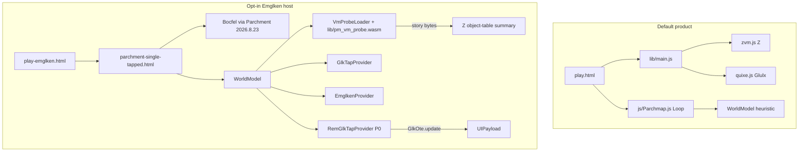

**Packaging:** runtime ships under repo root per `DISTRIBUTE.md`. Relative `meta[name=parchmap-root]`. No SKSEDevKit/emsdk required to play.

---

<a id="ar-s017" data-chapter-id="ar-s017"></a><a id="ar-ch15"></a>
## 15. Provider map (implemented vs target)

| Provider | File | Rank | Status |
|---|---|---|---|
| Heuristic | `js/WorldModel.js` collectHeuristic | P1 | **[removed, D24]** eliminated as a source for discoveredObjects/exits/inventory/roomName; not consulted by Actionable/Map/radial |
| RemGlk / GlkOte.update | `js/RemGlkTapProvider.js` | P0 | [yes] live on Emglken tapped host |
| Glk DOM tap | `js/GlkTapProvider.js` | P0/P1 assist | [yes] |
| Emglken stub meta | `js/EmglkenProvider.js` | meta | [yes] |
| Story-byte Z probe | `js/VmProbeLoader.js` + `lib/pm_vm_probe.*` | P2 light | [yes] ABI2 summary only - NOT live scope |
| Live ZVM RAM walk | target `js/ZvmCapture.js` + `js/ZRamProvider.js` + probe ABI3 | P2 full on play.html | [ ] CRITICAL PATH - player/location/children/dictionary |
| Live ZVM RAM walk (D22: all rooms/modules) | **implemented** `js/ZvmCapture.js` + `js/ZRamProvider.js`/`js/ZRamReader.js` (verified 2026-09-12 - these are real, working files, not target/nonexistent as previously stated here) | P2 full on play.html | [~] CRITICAL PATH remaining scope is **coverage breadth** (D22 arbitrary-room proof beyond Alley/start-rooms), not file existence - player/location/children/dictionary cascade itself is built and passing (Phase 1/2 harnesses, D22 matrix 7/7) |
| Live Bocfel HEAP | native-hooks linked into terp | P2 full alt | [ ] optional parallel to ZVM path |
| Inform-Glulx RAM | - | P3 | [ ] |

---

<a id="ar-s018" data-chapter-id="ar-s018"></a><a id="ar-ch16"></a>
## 16. Probe ABI (shipped WASM)

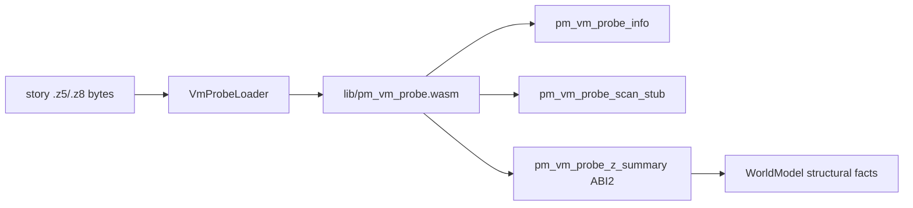

Build-only: `native-hooks/build.ps1` (MSVC) and Emscripten wasm preset. Outputs copied to `lib/` for distribution.

---

<a id="ar-s019" data-chapter-id="ar-s019"></a><a id="ar-ch17"></a>
## 17. Open questions (updated)

1. When to promote Emglken from opt-in to default without regressing Quixe UX?
2. (Resolved by D24) Object-table data shown under the spoiler shield is governed purely by RAM-scope containment/light rules (Phase 1), not by a printed-text match - nothing outside current real-time scope is ever shown, so there is no separate "how much text-derived data is safe" question left.
3. Specialized prompt UIs (yes/no, restore, content gates): handle in RemGlk `specialCommands` before broad module-matrix testing.
4. Live HEAP still blocked on terp export surface - keep story-byte structural probe as the shippable P2 light path.


<a id="ar-s020" data-chapter-id="ar-s020"></a><a id="ar-ch18"></a>
## 18. BUILD 45 chrome consumers (corrected, D24)

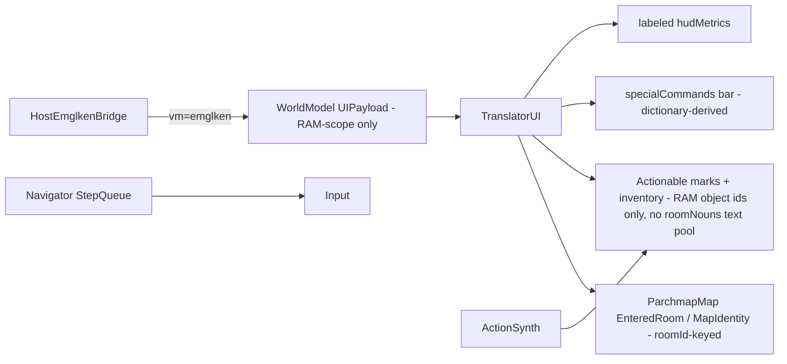

TextGate / BufferTap / GlkTap still load as WorldModel providers (script tags stay) but their `collect()` now returns empty `discoveredObjects` / `exits` / `roomName` (D24/D29: no half-migrated text-mining). `TextGate.isVisible` is a no-op always-true; RAM-scope is the spoiler shield. They are not on this diagram because they no longer feed actionable/map/radial.

- Quixe path: P2 Z RAM structural + optional probe (no heuristic text-mining feeding actionable/map/radial)
- Emglken path: iframe tapped host -> bridge merges child WorldModel into parent chrome


<a id="ar-s021" data-chapter-id="ar-s021"></a><a id="ar-ch19"></a>
## 19. Emglken entry (BUILD 45)

`play.html?host=emglken` / `play-emglken.html` ? top-level `parchment-single-tapped.html` (not nested iframe).


<a id="ar-s022" data-chapter-id="ar-s022"></a><a id="ar-ch20"></a>
## 20. Product rule (D15)

All player UX flows through `play.html` + Quixe for catalog modules. Emglken entry points are experimental only.


<a id="ar-s023" data-chapter-id="ar-s023"></a><a id="ar-ch21"></a>
## 21. Visible UI rule (D16)

Players only see Parchmap (`play.html`). Engine hosts and Translator internals are background. Debug chrome requires explicit user opt-in.


<a id="ar-s024" data-chapter-id="ar-s024"></a><a id="ar-ch22"></a>
## 22. Deterministic RAM-primary contract (D17-D20, corrected by D24)

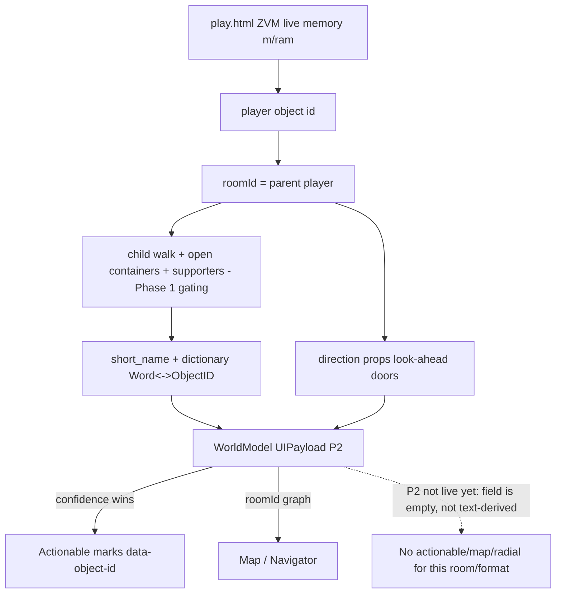

<a id="ar-s025" data-chapter-id="ar-s025"></a>
### Provider precedence (field-level, D24: no P1 fallback for these fields)
| Field | Winner when P2 live | When P2 not live |
|---|---|---|
| roomId / roomName | P2 parent(player) | empty (no room resolved) |
| exits | P2 direction props + door attrs | empty (no exits shown) |
| discoveredObjects / actionable | P2 in-scope object IDs + dictionary | empty (no marks rendered) |
| inventory tree | P2 child(player) worn/carried attrs | empty (no inventory tree) |
| verbs/radials | P2 attrs (calibrated per-game via live opcode observation, D73, when confirmed) + grammar table via ActionSynth | empty (no radial verbs) |

P0 behavioral may still populate HUD/meta fields (hudMetrics, specialCommands hints) independent of P2 - those were never part of this precedence table and are unaffected by D24.

<a id="ar-s026" data-chapter-id="ar-s026"></a>
### Guide gaps mapped into architecture
- Dictionary Word<->ObjectID -> every `.pm-act[data-object-id]`
- Look-ahead exits ? UIPayload.exits before travel
- @restore/@undo hooks ? Phase 8 resync bus
- Grammar table ? ActionSynth input
- Planarization / Glk shielding ? Phase 6 MapBeautify + GraphicsDock
- Live attribute-bit calibration -> js/AttrCalibrator.js (D73)

<a id="ar-s027" data-chapter-id="ar-s027"></a>
### Explicit non-goals retained
- Text-mining as proof of actionable correctness
- Visible non-Parchmap hosts / debug panels by default
- Blocking play.html UX until Emglken HEAP exports exist (ZVM live memory is an acceptable P2 path)

Live ZVM RAM walk is the CRITICAL PATH for deterministic actionable marks.


<a id="ar-s028" data-chapter-id="ar-s028"></a><a id="ar-ch23"></a>
## 23. Deterministic click / input commands (D21)

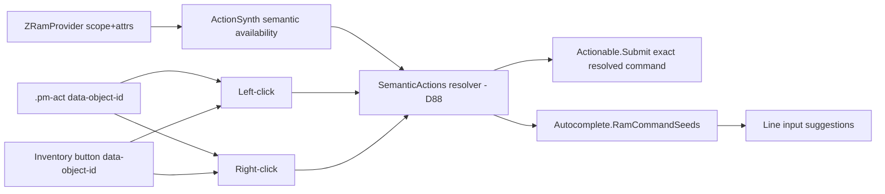

Before the D88 consumer cutover, `ActionSynth.commandsForPayloadObjectId` remains the
compatibility adapter and must produce byte-equivalent output. After cutover, left-click,
radials, and autocomplete consume the same resolved descriptor; none may rebuild parser
text from a first-token verb.


<a id="ar-s029" data-chapter-id="ar-s029"></a><a id="ar-ch24"></a>
## 24. Universal coverage contract (D22)

Product scope is **all rooms ? all catalog modules ? all supported module systems**, with one UI (`play.html`).

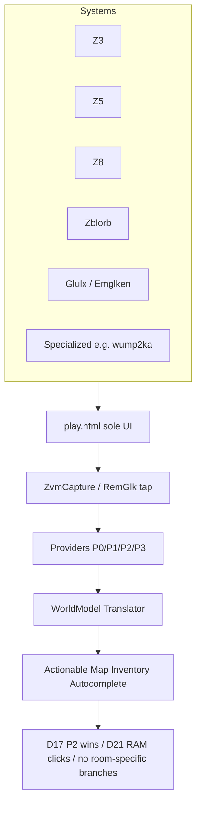

| Concern | Rule |
|---|---|
| Room change | Every turn re-resolve location (valid parent, else status/map ? findRoomsByName with children preference) |
| Module change | Same providers; story bytes / live RAM only differ |
| System change | Quixe Z ? P2 ZRamProvider; Emglken Glulx ? P0/P3; never fork UI |
| Fixture vs product | Harness fixtures (incl. Alley) prove the path; **Alley is never a product dependency**; matrix harness proves universality |

Open: Glulx live P3 parity still tracks Emglken HEAP export; until then Glulx stays P0 behavioral under the same chrome.


<a id="ar-s030" data-chapter-id="ar-s030"></a><a id="ar-ch25"></a>
## 25. Non-compass topological mapping (D23)

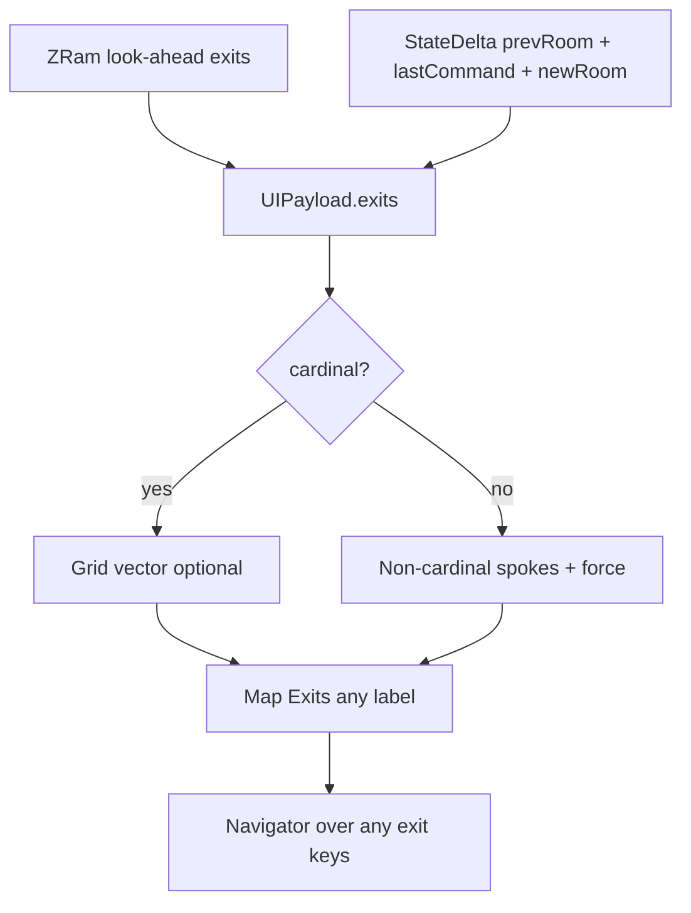

Compass vocabulary is optional layout hint only, never a mapping/pathing prerequisite (unchanged from D23, restated here for cross-reference from §26).

---

<a id="ar-s031" data-chapter-id="ar-s031"></a><a id="ar-ch26"></a>
## 26. Map Beautification Engine (Phase 6, D30)

Full mechanics restored from `Full Stack Engine Level Conversion.txt` - the prior version of this doc had this reduced to a single generic sentence.

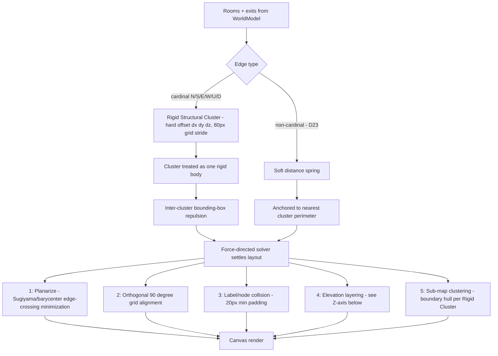

**Non-cardinal initial placement:** before the solver settles, seed each of a room's `N` non-cardinal exit stubs at `θ_i = 360° / N · i` (radial spoke seeding) rather than starting from a coincidental overlap.

**Z-axis:** `Z=0` at start; `+1` on up/climb; `-1` on down/descend; horizontal movement inherits current `Z`. Two required rendering modes: **Multi-Floor Tabs** (default) and **Phantom Layering** (ghost floors above/below the active one). Vertical links render as `↑`/`↓` perimeter badges, never long cross-canvas lines. One-way vertical exits (RAM-flagged non-reversible) get a distinct high-contrast warning arrow style.

**Gate (D27):** screenshot evidence of a >=N-room mixed cardinal/non-cardinal fixture with zero edge/label crossings, plus a multi-floor fixture showing both Tab and Phantom-Layering modes.

Compass vocabulary is an optional layout hint, never a prerequisite for mapping, pathing, or RAM mining.

---

<a id="ar-s032" data-chapter-id="ar-s032"></a><a id="ar-ch27"></a>
## 27. Live opcode calibration for attribute semantics (D73)

`js/AttributeSchema.js`'s static PROFILE (§3.3) is a documented guess at attribute-bit meaning. This section covers the escape hatch: watching the compiled game's own opcodes actually run, rather than only reading static RAM bits.

```mermaid
sequenceDiagram
  participant Player
  participant IN as Input (typed) / Actionable.Submit (clicked)
  participant AC as AttrCalibrator
  participant ZC as ZvmCapture (patched VM prototype)
  participant VM as lib/zvm.js (JIT-compiled game routine)

  Player->>IN: submit "take canteen"
  IN->>AC: observeCommand(command) - keypress capture (typed) or Submit wrap (clicked)
  AC->>AC: parse verb/noun, resolve real object id (AttributeSchema._findIdByName)
  AC->>AC: open correlation window (~450ms, keyed to that object id)
  IN->>VM: real turn executes
  VM->>ZC: test_attr / get_prop / set_attr / insert_obj / remove_obj (real opcodes)
  ZC->>AC: onOpcode(op, vm, args, result) for every call
  AC->>AC: append to window if args[0] == target object id
  AC->>AC: resolve window - success iff a mutating op (insert_obj/remove_obj/set_attr/clear_attr) occurred
  AC-->>AC: (Phase C) persist per-game learned bit, keyed by ZRamReader.gameIdentityKey
  AC-->>AttributeSchema: (Phase D) applyTo() consults AttrCalibrator.overrideFor() before the static PROFILE loop
```

Phase B, C, and D are all implemented (D73): Phase B observes and correlates (in-memory trace); Phase C persists confirmed per-game overrides to `localStorage` (mirrors the existing diagonal-exit calibration pattern, D49) - a per-verb learned bit for open/wear/lock/switch, and a per-object direct override for take/drop (which has no single learnable bit); Phase D wires both into `applyTo()`, additively - a game/flag with no confirmed observation behaves identically to the static profile alone. Live-verified fixing the canteen bug on wump2ka.z5.js with zero regression on Anchorhead and confirmed VM-generic (works identically) on non-Inform Zork1.

Z-machine (`lib/zvm.js`) only. Glulx/Quixe would need its own separate feasibility study first (matches the existing Glulx-sequenced-behind-Z-machine discipline, D36/D38).

---

<a id="ar-s033" data-chapter-id="ar-s033"></a><a id="ar-ch28"></a>
## 28. Semantic action dialect and command resolution (D88)

**Implementation status, 2026-09-19/20: Stages 1-6 of 8 shipped** (`js/SemanticActions.js`,
`harness/d88-*.js`; see PRODUCTION_PLAN.md D88/D90/D91 for full evidence). Everything
below describes the shipped contract, not a plan. `resolveForObject`/
`resolveForPayloadObjectId` currently populate only precedence step 7 (migration
compatibility, byte-parity with `ActionSynth`); steps 1-6 are real, empty hooks pending
Stages 7+ evidence. `resolveAskAboutFormsForObject` and `resolveExitCommand` are
separate entry points (not folded into `resolveForObject`) so that byte-parity gate
stays exact. The Stage 6 consumer cutover is live but **default OFF**
(`SemanticActions.CutoverFlag`, `localStorage`); flipping it swaps `js/Actionable.js`/
`js/Qol.js`/`js/Autocomplete.js` from calling `ActionSynth`/ad hoc construction directly
to reading this resolver instead, with zero output difference either way (proven, not
assumed, in `harness/d88-stage6-cutover.js`). Genuine touch long-press
(`js/Actionable.js` `Init()` `touchstart`/`touchmove`/`touchend`/`touchcancel`
handlers) is additive to the existing `click.pmAct`/`contextmenu.pmAct` handlers, not a
replacement.

D88 inserts a pure semantic layer between structural action synthesis and every
desktop/mobile command surface. It does not replace the provider ladder or collapse
engine-specific structural strategies. Intent, UI label, parser template, and rendered
command are separate values.

```mermaid
flowchart LR
  WM[WorldModel structural payload] --> AS[ActionSynth semantic availability]
  AS --> ACT[SemanticAction intent + roles + object ids]
  SP[StructuralCommandProvider] --> REG[SemanticActions registry]
  OP[ObservedDialectProvider] --> REG
  IZ[InformZDialectProvider] --> REG
  ZIL[ZilDialectProvider] --> REG
  GLX[Future InformGlulxDialectProvider] --> REG
  DICT[DictionaryCapabilityProvider lexical evidence only] --> REG
  ACT --> REG
  REG --> RC[ResolvedCommand or null]
  RC --> LC[Left click]
  RC --> OR[Object and inventory radials]
  RC --> MR[Touch long-press radial]
  RC --> IR[Input radial]
  RC --> AC[Autocomplete]
  RC --> NAV[Navigator]
  LC --> SUB[One accepted submission path]
  OR --> SUB
  MR --> SUB
  IR --> SUB
  AC --> SUB
  NAV --> SUB
  SUB --> TR[TurnRecorder]
  TR --> EV[Passive command-form evidence]
  EV --> OP
```

<a id="ar-s034" data-chapter-id="ar-s034"></a>
### Core records

`SemanticAction` contains stable `intent`, direct/indirect object ids, context,
structural command when already authoritative, and payload generation.
`CommandForm` contains a role-aware token template such as
`[literal("look"), literal("at"), slot("direct")]`, provider/source, scope, safety
class, evidence, and confidence. `ResolvedCommand` adds the stable UI label, exact
rendered parser command, form id, target ids, and provenance. The resolver is pure: it
cannot call `Input.Inject`, `Actionable.Submit`, or an interpreter API.

<a id="ar-s035" data-chapter-id="ar-s035"></a>
### Deterministic resolution

```mermaid
flowchart TD
  A[SemanticAction] --> S{Target current and unambiguous?}
  S -->|no| N[Return null]
  S -->|yes| V[Apply confirmed scoped vetoes]
  V --> P1{Explicit structural command?}
  P1 -->|yes| R[Render once]
  P1 -->|no| P2{Confirmed object/context form?}
  P2 -->|yes| R
  P2 -->|no| P3{Confirmed build-wide semantic form?}
  P3 -->|yes| R
  P3 -->|no| P4{Decoded compiler grammar?}
  P4 -->|yes| R
  P4 -->|no| P5{Capability-gated compiler profile?}
  P5 -->|yes| R
  P5 -->|no| P6{Migration compatibility form?}
  P6 -->|yes| R
  P6 -->|no| N
  R --> O[ResolvedCommand]
```

No failed form causes an automatic retry. No missing INSPECT falls through to the
first attribute action. Dictionary words cannot create compound templates. Ambiguous
nouns and parser clarification yield no learning observation until a stable target is
resolved.

<a id="ar-s036" data-chapter-id="ar-s036"></a>
### Evidence and persistence boundary

Typed and injected submissions carry optional `{intent, formId, objectIds}` metadata
through the existing two-entry-point `TurnRecorder` contract. Role-aware recognition
may annotate typed commands only when a known template and unique object spans match.
Structural opcode/state witnesses can confirm mutating semantics. Transcript response
patterns may identify a global stub or provisional object-specific behavior, but are
not sufficient to classify an unknown command as INSPECT; randomized presentation text
must not alter semantic classification.

New evidence lives in versioned `PM_SemanticActions_<buildIdentity>` sidecar storage,
keyed by release, serial, checksum, adapter version, locale/grammar regime, intent,
template signature, and scope. D85/v2 data remains untouched and is imported at most
once as provisional legacy evidence. Restore/undo/restart clears pending and
generation-bound observations; only independently established build-stable grammar
facts survive. Corrupt, foreign-build, or contradictory evidence fails closed.

<a id="ar-s037" data-chapter-id="ar-s037"></a>
### Mobile and out-of-sample gate

`contextmenu` simulation at a narrow viewport is not proof of mobile support. The gate
must exercise pointer/touch long-press, virtual-keyboard Enter, pagination, cancellation,
and the same descriptor/rendered command used by desktop click, radial, autocomplete,
and navigation.

The final evaluator chooses held-out stories/builds after code freeze and withholds
title/serial labels from assertions. Required cases cover Inform Z and non-Inform ZIL,
randomized Wumpus, AOTYRZ, same-name collisions, multiword-only and localized grammar,
random failure/success text, parser correction/disambiguation, delayed/menu output,
save/restore/undo/restart, and same-release/serial binaries with different checksums.
Default-on requires zero wrong automatic submissions and no title/build-specific branch.


<a id="ar-s038" data-chapter-id="ar-s038"></a><a id="ar-ch29"></a>
## 29. RAM-reading recovery: scope/attribute/exit walk (D89)

`js/ZRamReader.js` and `js/ZRamProvider.js` are the sole authority for turning live
Z-machine memory into a `UIPayload` (D3/D9/D24). Three walks compose, each already
covered by its own prior decision, and D89 is the record that all three went missing
together (a bulk file-state event, not an edit by any seat) and were restored to their
documented behavior, not reinvented:

```mermaid
flowchart TD
  MEM[Live Z-machine memory] --> SNAP[ZRamReader.snapshot - hint-free]
  SNAP --> LIKELY[findLikelyLocation: parent-player -> learned-global -> scored-scan]
  LIKELY --> SCOPE[scopeObjects - room children]
  SCOPE --> ATTRS[attrsFromObject -> AttributeSchema.applyTo]
  SCOPE --> WRAP{unnamed child?}
  WRAP -->|animate D57/D206| SKIP[own vocabulary recorded as D184 candidate; contents not recursed]
  WRAP -->|not animate| RECURSE[transparent recurse]
  RECURSE --> WORN{worn bit D68?}
  WORN -->|yes, via bypass| DROP[excluded - stays with wearer]
  SCOPE --> EXITS[lookAheadExits]
  EXITS --> INFORM{isInformCompiled D61?}
  INFORM -->|no| NOEXIT[honest empty - MapTopology state-delta is the fallback]
  INFORM -->|yes| DIAG[nw/se ambiguous-until-calibrated D49/D51]
  INFORM -->|yes| DOORDIR[door_dir/IndivTable numbered exits D35]
  DOORDIR --> DESTCHK[destIsMapRoom validates real dest]
  DESTCHK -->|fails| STUB[honest dest-less stub]
  SNAP --> PLAYER[findPlayerId - accepts unnamed self-object]
  PLAYER --> INVROOT[resolveInventoryRootId D53/D57/D58/D75]
  INVROOT --> WALK[walkVisibleDescendants - deep inventory]
  ZP[ZRamProvider.collect] --> SNAPCALL{snap.roomId set?}
  SNAPCALL -->|yes| TRUST[trust it - never overridden by a text hint]
  SNAPCALL -->|no| HINT[status-text hint ladder - last resort only]
```

**The invariant this section exists to name:** `ZRamProvider.collect()`'s text-hint
ladder (`resolveStatusRoom` -> `findLikelyLocation` with a hint -> `matchRoomFromText`
-> `findRoomsByName`) is a fallback for when structural resolution finds NOTHING, never
a second opinion permitted to override an already-successful structural answer.
`resolveStatusRoom()`'s primary source is `ParchmapMap.CurrentRoom` -- itself set from
the PREVIOUS resolved room -- so treating the hint as authoritative on every tick is
self-reinforcing: one wrong early guess becomes permanent, since every later tick
re-feeds that same wrong name back in as its own hint (confirmed live: an NPC name
"Michael" matched via the hint path and never let go, even though the hint-free
structural path was already correct the whole time). `collect()` now checks
`snap.roomId` first, unconditionally, before ever consulting the hint ladder.

Room-scope discovery (`scopeObjects`) and deep inventory discovery
(`walkVisibleDescendants`, reached via `resolveInventoryRootId`) are deliberately
separate walks with separate exclusion rules -- `scopeObjects` excludes the resolved
`playerId` from room scope (D82) and gates unnamed-wrapper recursion on the wrapper's
own `animate`/`worn` bits (D57/D68); `resolveInventoryRootId` has its own precedence
(D75's opcode-observed confirmed root first, then a direct-holds check, then an
animate+plural-children structural fallback, D53/D57/D58) because a game's resolved
`playerId` is not always the object that actually holds items. Neither walk may borrow
the other's exclusion logic as a shortcut; each was independently found broken and
independently restored.

**D75 containment-evidence correction (2026-10-04).** AttrCalibrator remains the
owner of inventory-root evidence; TurnRecorder freezes the submitted object's
before/after parent links at the existing turn boundary. A same-parent
remove/reinsert is not a successful TAKE/DROP and cannot become behavioral
confirmation. Root learning uses the submitted object's insert destination,
excluding the frozen original room and structurally known rooms (current resolved
room / compiler-owned room index). The existing confirmed-root getter ignores
a previously stored room root, allowing ZRamProvider's established holder
fallback to recover without deleting other calibration. No map/UI labels,
printed inventory guesses, title-specific branch, hidden command or new
equipment filter participates. ZRamProvider still walks held containment,
WorldModel still publishes the inventory identities, and EquipmentUI still
renders that inventory. Room-scope candidates and underlines continue through
their own existing path when descriptions/actions change.


<a id="ar-s039" data-chapter-id="ar-s039"></a><a id="ar-ch30"></a>
## 30. Mobile: portrait-primary shell, PWA shell, and native Android conversion (D93, supersedes D92's landscape framing)

> D92 originally shipped a landscape-lock/rotate-hint mechanism; the operator later
> identified this as a mistake, not a preference ("I was wrong about landscape view...
> It needs to be portrait view"). D93 replaces that framing below. The PWA-shell and
> Capacitor-conversion mechanics D92 established are unchanged and still described
> here; only the orientation policy and the mobile hit-testing/reachability bugs D93
> found along the way are new. See `docs/mobile-ui-plan-d93.md` for the full planning
> record (44 gates, six adversarial audit rounds) and PRODUCTION_PLAN.md's D93 entry
> for live verification evidence.

```mermaid
flowchart LR
  BOOT[play.html load, compact viewport] --> PORTRAIT[body.pm-mobile.pm-portrait -- default, no lock]
  PORTRAIT --> STACK[#parchment pointer-events:none]
  STACK --> HIT[LineInput / .pm-act / Glk dialogs all hit-testable]
  PORTRAIT --> TOOLS[#tools-toggle display:block under pm-mobile -- reachable without typing /tools]
  PORTRAIT --> ROW["[mic][input][submit] overlay row, gutters reserved in .Input.LineInput's own width"]
  ROW --> SUBMIT[Input.Inject('', true) -- append nothing, submit existing value]
  ROW --> MIC[Native STT or Web Speech -> Input.Inject transcript, false -- insert only, never auto-submit]
  LOAD[play.html load] --> SW{isSecureContext?}
  SW -->|https or localhost| REG[service-worker.js registers]
  SW -->|file:// or LAN http://| NOREG[no offline cache - app still runs fully]
  REG --> SHELL[App-shell cache-first: html/css/js/lib]
  REG --> RUNTIME[Everything else network-first, cache fallback]
  BUILD[build-android.bat] --> DIST[make-dist.bat -> static dist]
  BUILD --> BUMP[bump versionCode]
  BUILD --> COPY[cap copy android]
  BUILD --> GRADLE[gradlew assembleDebug]
  GRADLE --> APK[Parchmap.apk - bundled WebView, no hosting]
```

**Portrait is the default, fully-supported orientation** (`js/MobileLayout.js`).
`requestFullscreenLandscape` and its first-gesture `touchend`/`click` capture-phase
listener chain -- which silently rotated a portrait session into landscape on the very
first tap anywhere, including a tap meant for the menu, a noun, or the input -- are
DELETED, not disabled. `#pm-rotate-hint` stays in the DOM (a possible future, explicitly
optional landscape-enhancement affordance) but is permanently hidden by `apply()`
rather than shown for portrait. `manifest.json`'s `orientation` is `portrait-primary`.
`isCompact()` no longer includes `pointer: coarse` in its OR -- a touchscreen
desktop/laptop at a desktop-sized viewport (including this project's own 1400x900
layout-regression viewport) must not receive the mobile shell; touch capability and
compact layout are different questions.

**The stacking-context bug that made mobile "not work" was found and fixed at its
source, not worked around per-symptom:** `#parchment` (an always-present, invisible
`opacity:0` overlay div, confirmed otherwise fully inert -- the one place that would
give it real scrollable content is commented-out dead code) shared `#windowport`'s
`z-index:3` on mobile and, as a later DOM sibling, silently won hit-testing over
*everything* inside `#windowport` -- the line input, every `.pm-act` actionable mark,
and Glk's own native Save/Restore dialog, confirmed live via `elementFromPoint` for
each. `body.pm-mobile #parchment { pointer-events: none; }` restores all three at once;
desktop's `#parchment` (`z-index: auto`, never affected) is untouched.

**Reachability:** `#tools-toggle`'s desktop-only `/tools`-typed-first gate is overridden
to `display: block` under `body.pm-mobile` -- previously the entire Tools surface
(Items/Transcript/History/Display/Commands/Theme/Maps/Save-files) had no discoverable
path on a touch device at all.

**Touch long-press** (D88 Stage 6's real `touchstart`/`touchmove`/`touchend`/
`touchcancel` handlers, already correct, just unable to fire while the stacking bug
stood) is hardened: a `pm-press-pending` class applies `user-select: none` only while a
press is pending (not permanently -- a permanent rule would silently block copying
story text), preventing Android's native text-selection from winning the race and
firing a `touchcancel` that kills the radial; `ParchmapQol.HideRadialMenu` ignores a
`mousedown` within 400ms of `OpenRadial`, a defensive guard against a browser-
synthesized compatibility event from the same touch dismissing the radial it just
opened.

**Input row** (`play.html`, `js/Input.js`'s `BindInputRow`/`InitMic`/`ToggleMic`): a
fixed-position submit button (desktop + mobile) and mic button (mobile only) sit beside
Glk's own `.Input.LineInput` as host-owned siblings -- not children of it, since GlkOte
re-renders that node every prompt, so a reparent-on-each-prompt scheme was rejected in
favor of an overlay with a CSS-reserved gutter in the input's own width. Submit calls
`Input.Inject("", true)` specifically (append nothing, just submit the existing value --
`Inject(currentValue, true)` would duplicate the command, since `Inject` always appends
to whatever the box already holds). Mic prefers the native Capacitor path
(`@capacitor-community/speech-recognition` + `RECORD_AUDIO`) inside the APK when
`window.Capacitor.Plugins.SpeechRecognition` is present; otherwise it uses the
browser `SpeechRecognition`/`webkitSpeechRecognition` Web API where available,
and hides entirely where neither path exists (e.g. iOS Safari without Web Speech).
Both paths insert via `Input.Inject(transcript, false)` only -- never auto-submit
(see PRODUCTION_PLAN.md D93 full-closure round). Both controls hide via the existing
`has-line-input` body class whenever no line input is on screen (a MORE-prompt,
char-input, etc).

**PWA shell** (`manifest.json`, `service-worker.js`) precaches the fixed app-shell file
list (html/css/js/lib/icons) cache-first for instant offline boot; the ~300-file game
catalog and anything else is network-first with a cache fallback, so a game already
opened once works offline without precaching the whole catalog. Service workers only
register in a secure context (`https://` or the literal host `localhost` -- a browser
platform rule); `file://` and a plain LAN `http://` IP both run the full app but do not
get offline caching, which is documented rather than silently degraded.
`service-worker.js`'s `CACHE_VERSION` is bumped whenever `APP_SHELL`'s contents change
(including `manifest.json` itself) so an already-installed PWA doesn't stay stuck
serving a stale cached shell.

**Native Android conversion** uses Capacitor (bundles the static app inside the `.apk`,
runs in the app's own private WebView), not a Trusted Web Activity (Bubblewrap) --
a TWA fundamentally requires the app to already be hosted at a live,
Digital-Asset-Links-verified HTTPS origin, which contradicts "self-contained, no
hosting." `build-android.bat` is the single build entry point and always produces both
outputs (static dist + `Parchmap.apk`) in one run. Update-in-place (not a duplicate
install) requires `applicationId` (fixed), the signing certificate (Gradle's
auto-created debug keystore, never regenerated by the script), and `versionCode`
(auto-incremented every run via `android/bump-version.ps1`) to all match "same app,
newer version" -- re-verified after the D93 changes (versionCode 5->6, `BUILD
SUCCESSFUL`, compiled `android/app/src/main/assets/public/` output directly grepped to
confirm the real source changes propagated, not stale cached assets). Toolchain (JDK 17
+ 21 Temurin, Android SDK platform-tools/34/build-tools 34.0.0) lives in the shared
`AndroidDevKit` at `C:\Users\hymlo\Downloads\Projects\AndroidDevKit\sdk`, not inside
this repo. `make-dist.bat`'s root-file copy is a deny-list (ships any new root file
automatically), not a hardcoded allow-list, specifically so the next new root-level
artifact does not require a fresh manual ship-list edit the way `manifest.json`/
`service-worker.js` initially did.

**Full closure (same day, operator directive -- nothing left deferred):**
`capacitor.config.json`'s `webDir` is now repo-relative (`capacitor-www/`, built by
`make-dist.bat`'s new optional destination argument), not an absolute outside-repo
path. `AndroidManifest.xml`'s Activity carries `android:windowSoftInputMode=
"adjustResize"`, matching the resize-based model the existing `visualViewport`/
`--pm-kb-inset` CSS already assumes. Android's hardware back button (`@capacitor/app`,
`js/MobileLayout.js`'s `bindAndroidBackButton`) mirrors `js/Input.js`'s own Escape-key
dismiss priority (radial -> Message -> native dialog -> map) and exits only when
nothing is left to close. Glk `CharInput` prompts (Y/N, menus, "press any key") share
mobile bottom-strip positioning with `LineInput`, but are a different prompt mode:
body `has-char-input` shows the host submit arrow (`#pm-input-submit`), which fires a
synthetic keypress into the CharInput (begin/MORE/continue) without opening the OS
soft keyboard (`inputmode=none`, blur, readonly). Soft-keyboard policy on mobile:
the IME stays closed unless the player **short-taps** a visible `.Input.LineInput`
(sets `pmUserFocus` + `inputmode=text`); GlkOte's auto-`focus()` is rejected via a
`focusin` gate and per-tick `SyncMobilePromptFocus`; long-press on the line field
opens the input radial **without** IME; Tools/Menu/story touches call
`Input.DismissKeyboard`. The input-line radial also has a long-press path on
`#pm-input-submit` (a focused field's own long-press would open OS text-selection,
not a page radial). Desktop right-click on the line field is unchanged. The Tools radial (`WorkspaceUI.
OpenTools`, not D26-protected) renders as a scrollable vertical list with real 44px
targets on `body.pm-mobile` instead of paginating behind "More..." -- desktop's
circular Tools radial is unchanged. The mic button's native path
(`@capacitor-community/speech-recognition`, `android.permission.RECORD_AUDIO`) runs
`available()` -> `checkPermissions()`/`requestPermissions()` -> `start()` inside the
APK, falling back to the pre-existing browser `SpeechRecognition` path outside it; both
insert-only, never auto-submit. See PRODUCTION_PLAN.md's D93 closure-round entry for
the full live-verification evidence, including a real, self-caught Gradle manifest
merge failure (a literal `--` inside an XML comment) fixed before the final rebuild.

<!-- D93-MOBILE-FOLLOWUP-ARCH (moved here from a duplicate "19. Emglken entry (BUILD 43)" tail; the Emglken entry itself is section 19, BUILD 45) -->
<a id="ar-s040" data-chapter-id="ar-s040"></a>
### Post-D93 operator follow-ups: input, dialogs, mic (partly superseded)

Keyboard gate applies only to Glk .Input.LineInput / .Input.CharInput. Native Glk #dialog save/restore name fields are excluded from blur/dismiss so the soft keyboard stays up while typing a save name.

Mobile line row (LTR): command field, submit (➤), mic (far right). The mic behaviour recorded here at the time (hold-to-talk default via Global.Prefs.MicHoldToTalk, tap-to-toggle alternate, Options toggle) is superseded in detail by section 32 (D95 voice input state machine); the Menu/Map chrome by section 33 (D96).

After undo/restore/restart, UndoRestoreSync.resync refreshes WorldModel + Actionable + map and scrolls the buffer. D106 corrects the former assumption that scrolling made restored story text appear: successful native file restore additionally submits one settled `look` (section 41); undo/restart stay passive.


<a id="ar-s041" data-chapter-id="ar-s041"></a><a id="ar-ch31"></a>
## 31. VM restore hooks and the truthful character cell (D94)

Two contracts that the mobile shell depends on, each of which failed silently and was
found only by reproducing on a phone-sized browser.

```mermaid
flowchart TD
  subgraph HOOK[Restore/restart observer -- must never break the VM]
    VMR[ZVM restore_undo / restore_file / restart] --> WRAP[ZvmCapture wrapper: passive observer]
    WRAP -->|try/catch + operation identity| ORS[UndoRestoreSync.onStateRestored]
    ORS -->|coalesced 250ms timer| RS[UndoRestoreSync.resync]
    RS --> RF[WorldModel + MapTopology + Actionable + Map + TranslatorUI + scroll]
  end
  subgraph CELL[One character cell, measured where it is rendered]
    GO[GlkOte Y: hidden test pane in #parchment, width of 12345678 / 8] --> COLS[columns and rows told to the game]
    CC[css/CharCell.css: identical cell rules for #parchment AND #windowport] --> GO
    CC --> REAL[real GridWindow + BufferWindow in #windowport]
    COLS --> GAME[game hard-wraps, boxes and centres text to that width]
  end
```

**Restore/restart observer (`js/ZvmCapture.js` -> `js/UndoRestoreSync.js`).** Phase 8's
"terp-level @restore/@undo hooks" wrap the VM's `restore_undo`, `restore_file` and
`restart`; after a successful restore or any restart they call
`UndoRestoreSync.onStateRestored(operation)`, the opcode-level entry to the same `resync()` the
typed-command path uses (section 23/D86). Two invariants: (1) the callee must exist --
`onStateRestored` was missing, so the call threw inside the VM's own boot-time `restart`
and aborted game start (an intermittent blank game pane, because the wrapper is installed
by a polling timer and only crashed when it landed before the VM's first `restart`);
(2) the wrapper is a passive observer, so it calls the callee inside `try/catch` with an
existence check and an observer failure can never propagate into the VM. Guarded by
`harness/audit-restore-sync.js` (real module, not a mock), `tools/check-missing-methods.js`
(every `Module.method(` call in `js/` must resolve; comments and existence-guarded calls
ignored) and the boot section of `harness/d94-cell-and-boot.js`.

**Truthful character cell (`css/CharCell.css`).** GlkOte tells the game how many columns
and rows fit by measuring one character in a hidden test pane, and games treat the grid's
width as the screen width: they hard-wrap boxed text at it and pad centred text to it.
That pane is appended to `#parchment` (GlkOte's gameport) but the real windows live in
`#windowport`, and all Parchmap font rules are scoped to `#windowport` -- so on mobile the
game measured 14px/15px cells while the screen rendered 10px grid and 20px prose, the game
was told 44 columns when ~62 fit, and both the boxed quote and the centred title wrapped
wrongly. On the mobile shell (`body.pm-mobile`) the stylesheet enforces: **one cell for
grid and prose** (the prose column must hold at least as many characters as the grid
reports), sized as `min(Display font, fit)` where `fit` guarantees `--pm-cell-cols`
(default 50) columns; and **identical rules on the measuring pane and the real windows**,
so measured == rendered by construction. Grid spans render full-height edge to edge so
boxed text is a solid block. Desktop is untouched. `harness/d94-cell-and-boot.js` asserts
measured == rendered for grid and prose at five phone sizes, that the reported columns fit
the prose column, that no grid line wraps, that Anchorhead's quote and title stay intact,
and that desktop keeps its metrics; it fails if the stylesheet is removed. Trade-off: the
Display font size becomes an upper bound on mobile (about 12.5px effective on a 412px
phone); `--pm-cell-cols` is the single tuning knob. `css/CharCell.css` is in the service
worker's `APP_SHELL` (cache v5) and in `make-dist.bat`'s critical-file check.

<a id="ar-s042" data-chapter-id="ar-s042"></a><a id="ar-ch32"></a>
## 32. Voice input state machine (D95)

`Input.Mic` (js/Input.js) drives the mobile microphone button. The button is the ONLY
indicator -- no text is ever shown for the mic (operator requirement).

```mermaid
stateDiagram-v2
  [*] --> Idle
  Idle --> Listening: press (hold mode) / tap (tap mode)  -- lit immediately
  Listening --> Listening: recognizer segment ends by itself while still held -> next segment (hold mode)
  Listening --> Finishing: release / second tap -- dimmed, stop() the recognizer
  Listening --> Error: real failure (permission, no mic, network)
  Finishing --> Idle: commit accumulated text ONCE (insert only, never submit)
  Error --> Idle: ~2.5s red frame + circle-and-line sign
  Listening --> Idle: tap mode: recognizer ended on silence (text inserted, button goes dark)
```

Design constraints taken from the engines' real behaviour, not an idealised model: Android's
`SpeechRecognizer` (via @capacitor-community/speech-recognition) ends every session by itself
after a pause, so hold mode chains segments and accumulates text; a session that heard nothing
rejects ("No match"/"No speech input"), which is a normal outcome and not an error; availability
and permission are async (checked once, then cached), the permission prompt steals the touch,
so a release before recognition starts cancels cleanly. The button carries
`user-select:none`, `-webkit-touch-callout:none`, `touch-action:none` and suppresses
`contextmenu`, because a long press otherwise triggers selection or the OS menu, which fires
`touchcancel` and ends the recording early. A 60s watchdog and page-visibility/blur aborts
ensure a lost `touchend` cannot leave the mic lit and recording. CSS specificity note: the mobile
base rule `body.pm-mobile #pm-input-mic` and generic `button { border: ... !important }` rules
outrank a naive state class, so the lit/error/busy states carry matching specificity and the
border colours are `!important`. Guarded by `harness/d95-mic-hold.js` (native plugin modelled
from its source; real touch events). Cannot be proven on a physical phone from this environment.

<a id="ar-s043" data-chapter-id="ar-s043"></a><a id="ar-ch33"></a>
## 33. Bottom Menu handle and right-edge Map tab (D96)

This section records the original mobile chrome. D102 later removed the mobile Menu handle and retained radial Tools as the complete mobile menu; desktop keeps its top-right Menu chip and now also exposes the same quick-access Map tab.

```mermaid
stateDiagram-v2
  [*] --> Collapsed
  Collapsed --> Expanded: tap handle (capture-phase click stopped before the jQuery binding)
  Expanded --> GameMenu: tap Menu (existing click -> WorkspaceUI.OpenGameMenu)
  Expanded --> Collapsed: 4s timer / tap elsewhere / GameMenu opens
  Collapsed --> [*]: hidden while keyboard is up, a dialog is open, or a radial is open
```

Layout contract (css/Parchmap.css, end of file): `--pm-handle-h` (16px, 0 with the keyboard up) is a
strip reserved under the input row. Everything anchored to the input row adds that ONE variable
(input row, mic/submit, CharInput row, Tools list, buffer bottom padding, fade mask, autocomplete,
map sheet padding), so the handle can never overlap the text field and the strip cannot drift.
Collapsed = transparent hit area + 40x4 bar drawn by `::after` (no text; aria-label kept). Expanded =
normal button ABOVE the input row.

Right edge: `#pl-map-tab` (z 23) calls `ParchmapMap.Toggle()`. The exit rail
(`#exits .row.vertical.right`, z 24) shares that edge: three rotated 33vh cells (up / e / down) whose
labels are travel taps. The tab sits at the up/e seam; the rail strip is `pointer-events:none` and only
its real labels take pointer events, so a long exit name wins an overlap and the rest of the tab stays
tappable. Dialog ownership: `app-dialog-open` is set by `Message.Show` and is no longer cleared by
Parchmap's 100ms boot cleanup while `Message.IsOpen` (first-launch Help popup). Guarded by
`harness/d96-menu-handle-map-tab.js`.

Current pointer-priority invariant: a right-rail exit label is above the translucent Map tab and
therefore always receives a tap in shared pixels; the empty rail has no pointer surface, so uncovered
tab pixels still toggle the map. D96 verifies both sides with a temporary DOM-only exit-label fixture
when the sampled room has no visible right exit. The fixture never submits a command and is removed
inside the assertion, so the check cannot mutate navigation or map state.

<a id="ar-s044" data-chapter-id="ar-s044"></a><a id="ar-ch34"></a>
## 34. ParchLock release and documentation architecture (D99 -- implementation in progress)

Status: IMPLEMENTATION COMPLETE; READY FOR FINAL ADVERSARIAL REVIEW (2026-09-20).
Product identity, public docs, runtime/source allow-list packaging, generated-asset
cleanup and Android hardening are implemented. Operator/external release gates remain.
Canonical text: PRODUCTION_PLAN.md section 12 (D99), with D97 (story policy, section 12.2) and D98 (section 13,
see architecture section 35) as subordinate parts. Adversarial review #596-#611 converged. Current packaging (deny-list `make-dist.bat`, product still named
Parchmap) is described by sections 14 and 30.

```mermaid
flowchart TD
  PI[ProductInfo: one canonical source<br/>name, credit line, version, date, links]
  PI --> UI[Splash, footer, About / Credits / Legal, metadata]
  PI --> DOCS[Public docs: README, USER_GUIDE, RELEASE_NOTES,<br/>PRIVACY, CREDITS, NOTICE, THIRD_PARTY_NOTICES, SOURCE-BUILD]
  SRC[Working repository<br/>dev corpus, harness, plans, AI docs stay here] --> RT[Runtime ALLOW-LIST manifest]
  SRC --> SA[Source ALLOW-LIST manifest, non-story]
  RT --> PC[PC dist zip]
  RT --> CW[capacitor-www]
  CW --> AS[android assets public]
  AS --> APK[Signed release APK]
  SA --> SRCZ["ParchLock-source.zip, bundled with every distributed binary<br/>build scripts, native-hooks, wasm recipe, android without keystore"]
  PC --> G{Gates: exact-set both directions,<br/>forbidden name/content scan, decoded APK scan,<br/>brand scan with exact-string allow-list,<br/>reference + service-worker closure, hash parity}
  CW --> G
  AS --> G
  APK --> G
  SRCZ --> G
```

Rules carried by the plan (each is an acceptance criterion, not an implementation):

- **Identity.** Display "ParchLock!"; artifact name "ParchLock"; `ParchLock.apk`; appId and
  namespace `com.parchlock.app` (the Java package directory moves with it; custom URL scheme
  equals the appId). Product-owned tokens convert PM_ to PL_, pm- to pl-, __PARCHMAP_* to
  __PARCHLOCK_*; upstream Parchment/GlkOte contract identifiers (`#parchment`, `parchment.css`,
  `lib/parchment-modern/*`) and exact historical/legal attribution strings are protected. Every mechanical
  set asserts no target name already exists and runs the full harness sweep plus the Playwright suites.
- **Credit.** "Adapted by Hymlock Groves. Based on Parchmap by Roy Lazarovich." (credit only; the operator chose NO copyright line for now) Upstream is never
  claimed as owned; GPLv3 text stays verbatim; a modification notice carries the real release date.
- **Story policy (D97).** Packaging keeps copying games/ exactly as today; the operator removes
  story files by hand and checks the result; documentation is written as if no games ship and says the
  user is responsible for modules they add. There is deliberately NO automated story-rights or
  story-payload release gate.
- **Corresponding source (operator decision).** A `ParchLock-source.zip` is bundled with EVERY distributed
  binary/package (PC zip and APK release folder), with source directions in the docs and the About/Legal
  screen. It is built from its own explicit non-story allow-list (scripts to control compilation, native-hooks
  CMake source for `pm_vm_probe.wasm`, the source-only Emglken/Bocfel/Glulxe build recipe, the android project without any
  keystore, licences, the exact shipped third-party library copies), matches the exact build, and excludes games, dev
  fixtures, AI/internal docs, screenshots, logs and secrets. A Git repository is ALSO intended later (visibility,
  contents and host undecided; it must be clean from its first commit and each release tagged). Referring people only
  to upstream Parchment/Parchmap does not satisfy the source obligation for ParchLock's own changes.
- **Privacy.** Local storage, permissions, backup and outbound behaviour are stated; speech
  recognition is performed by the operating system or browser provider, never claimed to stay on-device.
- **Release signing.** External keystore kept by the operator (custody decided, creation deferred to release time; backups are the operator's responsibility), fail-closed, clean build, apksigner verification; `allowBackup`
  decided OFF and the app `INTERNET` permission decided REMOVED (operator, walk-through Q3/Q4; applied in the release phase, validated on the MERGED manifest; rollback: restore `INTERNET` if real-device voice input regresses).
- **Doc hygiene.** PRODUCTION_PLAN.md, ARCHITECTURE_UML.md, GUI_BASELINE.md, AI docs, harness, tools,
  screenshots and logs are repository-only and never packaged.
- **Runtime host.** Shipped packages use the standard `lib/main.js` ZVM/Quixe path. Experimental Emglken
  scripts, bridge, redirect page, modern tapped host and duplicate WASM trees remain available only in the
  repository/corresponding-source archive and are excluded by the runtime allow-list.

<a id="ar-s045" data-chapter-id="ar-s045"></a><a id="ar-ch35"></a>
## 35. Module library (D98 -- implemented)

**October 7 module-screen presentation refresh (Codex).** The existing Modules dialog now uses visible file/folder import cards, scoped system typography, responsive spacing and theme-aware surfaces. Installed stories have separate author metadata and Included/Imported badges; duplicate built-in labels are removed. An in-memory title/author search filters only the displayed collection and reports matching/total counts; no stored module or story state changes. Library-wide Remove all and Restore built-ins remain available in Library options with their existing handlers and confirmations. Compatibility, permission and device-storage information remains in a compact expandable note; permission reminder remains visible. File/folder input ids, import validation, stored bytes, duplicate handling and native picker behavior are retained. No new export implementation or APK build.

Before/after screenshots captured with the library tutorial bypassed: work/investigations/modules-before-390.png and modules-before-1280.png; modules-after-390.png, modules-after-1280.png, modules-after-390-light.png, modules-after-320.png and modules-imported-320.png. Basic modules-ui-check passes narrow320 dark, phone390 light and desktop1280 dark: no horizontal overflow, title/author filtering, empty search and actual file-card picker import with local Rename/Remove controls. Existing d98 ModuleLibrary core/GLUL response checks pass after updating their stale full-bytes assertion to the previously accepted frozen summary plus explicit bytes accessor. Runtime ModuleLibrary/ParchLock.css; shellv129; Claude accepted behavior and all four final visual corrections in bus #1664.

Status: IMPLEMENTED AND LOCALLY VERIFIED; READY FOR FINAL ADVERSARIAL REVIEW (2026-09-20); canonical text PRODUCTION_PLAN.md section 13. Compared before design against the current code: `lib/main.js` `launch()` (engine
chosen by the story URL extension, story bytes fetched by jQuery JSONP into `processBase64Zcode`),
`js/MainMenu.js` (former server-upload import), `js/GameList.js` consumers, `ParchLock.js`
(`SetTitle`, `PL_LastStory`, `EnsureStoryOrRecover`), `js/VmProbeLoader.js` and section 20/21 rules.

```mermaid
flowchart LR
  UIm["Modules dialog: add file or files, add folder,<br/>remove imported, hide built-in, remove all or hide all"] --> ML[ModuleLibrary]
  ML --> INS[inspect: sniff bytes, strict blorb parse,<br/>compat level, metadata]
  INS -->|reject with reason, never stored| UIm
  INS --> IDB[(IndexedDB: authoritative bytes + record)]
  IDB --> CACHE[localStorage: versioned sync cache<br/>rebuilt by reconcile]
  ML --> LIST[library list, counts, flags, Continue, SetTitle]
  LIST --- GL[GameList.js built-in catalog, unchanged data,<br/>plus hidden-built-ins list]
  PLAY[play.html ?story=local/HASH.EXT.js] --> HOOK[jQuery.ajax wrapper: canonical local URLs only]
  HOOK --> IDB
  HOOK --> ENG[lib/main.js launch: ZVM or Quixe by extension]
  PROBE[VmProbeLoader.scanCurrentStory] --> IDB
```

Contracts:

- **Identity.** id = SHA-256 of the story bytes (reviewed pure-JS fallback where `crypto.subtle` is
  unavailable); story path `local/<64 hex>.<ext>.js`; the extension is chosen by sniffing, never from the
  user's file name; `Parchmap.GameFilename` for a local story is that relative path, so per-story keys
  survive remove and re-add of identical bytes; identical bytes under different names dedupe.
- **Compatibility matrix (observed engine windows).** ZVM accepts Z-machine versions 3, 4, 5, 8
  (`lib/zvm.js`); Quixe accepts Glulx 0x00020000 <= v < 0x00030200 (`lib/quixe.js`). Z-machine 3/4/5/8
  and zblorb = FULL (map, actions, items). Glulx (ulx, gblorb) = PLAY-ONLY: it loads and plays through
  Quixe exactly like the catalog's existing gblorb games; the map/action/item layers are Z-machine
  features (D38/D28/D36 scope boundary). Anything else is rejected with a specific reason. A path is
  called "proven" only with a real or generated valid fixture; the corpus has none for z4 or raw ulx.
- **Loader seam.** The wrapper intercepts only canonical local URLs, delegates everything else
  byte-for-byte, returns a jQuery-compatible Deferred, installs before DOM ready, never falls back to the
  network, and is a deliberate compatibility seam (vendored `lib/main.js` is not patched). Probe
  loading resolves local bytes directly. The experimental Emglken host is source-only and not a shipped
  runtime route; imported modules always use the standard ZVM/Quixe extension dispatch.
- **Information.** Title/author only from embedded IFmd (XML mode, DOCTYPE rejected, capped, text nodes
  only) else a sanitized editable file name, each labelled with its origin; Z release/serial are identity
  data. No filename-only catalog matching.
- **Removal v1.** Deletes module bytes, index row, library flags, PL_LastStory and the exact hash-path
  map keys. It does not touch Parchment Dialog saves (`dirent:<usage>:<gameid>:<filename>`,
  `content:<same>`), autosaves (`autosave:<VM signature>`) or calibration data (keyed by header
  release+serial, possibly shared with a built-in copy) until real-save tests prove ownership.
  Built-ins are hidden, never deleted; no automatic HEAD probing.
- **Boot without a module.** A defined-empty, undefined or 404 GameList and a missing games/ folder
  must not throw on either page; the library shows an empty state; Continue appears only for a story
  that still exists; play.html without a story keeps the recovery start screen (section 30).
- **Consistency.** IndexedDB is authoritative; the localStorage cache is versioned and reconciled at
  startup; add/remove are atomic with quota rollback; tabs converge through BroadcastChannel/storage
  events; a running session survives removal elsewhere but reload/Continue fails cleanly.
- **Naming.** New product-owned names are final from the start (`PL_Modules_*`, `pl-module-*`, a
  `parchlock-*` database); pre-existing legacy keys/classes it must touch sit behind one `LEGACY`
  adapter table so the mechanical rename edits a single place.

<a id="ar-s046" data-chapter-id="ar-s046"></a><a id="ar-ch36"></a>
## 36. Display text scaling and menu de-duplication (D101)

Mobile rendering has two deliberately separate typographic layers:

```mermaid
flowchart LR
  PREF[Display: Text size] --> APPLY[Global.ApplyDisplayPrefs]
  APPLY --> READ[--pl-reading-scale]
  READ --> PROSE[Reflowable BufferLine.Style_normal prose]
  CELL[D94 measured character cell] --> FIXED[Grid, pre, headings, reverse/status, boxed text]
  CELL --> MEASURE[#parchment measurement parity]
```

- `--pl-reading-scale` is relative to the 20px preference default, so the default is exactly
  100% and does not alter the D94 baseline. It applies only to normal reflowable BufferWindow
  prose and inline descendants, with a 9px floor at the smallest setting.
- `--pl-cell-font` remains the single mobile fixed-cell authority for Glk measurement and
  rendering. Grid output, preformatted lines, headings, status rows, and story-authored boxed or
  centred output do not inherit the reading scale. This preserves the minimum-column and no-wrap
  guarantees that fixed Anchorhead's mobile quote/title.
- Desktop keeps its existing preference-driven normal prose size and fixed 14px grid.
- The game radial has one Tools list entry and no centre `.radial-tools` button. The Tools radial
  itself has no recursive Tools entry. Both contracts are asserted on desktop and mobile by D96.

This replaces only the rejected broad D99 font override; that override remains removed. D94
54/54 and D96 112/112 are the acceptance gates for any future changes to these layers.

<a id="ar-s047" data-chapter-id="ar-s047"></a><a id="ar-ch37"></a>
## 37. Mobile menu reachability (D102)

```mermaid
flowchart LR
  HOLD[Hold line input or submit] --> RADIAL[Existing input radial]
  RADIAL --> TOOLS[Tools button]
  TOOLS --> LIST[Scrollable comprehensive Tools list]
  LIST --> GAME[Save / Restore / Open map / Exit]
  LIST --> DATA[Save files / Map files / Modules]
  LIST --> APP[Items / Transcript / History / Display / Commands / Options / Theme / Help / About]
```

- No input-radial producer, ranking, gesture, or command handler changes in D102.
- `#game-menu` remains available on desktop and is hidden only under `body.pl-mobile`.
- Mobile `--pl-handle-h` is zero; every existing offset that references it automatically
  closes the former reserved strip without a second set of positional constants.
- `WorkspaceUI.OpenTools` adds only the three mobile-unique former Menu actions. Shared
  actions are not duplicated; desktop receives the pre-D102 list unchanged.
- The right-edge Map tab and Android Back/Escape radial dismissal retain their existing
  paths. During a story state with no line or character prompt there is no long-hold
  target; this is an accepted consequence of removing the always-available handle.

<a id="ar-s048" data-chapter-id="ar-s048"></a><a id="ar-ch38"></a>
## 38. First-install mobile gesture tutorial (D103)

```mermaid
flowchart TD
  LOAD[Mobile app load] --> WAIT{Real line prompt visible and no overlay?}
  WAIT -->|no| OBS[MutationObserver waits]
  OBS --> WAIT
  WAIT -->|yes, key absent| ACTION[Step 1: actionable words]
  ACTION --> INPUT[Step 2: input hold and Tools]
  INPUT --> DONE[Done / Skip / Escape / Android Back]
  DONE --> KEY[(PL_MobileTutorialSeen = 1)]
  KEY --> QUIET[Future stories and reloads stay quiet]
  OPTIONS[Options: Replay mobile tutorial] --> CLEAR[Clear only tutorial key]
  CLEAR --> WAIT
```

- The tutorial observes the existing action and input systems; it does not implement or alter
  their gestures. Actionable quick tap remains the deterministic primary command, actionable
  hold remains `Actionable.Open`, and input/submit hold remains the existing input radial.
- Readiness is capability-based: compact mobile shell, visible line prompt, no splash, dialog,
  or radial. It is independent of story identity and does not wait indefinitely for an actionable
  mark, since some valid prompts have none.
- One installation-wide localStorage key prevents per-module recurrence. Reset is explicit and
  scoped only to that key. Desktop reset arms the next mobile run without opening mobile UI.
- The generated modal owns pointer input, traps keyboard focus, supports Escape and Android Back,
  and spotlights a real actionable when available followed by the live line input. Glk input
  replacement is handled by observer-driven accessibility annotation.

<a id="ar-s049" data-chapter-id="ar-s049"></a><a id="ar-ch39"></a>
## 39. Read-aloud pipeline (D104, supersedes the D100 delta design)

```mermaid
flowchart TD
  GLK[GlkOte prints div.BufferLine] --> MO[MutationObserver on .BufferWindow]
  UL[Word-underline pass pl-act rewrites old text ~170ms later] --> MO
  MO -->|trigger only, record text ignored| DEB[350 ms debounce]
  DEB --> FL[flush]
  FL --> GATE{Splash up or ReadAloud off?}
  GATE -->|yes| STOP[return]
  GATE -->|no| COL[collectNewLines: BufferLine elements not in WeakSet spokenLines]
  COL --> SKIP[skip blank, prompt, Style_input, .Input, noise]
  SKIP --> REP{ReadAloudSkipRepeats and line in previous flush?}
  REP -->|yes| DROP[drop line]
  REP -->|no| KEEP[keep]
  KEEP --> SPK[scrub then speak: native TextToSpeech stop+40ms defer, else speechSynthesis]
```

- Identity is per DOM line element, so the underline pass (which edits inside existing lines)
  can never re-trigger speech. No fingerprint history exists; the only cross-turn memory is
  `lastLineFps`, replaced on every flush.
- `start()` does not seed silently, so title/intro text already painted is read;
  `seedSilent()` (mark everything on screen handled) is used only when speech is enabled
  mid-game or a new story starts.
- Native path on Android: `Capacitor.Plugins.TextToSpeech` (`@capacitor-community/text-to-speech`);
  `harness/d100-live-turns.js` stubs exactly that plugin.
- Known scope limits: only `.BufferWindow` text is read (grid windows/status are not);
  app dialogs are opt-in (`ReadAloudDialogs`, default off, so the first-run Help popup is not spoken).

<a id="ar-s050" data-chapter-id="ar-s050"></a><a id="ar-ch40"></a>
## 40. Mobile input contract: keyboard intent, character prompts and the arrow pad (D105)

```mermaid
stateDiagram-v2
  [*] --> Closed
  Closed --> Line: short tap on line field
  Closed --> Char: short tap on char strip (focus persistent proxy)
  Line --> Closed: command submitted (Glk replaces the field), incl. a menu prompt opening
  Char --> Closed: leaving a char prompt for the command line
  Line --> Closed: story tap / Tools / Menu / radial / mic / dialog / IME dismissed
  Char --> Closed: same dismiss gestures, or no prompt for 1.5 s
```

- **Single truth:** `Input._kbIntent` (null | "line" | "char"). It is set only by a short tap on the strip. **Line intent is tied to the one field the player tapped (`Input._kbLineEl`): when Glk replaces it, a command was submitted and the keyboard retracts (operator: it must never cover the reply).** Char intent survives Glk recreating the CharInput because the persistent proxy holds focus. It is cleared by `Input.DismissKeyboard` (every dismiss caller), an app overlay (`CharKeys.onOverlay` from `ParchLock.HandleOverlayOpened`), and the IME being dismissed (blur of a still-connected field/proxy).
- **Line prompt:** unchanged (short tap = keyboard, hold with keyboard closed = input radial). New: with the keyboard open a hold starts **no** radial
  timer and `ParchLockQol.ShowRadialMenu` ignores a native `contextmenu`, so the OS Cut/Copy/Paste UI works. Submit-arrow hold still opens the radial.
- **Char strip:** a short tap opens the keyboard; a HOLD opens the same input radial as the line field (dismissing the keyboard), so Tools > Arrow keys is reachable from the visible strip; the strip renders for a char prompt in ANY window (Anchorhead HELP is a GridWindow request). On a compact mobile/Capacitor or coarse-touch runtime, ParchLock owns game-input focus and Glk only records the current prompt for hardware-key routing. Compact mouse/keyboard desktops keep normal Glk focus. Android Back therefore dismisses without a refocus loop.
- **Char prompt:** supersedes the D93 "submit arrow only, no soft keyboard" rule. A short tap focuses `#pl-key-proxy` (persistent, JS-created, mobile only, holds a
  sentinel so Backspace is observable). `CharKeys.decode` (pure) commits exactly once per non-composing input, first code point only; events are re-issued via
  jQuery keypress/keydown to the single visible `.Input.CharInput` (zero or several => fail closed), the same mechanism as `Input.SubmitPrompt`.
- **Arrow pad:** Tools > Arrow keys (mobile). Radial-style overlay (arrows around, Enter in the centre, outside tap closes) driving the current prompt.
  Char prompt: keydown 37-40 / keypress 13; line prompt: history Up/Down, caret Left/Right, Enter submits.
- Known limits: only BMP characters reach a char request; desktop is unchanged (no proxy, no pad, no Tools entry).

<a id="ar-s051" data-chapter-id="ar-s051"></a><a id="ar-ch41"></a>
## 41. Post-restore visible-state contract (D106)

```mermaid
flowchart LR
  RF[successful ZVM restore_file] --> GC[Glk native main-window clear]
  GC --> ID[ZvmCapture preserves operation identity]
  ID --> SETTLE[UndoRestoreSync: coalesced 250ms settle + resync]
  SETTLE --> READY{one visible line input; no dialog}
  READY -->|not yet| RETRY[bounded 125ms retry]
  RETRY --> READY
  READY -->|ready| CLEAR[remove stale BufferLines; preserve live Glk prompt]
  CLEAR --> LOOK[Actionable.Submit look exactly once]
  LOOK --> OUT[restored room is printed; normal observers run]
  RU[restore_undo / restart / failed restore] --> PASSIVE[resync only; no injected turn]
```

The VM restore hook is authoritative because typed-command observation fires before the
native file chooser has produced a result. `ZvmCapture` therefore passes the exact successful
operation into `UndoRestoreSync`; only `restore_file` clears the VM's main window with
`glk_window_clear` and arms the visible-state request. A DOM-only clear is insufficient because
Glk retains its own buffer model and recreates those lines on its next update. The request
waits for the dialog to be removed and for exactly one real Glk line input, removes the
older lines from that input's `.BufferWindow` while retaining its Glk-owned prompt, then uses
`Actionable.Submit("look")` instead of a private VM shortcut. This preserves the established
submission choke point for transcript echo, map/topology, command recording, semantic learning,
read-aloud, and mobile keyboard dismissal. A generation token makes it single-shot and the retry
limit prevents a command remaining armed indefinitely when a story never returns to line input.
Undo, restart, and unsuccessful restore retain D94's passive observer behavior.

<a id="ar-s052" data-chapter-id="ar-s052"></a><a id="ar-ch42"></a>
## 42. Parser-owned command descriptor pipeline (D107)

```mermaid
flowchart LR
  RAM[Inform property 1 parserWords] --> POOL[Current room + inventory objects]
  POOL --> OWN[Alias owners by distinct object id]
  OWN --> PICK[Unique alias, exact display token, stable order]
  PICK --> CN[CommandNouns rebuilt for current scope]
  TEXT[Printed room text] --> VN[VerifiedNouns visible phrase]
  VN --> MARK[Full actionable underline]
  CN --> SYN[ActionSynth / SemanticActions]
  SYN --> TAP[Left-click primary]
  SYN --> RAD[Object radial]
  CN --> PAIR[Ask-about / use-with operands]
  CN --> CAL{Exactly one object id?}
  CAL -->|yes| LEARN[AttrCalibrator observation]
  CAL -->|no| DROP[Fail closed; no learned attribution]
```

- Display identity and parser identity are intentionally separate. The longest printed
  phrase may be underlined while commands use only compiler-owned parser vocabulary.
- `CommandNouns` is a current-scope projection, not a permanent object cache. A noun that
  is unique in one room can become ambiguous after movement or inventory changes, so every
  changed `Actionable.Refresh` replaces the projection atomically.
- Alias frequency counts distinct RAM object ids, not payload rows. Selection prefers a
  scope-unique word, then the rightmost exact display token, then property-list order.
  Short structural words remain eligible; the length/noise filter belongs only to prose
  underlining. When no alias is unique, the module parser retains disambiguation authority.
- Non-Inform providers and any object with `aliases: []` preserve the existing display-name
  fallback. No response-text interpretation or module-specific dictionary is introduced.
- `commandNounFor` remains the single consumer boundary for ActionSynth, SemanticActions,
  left-clicks, radials, ask-about, use-with, and calibration. Calibration adds a stricter
  unique-object gate because a parser clarification response is not evidence about either
  ambiguous object.
- `harness/d107-compound-noun.js` proves the exact Huge Cave `long-handled shovel` path via
  both the actual radial and actual underline click, plus changing two-key scope, duplicate
  records, short aliases, and empty-alias fallback.

<a id="ar-s053" data-chapter-id="ar-s053"></a><a id="ar-ch43"></a>
## 43. Complete-turn narrator pipeline (D108)

GlkOte append mode may reuse the last BufferLine. Element identity is therefore not a
complete consumption cursor: ReadAloud keeps a WeakMap from each output element to its
consumed text length. New elements contribute all text, grown elements contribute only
their suffix, and same-length underline rewrites remain silent.

The suffix then enters one deterministic preparation stage shared by native Android
TextToSpeech and desktop Web Speech. It preserves normal prose and exact labels, removes
diagram geometry and bare prompts, normalizes all-capital words and compass labels,
deduplicates only exact case-insensitive labels, and emits one newline-free payload.
This stage is independent of parser nouns, semantic actions, module identity, and story
title; neither speech engine receives a separate interpretation path.

<a id="ar-s054" data-chapter-id="ar-s054"></a><a id="ar-d109"></a>
### D109 pronunciation hints

Portable pronunciation corrections run at the end of the shared plain-text preparation
stage, before the native/Web engine branch. The first bounded rule maps the English
"anchor" stem to spoken "anker", correcting Anchorhead without touching display text or
unrelated CH words. Rules must remain narrow, deterministic, idempotent, engine-neutral,
and backed by positive and negative fixtures.

<a id="ar-s055" data-chapter-id="ar-s055"></a><a id="ar-ch44"></a>
## 44. Adaptive radial ordering (D110)

**Build 57 More integration:** `Actionable.addMoreActions` explicitly marks its vocabulary/learned launcher with `MoreSuggestions`. `Qol.OpenRadial` separates that launcher from ranked actions only when overflow is needed, pages all actions in the existing usage-first order and uses the launcher instead of a redundant wraparound More on the last action page. Exactly one More continuation exists per object action page. Editable suggestion radials and other unmarked menus retain cyclic paging; no candidates, parser references, usage events or learned commands are removed. Reopening the item returns to the ranked first page. This amends D201's separate-launcher presentation, not its command-provenance contract.

```mermaid
flowchart LR
  SUBMIT[Accepted complete command] --> AC[Exact command / verb counts]
  TAP[Non-submitting launcher or stem tap] --> RC[Radial interaction key]
  AC --> COUNT[Uncapped UsageCount]
  RC --> COUNT
  PRIOR[Static module-derived prior] --> SORT[Sort: UsageCount, Prior, original index]
  COUNT --> SORT
  SORT --> PAGE[Paginate after ranking]
  COUNT --> LEADER[Unique global leader before pagination]
  COUNT --> FILL[Visible fill capped at six uses]
  PAGE --> DOM[Inner/first positions receive highest-ranked pills]
```

`ParchLockQol.RankRadialCommands` is a presentation-only copy transform shared by
adaptive input and actionable-object radials. It never mutates producer order and it
does not group by source. `UsageCount` is ranking authority; `Prior` is a static
confidence tie-break; original index is the explicit stable final tie-break. `Usage`
is only the capped visual bonus. Leader selection uses the full ranked set before a
page slice, so saturated fills cannot create a false tie or page-local leader.

Complete command pills rely on `TurnRecorder.subscribeAcceptedSubmit` and are not also
counted by click. Action-only and `Enter:false` pills carry `UsageKey` plus `TrackTap`
and increment `radialInteractionCounts` exactly once at the click boundary. **More...**,
center **Tools**, the mobile Tools list, and the game menu are excluded. Counts remain
session-local, preserving the existing lifecycle and story-switch behavior.

For `radial:*` keys only, the most recent tap is a pending completion. The next accepted
command consumes it when the normalized command equals that key or starts with the key
plus a word boundary. `radialAcceptedOverlapCounts` subtracts that paired event from
`accepted + radial`, preventing one tap-and-submit action from ranking as two while
retaining both the exact accepted-command count and unmatched/abandoned tap signals.
Any nonmatching accepted command clears the pending key. Launcher keys are independent
buttons and never enter this completion-pairing path.

<a id="ar-s056" data-chapter-id="ar-s056"></a><a id="ar-ch45"></a>
## 45. Automatic native-menu arrow pad (D111)

```mermaid
flowchart LR
  CI[Exactly one visible CharInput] --> GW{Closest Glk window}
  GW -->|BufferWindow| NO[No automatic pad]
  GW -->|GridWindow| BLOCK{Dialog, tutorial, radial?}
  BLOCK -->|yes| NO
  BLOCK -->|no| EDGE[Eligibility rising edge]
  EDGE --> AUTO[Open auto-owned pad once]
  AUTO --> GAP[Glk replaces CharInput]
  GAP -->|brief no-prompt gap| HOLD[750ms grace; remain visible]
  HOLD --> AUTO
  AUTO --> STRIP[Bottom CharInput strip remains uncovered]
  STRIP --> KEY[Short tap closes auto pad and opens keyboard proxy]
  AUTO --> EXIT[Line/Buffer prompt or overlay]
  EXIT --> CLOSE[Close only auto-owned pad; reset visit]
```

The trigger uses Glk window/input structure only. It never reads transcript text,
cursor glyphs, story title, module identity, coordinates, or timing to classify a
menu. `_autoEligible` spans prompt-node replacement, `_autoPadOwned` separates
automatic lifecycle from manual Tools use, and user dismissal is sticky for the
current eligible visit. Manual pads at line prompts retain history/caret behavior.

<a id="ar-s057" data-chapter-id="ar-s057"></a><a id="ar-ch46"></a>
## 46. Map panel: search, collapsible controls, unified notation (D112)

```mermaid
flowchart TD
  ROOMFILTER[#room-filter input] --> KNOWN[RebuildRoomsList]
  ROOMFILTER --> NOTES[RebuildNotesList]
  ICON[Any of 4 note-icon triggers] --> FOCUS[FocusNotesForRoom]
  FOCUS --> SCOPE[NotesScopeRoomKey = room]
  FOCUS --> OPENSEC[Open Notes details, clear search]
  HOLD[Hold/right-click a Known Rooms row] --> ADDNOTE[AddNoteToRoom popup]
  ADDNOTE --> REFRESH[RefreshMapPanels]
  EDIT[Edit/delete icon on a note] --> CHECK{Notes[index] still matches captured text?}
  CHECK -->|yes| MUTATE[EditNote/RemoveNote]
  CHECK -->|no, stale| NOOP[Fail closed -- no mutation]
  MUTATE --> REFRESH
  REFRESH --> KNOWN
  REFRESH --> NOTES
```

Full design: `docs/map-panel-plan-d112.md`. The map canvas gets no new gesture at
all (deliberately, to sidestep drag/pan conflict) -- hold/right-click to add a
note only exists on Known Rooms rows. Room boxes never render note text inline
(only the existing icon); the permanent Notes section header is always visible
regardless of note count, collapse state, or the optional Add-note button
preference (`Global.Prefs.ShowNotesAddButton`, default off, Options > Interface
& Accessibility). `RefreshMapPanels()` is the single shared refresh point every
mutation/load/import site calls, keeping Known Rooms and Notes in sync.

<a id="ar-s058" data-chapter-id="ar-s058"></a><a id="ar-ch47"></a>
## 47. App-wide navigation guard (D113)

```mermaid
flowchart LR
  CLICK[Any click on an a href] --> DL{has download attribute?}
  DL -->|yes| ALLOW1[Allow -- real save/export, e.g. blob: DownloadText]
  DL -->|no| FRAG{href starts with #, or empty?}
  FRAG -->|yes| ALLOW2[Allow -- in-page anchor]
  FRAG -->|no| ABS{Absolute scheme+// or mailto:/tel:?}
  ABS -->|yes| ALLOW3[Allow -- real external URL, OS handles it]
  ABS -->|no| BLOCK[preventDefault -- would unload the whole app]
```

`Global.BindNavigationGuard` (js/Global.js, self-invoked once at load, the one
script both `index.html` and `play.html` load) is a single delegated `click`
listener on `document`. Root cause it fixes: a relative `<a href>` navigates
the Capacitor Android WebView's single document away entirely (no real
multi-window support), unloading all JS/game state -- indistinguishable from a
crash/reset. `js/ProductInfo.js`'s own About-dialog doc links are fixed at the
source (fetch + render inside the existing `Message.Show` dialog) as the
worked example. The app's two intentional whole-app exits (Choose story / Exit
game) are untouched -- both are programmatic `location.href` assignments,
never `<a href>` clicks.

<a id="ar-s059" data-chapter-id="ar-s059"></a><a id="ar-ch48"></a>
## 48. Real file export on Android (D114)

```mermaid
flowchart TD
  DL[ParchLockQol.DownloadText] --> CHECK{Capacitor Filesystem + Share plugins present?}
  CHECK -->|no -- desktop/browser| ANCHOR[blob: URL + a download click, unchanged]
  CHECK -->|yes -- Android APK| WRITE[Filesystem.writeFile to Cache dir]
  WRITE --> SHARE[Share.share with the written file's uri]
  SHARE -->|user picks a target| SAVED[Saved via native share sheet]
  SHARE -->|user cancels| SILENT[No error shown]
  SHARE -->|genuine failure| ERR[Message.Show error]
```

Root cause: `MainActivity.java` is a bare `BridgeActivity` with no download
handling, and Android's WebView does not reliably fire download handling for
`blob:` URLs at all. Every export in the app (Download map, Text export,
transcript, save-package) funnels through this one function, so fixing it here
fixed all of them at once. `@capacitor/filesystem` + `@capacitor/share` added
as real native dependencies (`npm install` + `npx cap sync android`), auto-
registering into `window.Capacitor.Plugins` the same way `@capacitor/app`
already did, with no HTML script tag needed.

<a id="ar-s060" data-chapter-id="ar-s060"></a><a id="ar-ch49"></a>
## 49. Hardware back button never exits silently (D115)

Extends §45's neighbor concern: `MobileLayout.bindAndroidBackButton`'s dismiss
priority chain (tutorial -> arrow pad -> radial menu -> Message dialog ->
native Glk dialog -> map panel) is unchanged, but its final fallback -- nothing
else open, e.g. reading ordinary story text or a native `[Please press
SPACE.]` MORE/CharInput prompt -- used to call `CapApp.exitApp()` immediately.
Now it requires `confirm("Exit ParchLock?")` first, the same native
confirmation this app already uses for Reset Map and Remove-all-modules.
Considered and rejected: auto-submitting the exact key a CharInput prompt is
waiting for, since `read_char` (opcode 246) carries no metadata on what key is
expected (§45's own documented limitation) -- guessing risks sending the wrong
command into an unrelated char-prompt context.

<a id="ar-s061" data-chapter-id="ar-s061"></a><a id="ar-ch50"></a>
## 50. Top compass strip clears the real occupied top region (D116)

`#exits .row.horizontal.top` and `#current-room-notes` are fixed-position
overlays independent of `#windowport`'s own layout. Two obstacles stack at the
top of a mobile screen, and both must be cleared, not just one:
`env(safe-area-inset-top)` (the OS status bar) plus the restored Glk status
`GridWindow` from §version D93 G47 (`display:block!important` on mobile -- the
"Deck Nine / Score / Turns" banner), which has no static CSS height since Glk
computes it dynamically. `MobileLayout.apply()` measures the real
`GridWindow.reverse` element's rendered height every layout pass (same live-
measurement discipline as `--pl-kb-inset`) into `--pl-statusbar-h`; both
overlays' `top` offset is `8px + --pl-safe-top + --pl-statusbar-h + 4px`,
matching `#windowport`'s own `top: 8px + --pl-safe-top` starting point plus
the banner's real height.

<a id="ar-s062" data-chapter-id="ar-s062"></a><a id="ar-ch51"></a>
## 51. Programmable directional radial overlay (D117)

```mermaid
flowchart TD
  HANDLE[Idle pulsing handle, centered above input row] -->|press+hold >= 420ms| EXPAND[expand: build compass rose]
  HANDLE -->|short tap, no hold| SETTINGS[ShowSettings panel]
  HANDLE -->|Alt+D, keyboard path| EXPAND
  EXPAND --> SLICES[GetSlices: room Exits + D63 borrowed slots + custom slices]
  SLICES --> DRAG[updateHover: angle+radius bucketing per pointermove]
  DRAG --> CHASE[chaseIfNeeded: ring follows finger past its reach]
  DRAG -->|release over a highlighted slice| SUBMIT[Actionable.Submit]
  DRAG -->|release over nothing| CANCEL[collapse, no submit]
  SETTINGS --> STORE[PL_DirRadial_&lt;GameFilename&gt; localStorage]
  STORE --> SLICES
```

Full design: `docs/directional-radial-plan-d117.md`. Built on Pointer Events
(`setPointerCapture`) -- the same event model `ParchLockMap`'s own map-drag
already uses -- so mouse (desktop) and touch (mobile) share one code path with
no platform-specific implementation. `GetSlices()` merges three sources every
expand: the room's real exits via `ParchLockMap.GetCurrentRoom().Exits` (ring
0 compass words, ring 1 Up/Down/In/Out -- radius-separated from their compass
neighbors, not a tight angle, after a live-reported overlap bug); any exit key
not in the compass `LAYOUT` table borrows a leftover ring-0-then-ring-1 slot
(`BORROW_SLOTS`, the same claimed-angles-excluded-first principle as
`js/Map.js`'s own `ALL_SLOTS`/`assignSlot`) so non-compass/numbered-exit games
(D63) still get a usable radial; and the current module's player-defined
custom slices (`GetCustomSlices`, `PL_DirRadial_<GameFilename>` localStorage,
same per-story keying convention as `ParchLockMap.Save`/`Load`), added/edited/
removed through `ShowSettings` (opened by a short tap on the handle, or
Options > "Configure directions..."). `RadiusForRing(ring)` generalizes beyond
the two built-in rings -- ring 2+ is entirely player-defined and steps outward
by `RING_STEP` each time, unbounded. `chaseIfNeeded` shifts the whole ring
container toward the pointer once it presses beyond the current reach, clamped
to the viewport, so a handle near a screen edge never leaves a slice
unreachable. `BindKeyboard` is a fully separate keyboard-only path (Alt+D
opens; Tab/arrows cycle; Enter submits; Escape cancels), ignoring all keys
while focus is in a real text field.

Deferred at first (day 1) rather than merged into this widget: D111's (§45)
GridWindow-CharInput auto arrow pad -- see §52 below, where the operator
asked for that merge and it was implemented and adversarially audited by
codex (D117's own audit, bus #782) the same session.

<a id="ar-s063" data-chapter-id="ar-s063"></a><a id="ar-ch52"></a>
## 52. Merging D111's arrow pad into the DirectionalRadial widget (D118)

```mermaid
flowchart TD
  SYNC[CharKeys.syncAutoPad -- UNCHANGED eligibility/lifecycle] -->|eligible, rising edge| OPEN[CharKeys.openArrowPad]
  TOOLS[Tools > Arrow keys, manual] --> OPEN
  OPEN --> EXPAND[DirectionalRadial.ExpandArrows]
  EXPAND --> SHELL[Same handle/ring shell, mode='arrows']
  SHELL --> BTN[Real button per Up/Left/Enter/Right/Down -- discrete tap, never slide]
  BTN -->|pointerdown, preventDefault| PRESS[CharKeys.pressKey -- UNCHANGED key dispatch]
  SHELL --> OUTSIDE[bindOutsideTapClose: tap outside the ring]
  OUTSIDE --> CLOSE[CharKeys.closeArrowPad]
  ESC[Escape / back button / dialog opens] --> CLOSE
  CLOSE --> COLLAPSE[DirectionalRadial.collapse]
```

`js/CharKeys.js` keeps its entire eligibility/lifecycle state machine
untouched (`_autoEligible`, `syncAutoPad`, `autoPadBlocked`,
`_autoExitTimer`, `_autoSuppressed`, `_autoPadOwned`, all §45's own design) --
only its four rendering functions (`openArrowPad`/`closeArrowPad`/
`isPadOpen`/`refreshPad`) now delegate to `DirectionalRadial`'s shared shell
(§51) instead of building a separate `#pl-arrowpad` DOM tree; `buildPad()`
and `CharKeys.pad` are retired. Every external caller (`js/Input.js`'s
Escape chain, `js/MobileLayout.js`'s back button, `js/WorkspaceUI.js`'s
Tools menu) needed zero changes -- identical function signatures throughout.
`expand()` gained a `mode` parameter (`"exits"`, unchanged slide-to-select
over the room's real exits/custom slices; `"arrows"`, new discrete
tap-per-button with real `<button>` elements, Enter positioned at a
`ring: "center"` sentinel rather than a normal angle/radius slice).

Three real defects surfaced only once implemented, not by inspection: (1) a
self-blocking deadlock, since the shared `pl-dirpad-open` class the D117
audit's mutual-exclusion fix checked is now ALSO set by the auto-pad's own
open state -- fixed by excluding `DirectionalRadial._mode === "arrows"` from
that check; (2) `#pl-dirpad-ring`'s `pointer-events: none` (needed so
exits-mode slices rely on pointer capture, never direct events) is inherited
-- without an explicit `pointer-events: auto` override, every arrow button
would have been silently unclickable in a real browser, a class of bug no
fake-DOM test harness can catch; (3) the retired `#pl-arrowpad`'s real
full-screen backdrop provided "tap outside closes it" for free -- rebuilt
explicitly as a capture-phase document listener scoped to exactly while
arrow mode is open.

Verified against D111's own real-browser acceptance suites
(`harness/d105-review-fixes.js`, `harness/d105-input-contract.js`), updated
for the new selectors rather than replaced -- 187 real animation frames
across six actual arrow presses with zero visibility transitions (the exact
D111 "no flicker" gate), plus the real "tap outside closes it," "Escape
closes it," line-history recall, and responsive geometry at three viewports,
all passing unchanged.

<a id="ar-s064" data-chapter-id="ar-s064"></a><a id="ar-ch53"></a>
## 53. D117/D118 audit fixes (bus #786) + merged-settings gap + desktop arrow overlay (D119)

```mermaid
flowchart TD
  APPLY[DirectionalRadial.ApplyEnabledState] --> PLAYABLE{IsStoryPlayable?}
  PLAYABLE -->|no: no-story class, or no BufferWindow/GridWindow content yet| HIDE[handle.hidden = true; desktop overlay stays closed]
  PLAYABLE -->|yes| PREF{DirectionalRadialEnabled and platform checks}
  PREF -->|mobile| MOBILE[leave CharKeys auto-detect/Tools entry fully in control -- untouched]
  PREF -->|desktop, DesktopArrowPadEnabled| OPEN2[CharKeys.openArrowPad -- manual entry point, no new code path]
  PREF -->|desktop, off| CLOSE2[CharKeys.closeArrowPad]
  OBSERVER[MutationObserver: windowport childList + body class attr] --> APPLY
  CANOPEN[DirectionalRadial.CanOpen] --> PLAYABLE
```

Codex's D117/D118 audit (bus #786) reproduced 2 blockers + 3 high-severity defects live in
Chromium, all fixed: (1) the no-story recovery screen's Continue/Choose-a-story controls were real
`<a href>` anchors, unconditionally dead under D113's navigation guard -- now real `<button>`s doing
a programmatic `location.href` assignment, the same pattern §47's own intentional exits already
use; (2) the handle had no playable-story gate at all and was hit-testable before any game existed
-- `IsStoryPlayable()` reuses `js/ParchLock.js`'s own established BufferWindow-text-length signal,
checked by both `ApplyEnabledState` and `CanOpen`, re-evaluated live by two narrow
`MutationObserver`s matching `js/ParchLock.js:183`'s existing precedent; (3) the handle's own Enter
keydown bubbled into the document-level keyboard handler and was read twice, opening and
immediately submitting North in one keystroke -- fixed with `stopPropagation()`; (4) arrow-mode
buttons were keyboard-inert (`pressKey` only fired from `pointerdown`) -- fixed with a
`firedByPointer` flag so a keyboard-only `click` (Enter/Space on a focused button) fires it exactly
once too; (5) `forceReset()` bypassed `CharKeys.closeArrowPad`'s ownership bookkeeping in arrows
mode, leaking `_autoPadOwned`/`_autoEligible` state across a blur/visibilitychange cycle -- fixed by
routing through `CharKeys.resetAutoPadState()` + `closeArrowPad("system")` instead of collapsing
directly.

Separately, `Global.Prefs.DirectionalRadialEnabled` (§51) was found to have never actually gated
§52's merged arrow-pad mode -- only the exits-mode handle respected it. `autoPadBlocked()` and
`openArrowPad()` now both also check it, so the one Options checkbox genuinely governs both modes
of the one merged widget.

New this decision: `Global.Prefs.DesktopArrowPadEnabled` (default `false` -- a real PC keyboard
already has arrow keys). A manual-only Options checkbox, desktop branch only, drives the existing
`CharKeys.openArrowPad()`/`closeArrowPad()` entry points directly from `ApplyEnabledState()`,
strictly scoped to `!pl-mobile` so it can never interact with mobile's own auto-detect/Tools-menu
ownership of the pad in either direction. `syncAutoPad`'s native-grid-menu auto-detection remains
gated to `pl-mobile` exactly as it always was (via `Input.ManagesMobileIme()`), so there is no
auto-open on desktop for this toggle to conflict with.

`harness/directional-radial.js` grew to 108/108; `harness/parchlock-recovery-nav.js` new, 11/11;
`harness/d105-review-fixes.js` 43/43 and `harness/d105-input-contract.js` 58/58 both unchanged and
green.

<a id="ar-s065" data-chapter-id="ar-s065"></a><a id="ar-ch54"></a>
## 54. Non-live adaptive tutorial + phone-landscape portrait prompt (D120)

```mermaid
flowchart TD
  MM[MainMenu.Init on index.html] --> CHK{Global.TutorialIsComplete?}
  CHK -->|no| REDIRECT[location.replace tutorial.html]
  CHK -->|yes, or legacy PL_MobileTutorialSeen migrated| LIB[real module library loads]
  REDIRECT --> T1[Chapter 1: dummy library]
  T1 --> T2[Chapter 2: dummy play screen]
  T2 --> T3[Chapter 3: dummy map]
  T3 --> T4[Chapter 4: finish]
  T4 -->|Done or Skip| MARK[Global.TutorialMarkComplete]
  MARK --> LIB2[location.replace index.html]
  OPT[WorkspaceUI Options: Replay tutorial] -->|confirm, leaves live game| REDIRECT
  OPT2[Options: Reset tutorial] --> CLEAR[Global.TutorialClear]
  GJS[js/Global.js: shared on all 3 pages] --> CHK
  GJS --> MARK
  GJS --> PP{IsPhoneLandscape?}
  PP -->|smallest dim < 600 and landscape| PROMPT[pl-portrait-prompt overlay]
  PP -->|tablet or portrait| NOPROMPT[no overlay]
```

Full contract in `docs/ai-plan.md`'s stored D113 plan, itself adversarially audited and corrected
(bus #785/#786: splash-routing risk, harness-suppression-key blast radius, voice/tone) before this
implementation. Operator: "let's go ahead and implement this in full."

**Isolation.** `tutorial.html` + `js/Tutorial.js` + `css/Tutorial.css` load only `jquery.min.js`,
`ProductInfo.js`, `Global.js`, and themselves -- never `Input.js`, `Map.js`, `ModuleLibrary.js`,
`ReadAloud.js`, `MainMenu.js`, `WorkspaceUI.js`, `DirectionalRadial.js`, `CharKeys.js`, or
`MobileLayout.js`. Runs entirely on in-memory "Training Adventure" dummy data (two library cards,
one room, a three-room map); its only durable writes anywhere are `Global.TutorialMarkComplete()`
and an optional `sessionStorage` (not `localStorage`) progress key. `harness/tutorial-isolation.js`
proves the dependency allowlist mechanically; `harness/tutorial-storage-spy.js` seeds sentinel
values into every real storage key category (prefs, last-story, map slots, custom directional
slices, favorites, done-status) and proves a full sweep of dummy interactions through both Done and
Skip leaves every one byte-identical.

**Completion contract.** `Global.TutorialVersion`/`TutorialStorageKey` (`PL_TutorialSeen`)
supersede the retired `PL_MobileTutorialSeen`, with deliberate migration: an existing legacy
completion is honored once then written forward, so upgrading players never see a surprise full
tutorial. One shared implementation in `js/Global.js` (loaded by all three pages) is what lets
`index.html`'s routing and `tutorial.html`'s own finish path never disagree with each other.

**Routing lives in `js/MainMenu.js`'s `Init()`, deliberately not in `img/ParchLockSplash.js`.**
The splash is a per-session, per-PAGE gate that also runs independently on `play.html` with no
concept of "first install" at all; routing through its shared callback would have risked
redirecting a legitimate direct-to-play launch (an Android cold-start resume, or D119's own
no-story "Continue" button) into training instead of the player's actual game.

**MobileTutorial retirement.** The entire object (`js/MobileLayout.js`) and its CSS
(`css/ParchLock.css`) are deleted outright, not left as dead code. `DirectionalRadial.CanOpen()`
and `CharKeys.autoPadBlocked()`/`reconcileOverlays()`/`sync()` had their `MobileTutorial`/
`pl-mobile-tutorial-open` checks removed rather than renamed to a new flag: since the tutorial is a
genuinely separate route that never loads either file, there is no remaining scenario where
"tutorial active" and "widget opening" can occur in the same JS context to guard against -- a
replacement flag would have been dead code, not real defense-in-depth.

**Settings.** `js/WorkspaceUI.js`'s old mobile-only "Replay mobile tutorial" becomes
platform-neutral **Replay tutorial** (warns via `confirm()` before leaving the live game
underneath, same pattern as Exit Game, since Options only exists on `play.html`) and
**Reset tutorial** (completion-key-only, no navigation).

**Real bugs found only by live-testing, not by inspection**, three in the tutorial's own
interaction logic (an over-broad `stopPropagation` on the handle's keydown that would have
swallowed every later Enter, not just the opening one; a compass demo that never closed if the
player released without hitting a direction; `#tut-card` missing `box-sizing: border-box`, silently
rendering 37px wider than specified and eating into the desktop panel's own gap) and a deeper
responsive-layout chain: `css/ParchLock.css`'s base `body { position: fixed; height: 100% }` (the
live app's own SimpleBar-scrolls-internally convention) was silently inherited by `tutorial.html`,
making the whole page non-scrollable (confirmed: `window.scrollTo()` a no-op) until overridden for
`body.pl-tutorial` specifically -- which is what `placeSpotlight()`'s whole scroll-correction
system (verify-and-retry with absolute `scrollTo`, safe-area-aware centering above the mobile
card, a separate ordinary-scroll path for short-height desktop-width viewports like a landscape
phone) depends on working at all. `harness/tutorial-flow.js` covers the full 23-step walkthrough at
four viewports (320x640 through 1280x800, including tablet): 204/204 -- 844x390 phone-landscape was
proven at this same geometry first, then moved out of this click-through matrix once the portrait
prompt below began correctly blocking interaction there; its coverage now lives in
`harness/portrait-prompt.js`.

**Phone-landscape portrait prompt (same-session operator follow-up).** A narrower ask than D93's
original "don't discourage landscape at all" (which stands, untouched, for tablets):
`Global.IsPhoneLandscape()`/`BindPortraitPrompt()` show a pure CSS overlay -- nothing paused,
destroyed, or reloaded underneath -- whenever the viewport's *smaller* dimension is under 600
(Android's own `sw600dp` tablet qualifier) and the aspect is landscape, dimension-only per
`MobileLayout.isCompact()`'s own established precedent. One implementation in `js/Global.js`
covers `index.html`, `play.html`, and `tutorial.html` identically. `harness/portrait-prompt.js`:
27/27, including the exact threshold boundary and a live mid-session rotation proving progress
survives untouched.

**Cache.** `service-worker.js` `APP_SHELL` gains `tutorial.html`/`css/Tutorial.css`/
`js/Tutorial.js` plus `js/MainMenu.js` (a pre-existing precache gap found while touching this file,
not introduced by D120); `CACHE_VERSION` bumped accordingly.

**Follow-up (same session, persona-based review + live desktop reports).** Operator: "take on the
persona of a user and take the tutorial in full... make any adjustments you feel it needs."
Screenshotting all 24 steps and reviewing as a first-time player (not just automated checks) found
seven real issues in `js/Tutorial.js`/`css/Tutorial.css`/`tutorial.html`: the map tab visible in
every chapter instead of just the play screen; spotlight halos clipping into adjacent card text;
an actionable-word target that wrapped across a line break, spotlighting an entire paragraph
instead of one word; the directions-handle demo overlapping the button above it; edge banners
positioned relative to the whole scene instead of the story box, landing them over the page
heading; the finish chapter's own payoff heading scrolling off-screen; and three copy fixes for
presumptuous or inaccurate phrasing. Two more were found only on a real wide desktop monitor
(bigger than this session's own test matrix): `#tut-shade` rendering unconditionally while
`#tut-spotlight`'s own box-shadow already darkens everything outside itself, stacking two
55%-opacity layers into ~80% effective darkness (barely visible on a phone-width test, overwhelming
on a wide one) -- fixed to render only for the no-target case; and even the corrected single layer
still read as too harsh next to the bright instruction panel, lightened to 25%.

Separately, live-testing `play.html` itself on the same wide monitor surfaced three pre-existing
bugs in the D117 handle (§51), unrelated to D120's own code: `#pl-dirpad-handle`'s `left: 50%` CSS
centers it on the whole viewport, correct on mobile's single-column layout but landing it at the
seam between the story and map columns once desktop shows the map panel side-by-side -- fixed with
a new `DirectionalRadial.RecenterHandle()` that measures `#windowport`'s own live center instead
(mobile's own `!important` rule is untouched and still wins there); `CanOpen()`'s `map-open` block
was written for mobile's real full-screen map sheet but fired identically on desktop, where
`map-open` just means the side panel is visible and never covers the story -- silently disabling
the handle any time the map panel was open on desktop; and `RecenterHandle()` itself needed a
`transitionend` listener on `#windowport`, since `css/ParchLock.css` animates its width over a real
0.3s transition when `map-open` changes and the class-change observer alone fired too early,
capturing the pre-transition width. Desktop also gained the same quick-access map tab mobile
already had (`#pl-map-tab`'s click handler was never mobile-scoped, only the CSS hiding it was).

`harness/directional-radial.js` grew to 112/112; `harness/d119-live-audit.js` grew to 50/50 (a new
Part 5 reproducing the exact wide-desktop, map-open scenario end to end).

<a id="ar-s066" data-chapter-id="ar-s066"></a><a id="ar-ch55"></a>
## 55. Top reflow band, and real file export on Android (D121)

Two operator-reported defects in the same shipped APK, both of which had a prior "fix" that
passed its regression suite while being broken on the device.

<a id="ar-s067" data-chapter-id="ar-s067"></a>
### 55.1 `ParchLockQol.DownloadText` handed native a `Blob`

D114 (§48) routed exports through `@capacitor/filesystem` + `@capacitor/share`, but passed the
`Blob` straight to `Filesystem.writeFile`. A `Blob` cannot cross the Capacitor bridge — it
serialises to `{}` — and the plugin's own typings say so ("Note: Blob data is only supported on
Web"). The Android side rejects in `FilesystemMethodOptions.kt` (`getString("data") ?: return
null`) with the literal string `The 'writeFile' input parameters aren't valid.`, which
`DownloadText`'s own catch then rendered back to the player. Every export funnels through that one
function, so map text, map JSON, transcript, browser-save and save-package all failed identically.

Native now receives a **string plus an explicit `encoding: "utf8"`** — without the encoding the
plugin base64-decodes `data`, so fixing the Blob alone only trades one failure for another. The
`Blob` is still correct for the browser fallback and is constructed there. `directory: "CACHE"` +
the existing `${applicationId}.fileprovider` / `<cache-path>` declaration were already right and
are unchanged; no manifest or permission change was needed.

`harness/qol-download-text.js` previously asserted `data instanceof Blob` — it had encoded the bug
as the expected behaviour, and its `writeFile` stub always resolved. It now asserts a string, the
encoding, and a **bridge-serialisation guard** (`JSON.parse(JSON.stringify(opts))` must still
carry `data`), so a `Blob` fails closed.

<a id="ar-s068" data-chapter-id="ar-s068"></a>
### 55.2 The top chrome is a reflow band, not an overlay

Three independent sources rendered into the top of the mobile play screen with no shared layout
and no tier assignment: the compass chip row (`js/Map.js` `CreateMiniMap`/`DrawRoom`), the
non-cardinal spokes (`js/MapBeautify.js` `nonCardinalSpokes`), and the notation icons
(`#current-room-notes` plus each `.exit`'s `.room-notes`). They piled on each other and on the
story text, and none took a tap.

D116 tried twice to fix this by shifting `#exits .row.horizontal.top`'s `top` past the safe-area
inset and then past the in-app Glk status banner. That was the wrong shape of fix: `#exits` is
`z-index: auto` while `#windowport` is `z-index: 3`, so moving the strip *down* moved it *into*
`#windowport`'s rect, where it is painted over and hit-tested away.

`#exits` is now a real reflow band on mobile — a fixed flex **column** anchored at
`--pl-safe-top + --pl-statusbar-h` (i.e. directly under the status banner), spanning
`#windowport`'s width, at the documented exit-rail tier (24). Its rendered height is published as
`--pl-band-h` and reserved as `padding-top` on the story `.BufferWindow`, with an opaque
`#windowport::before` mask spanning the gap. This is the top-edge mirror of the bottom input
strip's long-standing reserve/mask pattern (`.BufferWindow` `padding-bottom` +
`#windowport::after`). Rows use `flex-wrap`, so a label that does not fit moves to a new line and
the band grows; the text follows it down. Unused exits are `display: none` (not merely
`opacity: 0`) so an empty band collapses to `0px` and the text sits directly under the banner.

Deliberately **not** touched: GlkOte's metrics. `Y()` measures the gameport (`#parchment`) and
frames are absolutely positioned from VM-authored geometry, so changing the panes would force an
`arrange` round-trip and re-flow the status grid's column count. Padding the buffer changes where
text renders without changing what the VM is told — the same trade already accepted at the bottom.

Supporting corrections, each of which independently broke the feature:

- `--pl-statusbar-h` was measured only inside `MobileLayout.apply()`, which never ran after the
  Glk status window was created on story load, so it was `0px` for the entire session. A
  `MutationObserver` on `#windowport` now re-measures it.
- Both observers bind to elements declared *later* in `play.html` than the `MobileLayout.js`
  script tag, so they must wait for `DOMContentLoaded`; binding from `init()` silently attached to
  `null` and reproduced the exact D116 symptom.
- The band is `position: fixed`, for which `offsetParent` is always `null`, so the usual
  `offsetParent !== null` visibility guard reported `0` forever. It uses `getClientRects()`.
- `nonCardinalSpokes` tore down and rebuilt its block ~5x/second via `ParchLock.Loop`. It now
  no-ops on an unchanged content signature, and clears stale spokes when walking into a room with
  none (previously it bailed before the host lookup and left the old room's buttons on screen).
- Elevating `#exits` put the bottom row and left rail inside its stacking context, above the story
  text; their 33vw x 100vh cells would have swallowed taps, so they get the same
  `pointer-events: none` / labels-`auto` contract the right rail already had.

`harness/exits-safe-area.js` was rewritten against these structural properties rather than literal
`calc()` strings (28/28). A live Playwright probe at 412x860 verified the behaviour end to end —
band `0px` when empty, `28px` with one chip, buffer reserve tracking to `32px`, `--pl-band-h`
matching the rendered height, the chip winning `elementFromPoint`, and the mask opaque and
non-interactive. That probe is what caught the null-binding and `offsetParent` bugs, neither of
which any source-text assertion could see.

**2026-09-29 lifecycle correction.** The protector no longer belongs to `#windowport::before`.
DarkScope applies `filter: brightness(...)` to `#windowport`; CSS filters establish a containing
block for fixed descendants, so the protector's viewport coordinates were silently rebased in dark
rooms even while every measured height remained correct. `#exits` now paints its own opaque
background plus 4px lower edge, making protector geometry identical to the auto-height band by
construction. `--pl-band-h` still controls only story reflow and is published with `Math.ceil`.

**2026-10-09 bottom correction (D215 item 5).** The same trap held for the bottom: the input, its buttons and the `#windowport::after` protector are fixed children of `#windowport`, so DarkScope's `filter` rebased them, leaving a gap at the left where story text showed, and an input that shifted between rooms. DarkScope now dims with `opacity`, which creates no containing block. On mobile, left, right and bottom share one fixed border (`--pl-edge-border`, 26 px) and only the top band is dynamic. Bottom exits sit at the screen edge under the input, and the protector reaches the top of the direction handle.

Native Glk dialogs are created inside `#windowport` (stacking context 3), whereas `#exits` is its
sibling at 24; `#dialog_frame`'s internal z-index cannot escape the lower parent. Native/app dialog
ownership therefore hides `#exits` and `#current-room-notes` for the whole overlay lifecycle, with
`:has(#dialog_frame)` closing the creation frame before `native-dialog-open` is observed. The
rotated left rail is offset by `8px + safe-left` and its label boxes have a 32px local height (the
on-screen cross-axis thickness after rotation). No command producer or navigation consumer changes.
The expanded live D96 matrix is 112/112 over five phone widths plus desktop, including a real
RESTORE file-dialog cycle; the structural suite is 36/36, with D94 54/54 and D105 43/43 unchanged.

<a id="ar-s069" data-chapter-id="ar-s069"></a><a id="ar-ch56"></a>
## 56. Equipment sheet (D122)

**October 7 stale-status and offset-counter correction.** Curses at desktop1280 initially prints labelled Turns2, then redraws bare3/4/5. The old status-sourced2 was wrongly treated as a fresh contradiction and demoted the agreeing globals3/8. Global reading now compares against the current tick observation; a missing current label lets the proven RAM reading advance, while an actual current contradiction still demotes. Without a current tick snapshot, the prior conservative contradiction rule remains. Behavioral candidate promotion also requires agreement with every available labelled status/SCORE absolute turn sample, identifying true copied counters even beside a different offset timer.

Heroine global237 was independently identified from live compiled game routines91521/91581: it loads object property41, increments or decrements the scratch value and writes it back. It is a compiler temporary for location/event timer updates, not another persistent player stat. Printed Moves and SCORE identify globals2/8; no fabricated label or secondary statistic is added. Evidence: work/investigations/offset-counter-identification.md. Unknown candidates still require authoritative identification rather than a guessed meaning. Focused stale/offset7, retained Anchorhead12 and statistics204 pass; actual Curses labelled-to-unlabelled transition advances correctly and SCORE confirms5. No catalogue sweep or APK build. Claude audit requested.

**Identity hot-path correction (October 7).** ModuleLibrary constructs one frozen identity summary per authenticated executable input, containing digest/format/size/path and a frozen 64-byte header array. currentExecutableIdentity returns that same summary; currentExecutableDigest returns only the digest. Full executable bytes remain private and are available only through explicit currentExecutableBytes, which returns a defensive copy on demand. StatTracker header checks use the summary header. This avoids roughly126 whole-file copies per ordinary turn observed in the audit. Basic live check:1000 calls reuse one immutable summary in0.60ms, no full bytes exposed. No decoder memoization that could retain a stale story identity.

**October 7 Treasures equipment correction.** The standard compiler-declared worn bit is correctly decoded but unused for this game's armor. Native USE ARMOR toggles declared individual property p80_girded (73) between 1 and 0; native inventory changes between being worn and currently un-used. An exact executable SHA256-owned equipmentState declaration now reads that boolean directly from RAM, marks the object wearable, and maps equip/remove actions to the verified native USE toggle. Missing/invalid declarations, absent properties, values outside 0/1 and unknown executables retain ordinary attribute behavior. No item-name or prose inference. The same measured-facts overlay declares the HELP-documented one-object USE command; ActionSynth exposes it for this executable's objects, including carried non-equipment. EquipmentUI requires a unique scoped reference for ordinary Yourself interactions; custom parse_name does not by itself block interaction. Automatic learning retains its stricter verified/opcode evidence gates (D198).

October 7 E1/E2/E5 follow-up: ParchLock resolves the native save namespace from the immutable executable header (Z-code first 30 bytes; Glulx first 64), retries on identity readiness, and applies only to the same story path. Existing cross-story import validation stays authoritative. Actionable preserves hyphens/apostrophes as vocabulary tokens and uses actual ZVM dictionary encoding for punctuated truncation equivalence. Existing scoped references, observed descriptors and duplicate ambiguity gates remain; EquipmentUI groups instance badges by its existing displayed labels. Refresh signatures include live name, aliases, parent and primitive attributes, and each Equipment open forces fresh structural collection/rendering without adding a command. Targeted live fixtures prove both Treasures sword USE forms, same-ID vocabulary refresh, full cloth labels on the existing quiet INVENTORY display path and Anchorhead distinct column references. Fixtures are controlled RAM setup, not natural story progression. Claude accepted E1/E2 in bus1708; Claude final E5 acceptance is recorded in bus1736.

October 7 E3 and Options: first Equipment open after installation presents a large WARNING about rummaging, consumed turns and irate enemies. The acknowledgement is keyed to the captured installed module, before draft/question/valve guards; only uninstall/reinstall resets it, not tutorial replay or reload. Codex accepted the revised warning with six focused live checks in bus1713. Options uses scoped expandable cards with concise descriptions, readable controls and keyboard focus states. All seven expanded sections were inspected at phone width; existing preference and speech-rate handlers remain. The operator removed the inactive legacy Map animation checkbox and hidden toolbar button. No dormant animation code was enabled. Transcript lifecycle E4 was independently accepted by Claude in bus1736. Claude implemented save-owned IndexedDB ranges and unsaved in-memory capture; Codex corrected the observed lifecycle gaps: shared Dialog at Quixe prepare, successful vm_restore rather than file-read availability, observed Glk auto-resume, immutable saved line prefixes with later unsaved suffixes, and hidden ancestry in detached subtrees. Existing basic transcript suite passes 15 checks; focused actual Quixe rejection/capture checks pass. The linked Directions settings form now has visible field labels; existing Add/Edit handlers remain. D206 room candidate collection excludes the structurally resolved player, including unnamed actors, while retaining unnamed NPC parser candidates and never walking their possessions. Existing snapshot/provider callers pass their resolved player id to avoid duplicate resolution; live LLR player exclusion and Treasures Von Darth candidate preservation pass. No title/name-based exclusion was added. Claude accepted all current-slice fixes on the frozen checkout in bus1736; Codex confirmed consensus in bus1737. The random D201 TAKE fixture and three legacy button fonts remain non-blocking follow-ups in OPEN_WORK.md.

The THESKIAN DUFFEL BAG is object51, a scenery/static prop floated into the current room through found_in. It has no container flag or children; the actual six held objects belong directly to player55. Its narrative carrying role does not license an invented container hierarchy. Basic evidence: treasures-equipment-regression 9 checks PASS; actual supplied save at phone width verifies equipped -> USE removal -> USE re-equipping, Yourself model/DOM and Use on all six items. No APK built; Claude implementation audit pending. Runtime: AttributeSchema, ModuleStatFactsClaude, ActionSynth, EquipmentUI; shellv128.

Inventory was a flat chip list inside the map sheet that encoded containment as a **text suffix**
(`towel (in trenchcoat)`, `key to the house (in keyring)`). The structure was never missing — it
was being computed and then discarded: `payload.inventory` is a flat array of
`{id, name, parentId, attrs}` (D31) plus `payload.playerId`, and `Actionable.RenderInventory`
already built a `parentId -> children` index before flattening it into suffixed labels.

`js/EquipmentUI.js` keeps the tree and gives it its own sheet.

**Nesting is unbounded.** A sub-container is just a container whose parent is another container, so
the walk recurses to arbitrary depth with a `seen` cycle guard; the operator's own save is three
levels (`trenchcoat` worn > `keyring` > `key to the house`). The chosen comparator is applied
independently at *every* level, which is what "containers alphabetical, then their contents
alphabetical" means.

**The self container is explicit.** `payload.playerId` becomes a real base-level `Yourself` node
holding worn gear, so worn state is structure rather than a name suffix. Worn/container detection
reuses `AttributeSchema.isTrulyWorn` and the `container`/`supporter`/`open` bits — deliberately not
a second opinion on what `Actionable` already decides.

**Indent is dynamic.** A fixed per-level step walks deep chains off a phone screen at about four
levels, so the step is derived from the panel width and the tree's real depth
(`--equip-indent`, clamped 8-18px, capped so the deepest row's indent never exceeds ~45% of the
panel), recomputed on resize. Names ellipsize, so nothing can overflow regardless.

**Sorting**: A-Z, Z-A, most recent, least recent, containers first, worn first. The payload carries
no timestamps, so recency is an observed first-seen sequence persisted per story under
`PL_EquipSeq_<GameFilename>`.

**Search/filter** keeps a match's whole container path — a hit inside a sub-container would
otherwise be severed from its parents and become unreachable.

**Drag and drop uses Pointer Events, not HTML5 DnD**, which does not fire on touch at all; one
implementation therefore serves phone and desktop. A drag only begins past an 8px threshold so a
tap still reaches the action radial. Drop legality is structural: open container -> `put X in Y`,
supporter -> `put X on Y`, the self node -> `take X`, closed container refused, and a container may
never be dropped into itself or any descendant. The drop **submits the game command** and lets the
next payload re-render; it never mutates the model locally, so the game stays the authority exactly
as every other action in this app does.

**Navigation contract**: `#pl-equip-tab` sits beneath `#pl-map-tab` and is only reachable while a
sheet is open. Map -> equipment swaps the sheets; equipment -> main screen, never back to the map.
`Actionable.ShowInventory` now opens this sheet, which moves `/items`, the Tools list and the
desktop control panel at once without touching any caller. The old `#items-tab` markup stays in the
DOM (RenderInventory still writes its "Last response" text) but is hidden inside the map.

Two regressions were caught by the live probe and are worth recording, because neither was visible
to a source-text check:

- D121's `body.pl-mobile #exits` rule is specificity (0,2,1) and silently outranked the
  long-standing `body.map-open #exits { display: none }` at (0,2,0) — so on mobile, opening a sheet
  stopped hiding the exit rails, and the right rail's labels (z-index 24) sat over the sheet tabs
  and ate their taps. Restored at matching specificity for both sheets.
- `#room-filter` scrolled away with the list it filters; both search lines are now `position:
  sticky` within their own scrollers.

Tests: `harness/equipment-ui.js` (25/25) proves the model, arbitrary-depth nesting, per-level
sorting, path-preserving search and every drop rule against the operator's own three-level
inventory. Live Playwright: 20/20 at 412x860 and 8/8 at 1400x900 covering tab visibility, the
map/equipment/main-screen cycle, tree render, no-overflow at depth, sticky controls, sort, flat
view and search.

<a id="ar-s070" data-chapter-id="ar-s070"></a><a id="ar-ch57"></a>
## 57. Live tutorial restored (D124)

**Build 56 desktop startup amendment (D119/D130):** Non-native, non-compact play.html launches without a story parameter replace their URL with index.html, entering the existing real module library and its first-run tutorial. Valid story links bypass this routing; explicit missing-module links retain recovery. Compact/mobile and Capacitor-native cold-start/Continue remain unchanged. Saved games, last-story storage, native Restore and tutorial completion keys are not migrated or cleared. Replacement navigation prevents Back from reopening the redundant empty chooser. No interpreter or learning system starts on the library page.

D120 replaced the original live tour with a separate route (`tutorial.html` + a `js/Tutorial.js`
that rebuilt imitation library/play/map screens and asked the player to perform tasks against those
fakes). The operator rejected it outright. D124 is the full conversion back to the D103 style
(`PRODUCTION_PLAN.md:744`) — cards drawn over the **real** running app — with three changes the
operator specified.

**No task interactivity.** The original tour still demanded gestures. This one is information only:
Back / Next / Skip, nothing else. `body.pl-tutorial` puts `pointer-events: none` on the app
(including the line input, so no IME opens and resizes the shell under a spotlight measurement),
so a highlighted control is explained but cannot be operated and the tour cannot be derailed.
Navigation controls remain — skipping or continuing is the point, it is the *task* interactivity
that was the pain.

**It still walks the whole UI.** The tour drives the real sheets itself through the app's own body
classes (`map-open`, `equip-open`), so the player sees every screen without touching anything.

**Read aloud.** Each step speaks through the existing `ReadAloud.speak()`, cancelling the prior
utterance.

**It opens by saying what ParchLock is** — a graphical interface that gives text-based interactive
fiction a live map, tappable objects, an equipment screen, notes, voice and narration — by name.

17 steps cover everything added since D103: the D121 exits band, the D122 equipment sheet
(container tree, sub-containers, the self container, sort/search, drag-and-drop), the pinned map
search, notes, narration and the D123 text size, and real file export.

**Routing.** Because it explains live screens, it needs a real module to point at, so
`js/MainMenu.js` no longer redirects first-time players into an isolated route — they pick a story
normally and the tour starts once it is on screen. `tutorial.html` is kept as a redirect to
`index.html` rather than deleted, so bookmarks, the service-worker precache entry and
`make-dist.bat`'s allow-list all keep resolving.

**Degradation matters here.** Several targets are legitimately absent or zero-sized at tour time —
`#pl-input-mic` carries `hidden` until voice is available, the D121 exits band collapses to `0px`
in a room with no mapped exits, and there may be no `.pl-act` in the opening paragraph yet — so
each such step names an ordered fallback and, failing all of them, renders a centred card. The tour
never frames empty space.

**Completion and restart.** Finish or Skip records the existing versioned key via
`Global.TutorialMarkComplete()`; Finish then reloads `play.html` with the same `?story=`, restarting
the module fresh. Nothing is lost, because the tour is non-interactive and the player never advanced
the story. Options' "Replay tutorial" now replays in place instead of navigating away.

Tests: `harness/tutorial-live.js` (41/41). `harness/tutorial-flow.js`, `tutorial-isolation.js` and
`tutorial-storage-spy.js` asserted the retired route's contract and are moved to `.retired/`. Live
Playwright: 18/18 across 412x860 and 1400x900 — all 17 steps reachable, 12-13 spotlighting genuine
live elements, both real sheets opened by the tour, app inert throughout, completion recorded and
the module reloaded fresh.

<a id="ar-s071" data-chapter-id="ar-s071"></a><a id="ar-ch58"></a>
## 58. Save to device via the Storage Access Framework (D129)

October 7 Tools visual pass (operator authorized): responsive themed utility launcher and submenu cards; Save files, named/current Maps, Transcript, History, Commands, Display, Help, About and linked documents, and Learned Words are inspected together. Preserve command callbacks/IDs, native save prompts, stored/export naming and specialized Equipment/Arrow/Module/Options interactions. Implemented by Codex after exact-path handoffs and independently accepted by Claude bus1759. Tools uses themed grouped cards on desktop/mobile; utility screens have consistent controls, native prompts retain ownership, Help has eight expandable sections, and existing Learned Words section behavior remains. Focused thirteen-screen phone/desktop visual checks and Display/History/map-save/native-SAVE/cancel checks pass. Screenshots are recorded in OPEN_WORK.md; both cosmetic notes were subsequently fixed and verified before APK build61.


October 7 export naming planning consensus (Claude bus1745, Codex confirmation): all external artifacts use a Qol-owned readable name: Story title - Kind - optional actual save/map label - local YYYY-MM-DD HH-MM-SS-mmm, with an app-generated (n) only for a same-session collision. Preserve player text wherever filesystem-safe; bound Unicode components without splitting surrogate pairs. Capture payload/module/label before asynchronous work and reuse one suggested filename across browser, Android picker and share fallbacks. Include current/named map JSON, map text, transcript, whole save package, individual native-file package and Save Package As. The native Dialog generic data link also requires a non-minified existing-owner UI hook before all-download completion. Stored save keys/names, autosave identities, package bytes/schema, renamed-file imports and cross-story validation remain unchanged. Implemented by Claude and independently accepted by Codex bus1763 after source/adversarial repairs and filename18/0 checks. Native link kind is taken from Quetzal bytes, and each click receives a fresh name; actual save/map labels are retained. Native transport and picker mocks pass. Operator superseded backward-compatibility planning: this is a development build with no migration requirement. Tools cosmetics were corrected by Claude1766 and verified by Codex. Gradle build61/versionCode34/cache138 succeeded; signed APK and matching corresponding-source archive are delivered in ParchLock-dist, with nine audited assets matching checkout byte-for-byte.


Operator-reported: "Download" opened the **share** sheet, not a file picker, so there was no way to
put a file into the phone's own Downloads folder the way a desktop browser does.

**The safety mechanism is scoped storage.** Since Android 10 (API 29) an app cannot write into
shared storage by path, and at `targetSdk 36` there is no opt-out left. `@capacitor/filesystem`'s
`Directory.Documents` resolves to `Environment.getExternalStoragePublicDirectory(...)` and writes
through raw `java.io.File` (`LegacyFilesystemImplementation.kt:53`), which the platform refuses.
`MANAGE_EXTERNAL_STORAGE` would bypass it but is a Play-policy-restricted permission intended for
file managers and backup tools, and is not justifiable for saving a transcript.

D114's cache-dir + share-sheet route was the correct answer to "get this file off the device"; it
is simply the wrong verb for "save this file onto the device". The sanctioned API for the latter is
the **Storage Access Framework**: `ACTION_CREATE_DOCUMENT` shows the system's real "Save to..."
picker, the player chooses Downloads or any folder, and the app writes to the returned `content://`
URI. It requires **no permission on any API level**, because granting a location *is* the
permission. That is the desktop Save-As behaviour that was asked for.

No installed plugin exposes it, so `android/app/src/main/java/com/parchlock/app/SaveFilePlugin.java`
is a small local Capacitor plugin that fires the intent and writes the bytes with `"wt"` (truncating,
so overwriting an existing file cannot leave a tail of the longer previous contents). It is
registered in `MainActivity.onCreate` **before** `super.onCreate()` — `registerPlugin` feeds
`bridgeBuilder`, which `super.onCreate` consumes, so registering afterwards yields a plugin the
WebView can never see.

`ParchLockQol.DownloadText` now prefers `SaveFile` and keeps the Filesystem+Share route as the
fallback for an APK built before the plugin existed, with the browser blob-anchor below that. MIME
type is derived from the export's own extension, because the picker filters visible folders by type
and a wrong one can make a file manager look empty. Backing out of the picker rejects with
`"canceled"`, which the existing `/cancel/i` suppression already treats as "not an error".

Verified: `harness/qol-download-text.js` 23/23 covers plugin-present, MIME derivation, both
rejection kinds and the fallback ordering. The native side compiles (`compileDebugJavaWithJavac`)
and `ParchLock-dev.apk` contains `Lcom/parchlock/app/SaveFilePlugin;` in `classes7.dex`. The
picker's on-device behaviour is still an operator gate.

<a id="ar-s072" data-chapter-id="ar-s072"></a><a id="ar-ch59"></a>
## 59. Commanding non-standard items: spells, instruments, and held containers (D146-D148)

Three layers cooperate to turn a RAM object into a command the story will actually accept. Each was
found broken for non-standard items -- the Enchanter family's spells -- and each is fixed by the same
rule: a word may only be submitted if the story file itself contains it.

<a id="ar-s073" data-chapter-id="ar-s073"></a>
### The dictionary as the single arbiter

`ZRamReader.hasDictionaryWord(mem, word)` is the primitive. It reads `parseDictionary(mem).words`, a
map of decoded entry text to entry address that exists for **every** compiler, unlike the `entries`
array and its `isVerb` flags, which `parseDictionary` only populates for the Inform v4+ 9-byte layout.
Measured word counts: Enchanter (ZIL v3) 723, Advent 786, Anchorhead 2257. The result is cached per
`gameIdentityKey`, because the function is consulted once per object per render and a parse Z-decodes
up to 4000 entries. A word longer than the stored entry (6 characters in v3, 9 from v4) is retried
against its own truncation, which is exactly what the interpreter does to typed input (D144).

`Actionable.isGameWord(word)` wraps it and returns false whenever RAM is unavailable, so an
unverifiable word is never treated as verified.

```
          ZRamReader.parseDictionary(mem).words        (every compiler)
                        |
          ZRamReader.hasDictionaryWord   <-- cached per game file
                        |
          Actionable.isGameWord          <-- false when RAM is absent
                 /              \
   disambiguatedNoun          availableInstrumentals
   (qualifier from the        (which two-object verbs
    object's own name)         this story really has)
```

<a id="ar-s074" data-chapter-id="ar-s074"></a>
### Instrumental verbs

`Actionable.INSTRUMENTALS` is an ordered list of `{verb, label, build(a, b)}`. `build` carries the
phrasing that verb genuinely takes, because the instrument is not always in the same slot:

| verb | phrasing | instrument |
|---|---|---|
| `use` | `use A with B` | A |
| `cast` | `cast A at B` | A |
| `unlock` | `unlock B with A` | A, second |

`availableInstrumentals()` filters that list through `isGameWord`, and the radial pushes one launcher
per survivor. A story with none gets no launcher, which is the D24 position: an honest absence beats a
command that cannot parse. This replaced a single hardcoded `use X with Y` launcher offered in every
game; `use` is absent from the RAM dictionaries of Zork 1, Planetfall, Enchanter, Balances and
Anchorhead, and Enchanter answers `use book with me` with `I don't know the word "use".`

Both nouns passed to `build` come from `disambiguatedNoun`, since with three spells held
`cast spell at spell` names nothing.

<a id="ar-s075" data-chapter-id="ar-s075"></a>
### Qualifiers from the printed name

`disambiguatedNoun` previously drew qualifiers only from mined aliases. It may now also use a token of
the object's own printed name **when `isGameWord` confirms it**. The distinction from D107 matters:
D107's failure was submitting a word the parser has never heard of (`long-handled`), whereas a word
that ships in the story's dictionary parses by construction -- the same self-verification discipline as
D142's structural vocabulary mining. A rival's printed name tokens are added to the `taken` set
alongside its mined words, because two objects both named `... spell` are not separated by `spell`
whichever list supplied it.

<a id="ar-s076" data-chapter-id="ar-s076"></a>
### Descending into a held container whose bits do not decode

`canSeeInside(attrs)` requires `container && (open || transparent)`, or `supporter`. Those are
Inform-6 bit meanings, and D73/D145 established that the mapping genuinely differs per compiler.

`ZRamReader.attrInsideTrusted(mem)` reports whether that answer can be believed here: true for Inform,
true once `AttrCalibrator.hasConfirmedFlag(mem, "container")` holds, false otherwise.
`walkVisibleDescendants` -- whose two callers both root at the player, so this is the inventory walk --
then applies one narrow relaxation:

> descend into a named child-bearing object when the bits are untrusted **and** the object carries
> neither a `container` nor a `supporter` bit.

A bit that did decode is always obeyed, open or closed, so a closed opaque bag still hides its
contents (D31/D68) whatever the compiler. The relaxation covers only the case where nothing decoded at
all, so nothing is being overridden. Enchanter's held spell book is exactly that: its bits read
moved/openable/scored/static/switchable, `canSeeInside` said no, and blorb/nitfol/frotz/gnusto never
reached the payload -- the whole spell path was unreachable from the UI.

A first attempt relaxed on `attrInsideTrusted` alone, which would have spilled every closed container
in every ZIL game. `harness/d31-nested-inventory.js` failed 2 of 60 and the gate was narrowed rather
than the test weakened.

<a id="ar-s077" data-chapter-id="ar-s077"></a>
### Marks versus commands (D146)

`headNounOf` requires confirmed vocabulary, which is correct for building a command and wrong for
choosing which word to underline -- Anchorhead's `transom window` has no minable words, so a
longest-token rule marked `transom` and left `window` unmarked in the same sentence. `headTokenOf`
(rightmost real token, no vocabulary requirement) exists for marks only and never reaches a command.
The wrap loop enforces one mark per object with no exemption for name-derived targets, walking targets
in two passes so a full-name or head-noun match wins over an incidental alias.

Verified: `harness/command-disambiguation.js` 28/28, `harness/d31-nested-inventory.js` 60/60. Live:
Enchanter scope 2 -> 6 objects, ambiguous commands 1 -> 0. Spellbreaker's five identical `cube`s stay
ambiguous, correctly -- they are indistinguishable until the player labels them, which is the puzzle.


<a id="ar-s078" data-chapter-id="ar-s078"></a><a id="ar-ch60"></a>
## 60. Character tracker (D149)

`js/StatTracker.js` reports the stats a module actually tracks and nothing else. Every number it shows
was verified against the game's own evidence first; an unverifiable stat has no row, which is D24's
honest absence applied to the HUD. No per-title branching.

<a id="ar-s079" data-chapter-id="ar-s079"></a>
### Source precedence

```
  header (v3 Flags1 bit 1)        -> is there a score at all, or is this a clock?
  status window columns (v4+)     -> Score/Health/HIT POINTS, as plain | percent | n/m
  globals                         -> promoted ONLY after tracking a stat through a real CHANGE
  SCORE / DIAGNOSE reply          -> the only route to a maximum, a rank, and hunger/rest/thirst
                                     (costs a turn, so never issued unasked)
```

A stat printed by the game outranks a seeded or promoted slot and is never overwritten by one.

<a id="ar-s080" data-chapter-id="ar-s080"></a>
### Why globals are a candidate and not a source

The Inform library often uses the v3 slots (Advent `G1`=score, `G2`=moves; Balances the same), but
Anchorhead's `G2` is constant at 105 with its real counter at `G4`/`G10`, and Planetfall's `G2` climbs 40
a turn because it is a clock. So promotion requires the stat to have actually **changed** between
samples: at turn one a scoreless game has dozens of zero globals and any of them would match a score of
0. A slot that later disagrees with the text is demoted. Same shape as D73's AttrCalibrator and D134's
ExitCalibrator.

<a id="ar-s081" data-chapter-id="ar-s081"></a>
### The v3 seeding path

A v3 status line is drawn by the interpreter from globals 0/1/2, so the layout is the standard. But every
v3 game here renders the room name alone (D137), leaving no text to verify against, so verification comes
from behaviour instead: slot 2 is a turn counter only once it has risen by 1..8 on consecutive turns and
never fallen. Confirming that confirms the pairing too, since the same clause places the score in slot 1.
Planetfall fails this and registers nothing, which is the correct outcome.

October 7 D152/D153 correction: this initializer is restricted to interpreterStatus
(version<=3); v4+ slot2 has no standard turn meaning. In Anchorhead it is location,
including File Room id622. V4+ uses all-global behavioral discovery. Several candidates
are interchangeable only when their complete sampled absolute sequences agree; differing
offsets remain ambiguous. On v4+ story load retained turn pins are discarded before
readConfirmedGlobals, with old readings already unconfirmed; other locators and v3
semantics remain intact. This prevents legacy room/offset bindings from returning as
current Turns. A sole unrelated +1 counter remains a behavioral-discovery limitation.

<a id="ar-s082" data-chapter-id="ar-s082"></a>
### Deaths

No module exposes a counter. Every ending in both libraries prints a `*** ... ***` banner, so the banner
is classified rather than one sentence matched: a win is a win, a quit is ignored, and **anything else is
an involuntary ending and counts** -- which is what makes it work on modules nobody has probed. Only text
that arrived since the last look is scanned, and each banner is keyed by text plus turn, so a banner in
the scrollback is not re-counted. Zork 1's death cost 10 points, so a score decrease emits `score-down`
and never the rising cue; if a death and a score change land together the death cue wins.

<a id="ar-s083" data-chapter-id="ar-s083"></a>
### Audio

The app had no audio of any kind. Both cues are WebAudio oscillators -- a rising 659->880 Hz triangle for
a score gain, a 220->110 Hz sine fall for a death -- because a bundled asset would need registering in
`play.html`, the service worker precache list and `make-dist.bat`'s allow-list, which is exactly the trap
that let D120's `tutorial.html` ship missing. The context is created lazily so it is born inside a real
user gesture, and cues are skipped while the tab is hidden.

<a id="ar-s084" data-chapter-id="ar-s084"></a>
### Relevance gating, generalised

`#pl-stats` hides its whole block at zero confirmed stats, and `EquipmentUI.categoryCounts` hides the
checkbox of any category with no items in this module. Hidden controls keep their checked state, so a
category that appears later returns already enabled and nothing is filtered by a control never seen. The
`Spells` category and D147's `Cast` launcher share one gate: `cast` present in this story's own
dictionary.

<a id="ar-s085" data-chapter-id="ar-s085"></a>
### Custom status windows

Every one is the ordinary Glk grid window with game-authored contents (Slavers: HIT POINTS + a `Paths:`
exit list + QUEST RATE; wump2ka: Score + Health%; Sherlock: a clock; curses: a bare turn count and an
in-game date; Anchorhead: `day one`). The decision is to mirror, never suppress by default -- some carry
things the tracker does not model, and hiding a window the player relies on is a regression. The game's
window is never written to: the VM owns those cells, which is the cause of D137.

Verified: `harness/stat-tracker.js` 68/68, `tools/stat-tracker-live.js` 12/12 against Deadline, wump2ka,
Slavers, LDoDoom, Zork 1 and Anchorhead.

<a id="ar-s086" data-chapter-id="ar-s086"></a><a id="ar-ch61"></a>
## 61. Compiled attribute declarations and audit corrections (D186)

Implemented in source, 2026-09-27. Contract and evidence:
[D186](PRODUCTION_PLAN.md#pl-d186). Amendments to sections 22/27/28/60 are scoped
to first-query schema resolution, inspect-only commands and stats lifecycle.

The first-use capability path is now:
compiled Inform identifier/attribute-name tables ->
ZRamReader.informAttributeNames(mem) -> AttributeSchema.bitFor/applyTo ->
takeable derivation -> existing observed overrides -> ActionSynth -> existing
actionable/radial consumers. No command is executed to populate this path.
Compiler declaration names are metadata, not mined room prose or object-name
guesses. In Wumpus five custom attributes precede the library declarations,
which invalidates the fixed bit positions without invalidating the declarations.

The extractor follows the bounded end of the object-property area, the class
list terminator, the identifier count and the compiler's 48-entry attribute
array. Packed strings must terminate within bounds; declared names must be
valid, and unique per BIT -- several names may share one bit ([D193](PRODUCTION_PLAN.md#pl-d193)
aliases), but one name may not claim two bits -- with a complete
action-relevant library subset: the nine names animate, static, scenery,
container, open, openable, on, switchable, worn. `talkable`, `supporter` and
`clothing` stay OPTIONAL although all 225 decoded tables declare them --
promoting them was built and reverted under [D193](PRODUCTION_PLAN.md#pl-d193)
item 2, because requiring a name turns one omission into a whole-table reject
and a PROFILE fallback, while `bitFor` omitting an unset optional flag preserves
the shifted map that was parsed correctly. A WeakMap
caches immutable declarations per memory instance. Failure returns null and
preserves the existing profile/learners. Z4/Z5/Z8 Inform only; no Glulx/ZIL
reinterpretation. Learned overrides retain their current priority. The ordinary
Anchorhead/905 profiles match exactly; LostPig supplies another shifted profile.

This corrects the older wording that the canteen was fully fixed by observing
one TAKE: that repaired subsequent queries, not the first query. The canteen
and Glow Bar now expose their declared actions before any observed item command.
Arbitrary custom-handler acceptance remains state-dependent; this is not a
general symbolic execution engine or a guarantee that every offered verb succeeds.

Related audit corrections: examineOnly goes through the shared inspect policy;
StatTracker.blank includes carry pins; carry candidate ties fail closed and
unchanged observations do not accumulate evidence; load/resync drop provisional
correlations but retain uniquely evidenced pins. Resync also discards queued
events/pending deltas, seeds the transcript watermark and cancels deferred
diagnose. Existing UndoRestoreSync ordering is unchanged. The desktop launcher
binds a stable origin on port 49371, reporting a conflict rather than silently
moving saves/settings to another browser origin.

Verification scope and counts are recorded in D186, including first-query
desktop/mobile browser checks with empty action traces. Native Android and
packaged launcher relaunch are not claimed verified; web cache v71, no package rebuilt here.

<a id="ar-s087" data-chapter-id="ar-s087"></a><a id="ar-ch62"></a>
## 62. Attribute audit coverage and remaining decoder gaps

2026-09-27 verification follow-up to section61 and Claude bus850. Full results,
commands and limits: [production audit](PRODUCTION_PLAN.md#pl-s253).
The catalog test compares all 56,974 objects in 271 Inform modules, including
ZCOD payloads in Blorb, and preserves the null-declaration path for 27 others.
44 modules differ from the assumed standard map; differences are explicitly
recorded per flag, not inferred from unchanged highlight counts. Live scope
comparison covers four Anchorhead rooms, three 905 rooms and three LostPig
rooms. Anchorhead/905 have exact parity and retain their fragile inventory roots.
The missing-required-flag fixture proves table rejection is all-or-nothing.

The broader 298-module browser run verifies startup only, not all game states:
zero caught browser exceptions; early empty map readings and native menus are
coverage limitations, not automatic failures. Existing providers and opcode
learners remain parallel mechanisms. D188 prohibits unasked gameplay commands
as a substitute for headless observation, with ONE operator-approved exception:
the carried-value probe submits an inventory command when the player opens the
equipment sheet. That is an explicit user action, not an unasked one, and the
operator directed that it be kept unless an equally effective headless
replacement is proven. D194/D195 constrain it -- one transaction at a time, and
every non-submitting path restores what it changed.

Implemented in [D193](PRODUCTION_PLAN.md#pl-d193): the reader accepts the
compiler's slash-separated attribute aliases as multiple names for ONE bit.
Inform symbols.c's write_the_identifier_names supplies this format. Every
segment is validated as an identifier; an empty segment or a name claiming two
different bits rejects the whole table, and the required-library-subset
all-or-nothing rule is unchanged. Several names per bit is the only relaxation.
Measured: 205 -> 225 declaring modules, the 20 predicted by the audit, each
independently confirmed to contain a shared-bit alias; all 205 previously
decoded modules are bit-for-bit identical. The other 46 are unchanged, and
[D196](PRODUCTION_PLAN.md#pl-d196) now says what is wrong with each: only THREE
of them (the Inform Z3 titles catseye, gussdeath, moonglow) contain a real,
contiguous attribute-name table and are recoverable at all. Z3 remains not a
version-gate edit -- it needs its own object-entry size, 32 attributes, the
31-word property-defaults table and +7 property pointers. The remaining 43 carry
no attribute-name table in the file, so no locator work reaches them; the opcode
learners are the only mechanism that can. The realistic ceiling is 228 of 271.
Do not merge this work with heuristic action guessing or remove existing fallback
providers. Full state-dependent action-handler interpretation remains separate.

<a id="ar-s088" data-chapter-id="ar-s088"></a><a id="ar-ch63"></a>
## 63. Inform Z3 declaration layout (D200)

D200 extends section 61's declaration pipeline; it does not add a parallel schema
provider or a title-specific exception. `ZRamReader.informAttributeNames` owns both
version layouts and is still selected only after `isInformCompiled` succeeds.

```mermaid
flowchart LR
  H[Z-machine header + Inform gate] --> V{version}
  V -->|V3| V3[31 defaults; 9-byte objects; +7 props; 32 attrs; scale 2]
  V -->|V4/V5/V8| V4[63 defaults; 14-byte objects; +12 props; 48 attrs; scale 4/8]
  V3 --> B[bounded property walk + identifier table]
  V4 --> B
  B --> R{version-owned required set complete?}
  R -->|yes| D[declared name-to-bit map]
  R -->|no| F[null: existing fallback providers]
  D --> A[AttributeSchema.bitFor/applyTo]
  A --> O[absent optional name is omitted]
  A --> C[ActionSynth and existing consumers]
```

The V3 branch follows the version's native object and property representation rather
than changing only a version allow-list. Its accepted structural core is the nine names
actually shared by the three recovered old libraries. This narrower required set does
not resurrect standard-profile bits for missing names: once any declaration table is
accepted, `AttributeSchema.bitFor` returns `null` for an undeclared flag. Thus the
14-name `catseye`/`moonglow` maps remain sparse and truthful; the 28-name `gussdeath`
map exposes its additional capabilities; and no absent `animate`, `openable`,
`switchable`, `worn`, `talkable`, `supporter` or `clothing` declaration is invented.

The capability boundary is now 228 declaring Inform modules and 43 table-absent Inform
modules. All 27 non-Inform modules remain outside this path, including all ZIL/Infocom
V3 stories addressed by the separate proposed D198 adapter. `tools/decoder-gap-diagnostic.js`
uses the reader's own version-owned `required` set and reports the D200 trio as historical
recoveries that declare today, so the tracked citation no longer contradicts runtime.
The Inform compiler gate caches by the underlying `ArrayBuffer`, not by the disposable
`DataView` returned on each provider read. This preserves per-game isolation while making
the whole-file classification genuinely once per loaded memory buffer.
Evidence and packaging limits are recorded in [D200](PRODUCTION_PLAN.md#pl-d200).

<a id="ar-s089" data-chapter-id="ar-s089"></a><a id="ar-ch64"></a>
## 64. D198 ZIL/Infocom composition architecture

**Lifecycle:** IMPLEMENTED / VALVES DEFAULT OFF. This section is the architecture
companion to [D198](PRODUCTION_PLAN.md#pl-d198). Identity, provider completeness, grammar
classification/valve, semantic provenance/valve, exit valve boundary, and lifecycle reset
are implemented in the 2026-09-29 working tree. The clean distribution and development APK
have source/asset hash parity. Operator-device behavior and genuinely unseen external held-out
stories remain release confidence checks.

The implemented owners are `ModuleLibrary.captureExecutableIdentity`,
`WorldModel.ensureProviders`, `GrammarProvider.decodeD198`/`D198GrammarValve`,
`AttrCalibrator.d198ProvenanceForObject`,
`SemanticActions.D198SemanticValve`/`confirmedObjectFormsFor`,
`ExitCalibrator.D198ExitValve`/`setD198StructuralHints`, and the explicit calls in
`UndoRestoreSync.resync`. No consumer-specific D198 branch, new VM hook, global trust
manager, or alternate persistence store was added.

```mermaid
flowchart TD
  B[Immutable executable ZCOD bytes] --> I[Canonical SHA-256 identity owner]
  B --> C{Pure structural classifier}
  C -->|confirmed-inform| IP[Existing Inform providers]
  C -->|confirmed-zil-family| L[Bounded family locator + pure grammar decoder]
  C -->|unknown| N[No new D198 facts]
  L --> S{Capability state\nevidence + activation + version + refs}
  S -->|absent/candidate/rejected| N
  S -->|validated| GC[Immutable grammar cache]
  B --> LV[Live object vocabulary/applicability reads]
  GC --> GV{Grammar valve\noff / shadow / on}
  LV --> GV
  GV --> GP[Existing GrammarProvider + WorldModel registry]
  OP[Existing opcode/state capture] --> PB[Provenance bridge]
  GP --> PB
  PB --> SV{Semantic valve\noff / shadow / on}
  SV --> SA[Existing SemanticActions resolver]
  EX[Validated family exit linkage] --> EV{Exit valve\noff / shadow / on}
  EV --> EC[Existing ExitCalibrator / travel path]
  SA --> U[Existing left-click, radial, autocomplete consumers]
  EC --> M[Existing map/navigation consumers]
  I --> P[Versioned build facts + generalized mappings]
  P --> GP
  P --> PB
```

**Classifier and capability boundary.** The only top-level classifications are
`confirmed-inform`, `confirmed-zil-family`, and `unknown`; non-Inform is not evidence of
ZIL. Deja Vu is a required negative fixture because it is early Inform Z3 while the current
Inform detector returns false and its checksum is zero. Grammar family comes from validated
structure. Z-machine version chooses widths and object/property layout but does not name a
grammar family. Every capability carries separate `evidence` (`absent`,
`candidate`, `validated`, `rejected`) and `activation` (`off`, `shadow`, `on`) plus decoder
version and reason/evidence references. Classification is deterministic and has no rollout
input. Anything other than validated evidence produces no active D198 fact.

**Decoder and locator ownership.** `ZRamReader` remains the single owner of shared Z3
object primitives used by D200 and D198. A pure grammar-family decoder belongs in or below
`GrammarProvider`; research tools may call the same pure decoder, but their output is never
runtime evidence. Runtime redecodes loaded bytes. Each locator starts at a documented root,
proves monotonic bounds, terminators/count caps, dictionary/address cross-links,
non-overlap, and uniqueness, and rejects its whole result on contradiction. It never scans
arbitrary dynamic memory for the most plausible table. A family needs two unrelated builds
and cross-family negatives; a singleton stays candidate. `ztools`/`infodump` is an external
research/test oracle only, subject to license review before vendoring.

Immutable/static grammar bytes may be parsed once per load only after the full table range
is proved immutable. Dynamic object properties and vocabulary remain live reads. A valid
dynamic grammar table is eligible for live decoding only with explicit write/lifecycle
invalidation, never the immutable cache. Object-layout coverage and grammar/action
coverage are reported separately; the D200 228-of-271 declaration result supplies no D198
grammar ceiling. D198's catalog classifier independently identifies 24 validated ZIL-family
builds.

**Registry and valves.** The family decoder is fixed entirely beneath the existing
`GrammarProvider`; D198 creates no new `WorldModel` provider. The D158-class
provider-registry repair now ensures required providers by stable name rather than returning
because any provider is present; it is prerequisite hardening rather than an alternate
D198 delivery path. Partial-registry tests prove that repair. New grammar vocabulary,
semantic forms, and exit hints each have an independent,
versioned valve defaulting to `off`. For every off valve, provider payload, shared resolver,
radials, autocomplete, map, persistence, and package output must deep-equal baseline.
Valves cannot disable or relabel existing Inform grammar, legacy `ActionSynth`, learned
travel, existing ZIL behavior, or `AttrCalibrator`.

**Cross-system placement and protection.** The Phase 0A code audit rejects a monolithic
shared D198 service. Reuse follows existing ownership boundaries:

```mermaid
flowchart LR
  LB[ParchLock-owned load boundary] --> ML[ModuleLibrary inspect + hash]
  ML --> MID[Container/module identity unchanged]
  ML --> XID[Separate executable ZCOD digest]
  XID --> GP[GrammarProvider family decoder]
  XID --> SA[SemanticActions build facts]
  XID --> EC[ExitCalibrator structural hints]
  GP --> WM[WorldModel existing payload]
  AC[AttrCalibrator provenance API] --> SA
  SA --> CC[Existing command consumers]
  EC --> MAP[Existing map/navigation]
  UR[UndoRestoreSync ordered lifecycle] --> GP
  UR --> SA
  UR --> EC
```

`ModuleLibrary.inspect` retains container bytes as `bytes` after validating a
Blorb executable, and `addFile` hashes those bytes for the module record. Built-ins expose
path metadata without an equivalent digest. That behavior remains correct for module-library
identity and duplicate management, but it is not executable identity. The load boundary now
exposes a separate digest of the exact immutable ZCOD bytes delivered to the VM, computed
once before `vm.prepare` for imports and built-ins. The named seam is a product-owned
`jQuery.ajax` adapter installed by `ModuleLibrary` before `lib/main.js`; it passes the
original response through only after inspecting and hashing the same bytes. It does not
patch the minified loader or perform a second fetch. Container ID, path and executable
digest remain distinct, and identity failure is fail-open for play but fail-closed for D198.

Only build-derived facts may consume the executable digest. Existing maps and their notes,
named map slots, interpreter saves/game IDs, favorites, completion marks, last-story,
tutorial state, UI preferences and directional-radial settings retain their current keys.
Equipment remains a view of `WorldModel.lastPayload.inventory`; stats readings remain
session state. No current sidecar is globally rekeyed. New D198 schemas use their owner's
existing prefix; old records cannot be silently promoted. Digest adoption by an existing
calibrator or stats pin is outside Phase 0A and requires a later measured decision, after
D198 valve-off parity, with dual-read/no-write shadow evidence.

Capability state and immutable grammar caching stay beneath `GrammarProvider`; they do not
become generic `WorldModel` policy. In shadow mode the exact side channel is
`GrammarProvider._d198ShadowSnapshot`, available only through a diagnostics/test getter and
never returned by `collect()`, copied to `__PL_GRAMMAR_VERBS__`, or placed in
`WorldModel.lastPayload`. `WorldModel.specialCommands` receives D198 facts only after the
grammar valve is on. `SemanticActions` owns command trust, evidence/rendered dedupe and the shared
consumer result, using a new provenance query from `AttrCalibrator`; it does not consume
`allowedVerbsFor` or name-based object lookup. `ExitCalibrator` independently owns structural
exit hints plus travel contradictions. D198 hints are valve-gated, ephemeral per-load facts
recomputed from current state; they never write `PM_ExitCalib_` or become durable confirmed
exits. Only the existing real-travel `observe()` path persists candidates and confirmation.
This deliberately keeps command trust out of room
identity/structural provider precedence and keeps exit policy out of command-form resolution.

The implemented provider-registry repair is shared and narrow: ensure every known provider by stable name
while preserving current collection order and structural-field exclusivity. Owner-local
valves remain separate (`GrammarProvider`, `SemanticActions`, `ExitCalibrator`); only test
utilities may share deep-equality machinery. `UndoRestoreSync` retains explicit ordered calls
because `StatTracker.Resync` before `WorldModel.tick` is a proven behavioral dependency. D198
adds explicit resets/hydration at that coordinator rather than replacing it with an unordered
event bus. Decoder caches are private and static-range-only; no general application cache is
introduced. The D198 semantic valve defaults off and controls only D198 forms; D88's legacy
`SemanticActions.CutoverFlag` still selects `ActionSynth` versus the shared resolver. A D198
form reaches a consumer only when both are on. If either is off, D198 forms remain absent and
ordinary D88 parity behavior is unchanged.

The guarded implementation sequence froze green identity/payload baselines after repairing
`command-consistency-regression.js` and `d46-room-identity.js`. It then delivered executable
identity, provider completeness, the pure decoder, and one owner-local provenance/valve path
at a time. Commands, mapping and diagnostics gain reusable results only through existing
owners. Equipment, stats readings, narrator, tutorial, layout, notes and save UI remain
unchanged unless a later independently reviewed decision establishes a direct need.

**Semantic bridge and provenance.** D198 custom/non-standard actions are game-wide
vocabulary only. Object-specific custom forms are outside this contract because a grammar
action ID alone is not object applicability. This is not a permanent prohibition: a future
decoder may extend the same bridge when it proves an opaque action mapping and a current
object-specific structural witness. Standard intents may
bridge only through a validated family mapping or unique action-specific opcode/state
witness. The existing six capture hooks are reused, with no new hooks or active probes.
Mutation/containment can witness some actions. Non-mutating ENTER and `TALK_TO` remain
absent or provisional without a compiler mapping or separately approved structural witness.

`AttrCalibrator` exposes provenance rather than letting D198 call the current
behavior-threshold `allowedVerbsFor()`. The D198 bridge accepts compiler/static and
opcode/state provenance, never behavioral/transcript evidence as confirmation. Correlation
uses a scoped unique object ID and must not call `AttributeSchema._findIdByName`; equal
printed names and aliases fail closed. Legacy calibrator behavior is preserved but not
relabelled. Behavioral/transcript evidence may suppress or demote a candidate in
`SemanticActions` ranking, but it can never set a D198 confirmed/build fact or satisfy the
compiler/opcode provenance gate. The operator-approved Equipment inventory probe remains a separate documented
exception and is not revoked.

Evidence identity is ZCOD digest + family/action ID + roles/object IDs + provenance.
Rendered identity is normalized command + role/object context. Provider/UI output dedupes
on rendered identity and aggregates provenance. Trust descends from validated
compiler/static structure, to target-specific opcode/state witness, to confirmed travel
for exits, to provisional behavior/transcript. Incomparable conflicts fail closed. Stable
structural address/action ID breaks ties; registration order and object-key order never do.

These are evidence gates, not ceilings on deterministic development. Today only TAKE in
room scope and DROP in inventory scope have both a direct opcode-state witness and a current
containment guard, and today the decoder proves no direction-property linkage. Stronger
validated family mappings, action-specific live-state witnesses, or direction linkage may
add facts through `GrammarProvider`, `AttrCalibrator`/`SemanticActions`, and
`ExitCalibrator` respectively. They must not be rejected merely because the first D198
decoder could not prove them, and they must not bypass the existing owner, valve, identity,
contradiction, or lifecycle contracts.

**Identity, stores, and lifecycle.** The story/module identity owner reuses
`ModuleLibrary.hash()` SHA-256 machinery to digest executable ZCOD bytes once, before VM
mutation, for imports and built-ins. Container/module identity remains separate: identical
ZCOD in different Blorbs shares semantic identity, while different ZCOD does not. Missing
digest disables durable confirmed reads/writes. Crypto does not move into
`SemanticActions` or `GrammarProvider`.

Only immutable build facts (digest, family, validated static grammar/templates/action IDs)
and contradiction-tested, cross-object generalized build mappings persist. Correlations,
current state, accepted/refused outcomes, dynamic-table contents, and other generation facts
do not. Command success is not permanent applicability. Module switch/hydration clears both
classes in memory before matching-build load; undo/restore/restart clears provisional and
generation state while confirmed build facts may survive. Old v1/v2 data loads only as
explicit provisional evidence, never silent confirmation. Storage ownership stays
`PL_AttrCalib_`, `PL_DiagonalCalib_`, `PL_SemanticActions_`/Cutover, and the deliberate
legacy `PM_ExitCalib_`; there is no global prefix rewrite or third store.

**Evaluation and release boundary.** The inspected catalog is not pristine double-blind.
After metrics and failure rules are precommitted, prospective evaluator-blind tests use an
independent evaluator and withhold identities/expectations from implementers; genuinely
unseen lawful/free modules or generated fixtures are preferred, and implementers do not
inspect heldout bytes after freeze. Phase 0 read-only work may record existing reds.
`command-consistency-regression` line 44 must be green before semantic Phase 3/4 baseline
freeze, and `d46-room-identity` 26/27 must be green before exit Phase 5 baseline freeze.

The implementation gate covers malformed/ambiguous structures, contradictions, singleton
families, cross-family negatives, duplicate names, dynamic invalidation, identity and
lifecycle matrices, all three valve states, partial provider registries, import/built-in
parity, existing Inform/ZIL paths, desktop/mobile, and every shared consumer. Subsequent
packaging must close script order, service-worker cache, distribution/source allow-lists,
Android assets, and hash parity. Unknown or unsafe evidence remains absent; later phases
cannot authorize an earlier failed valve.

<a id="ar-s090" data-chapter-id="ar-s090"></a><a id="ar-ch65"></a>
## 65. Unnamed early-Inform identity composition (D201)

October 8 compiler-boundary repair plan (companion to D201, bus1782/1785): the existing provider's unnamed-holder recovery is an Inform lane, not proof that an unnamed ZIL offstage grouping belongs to the player. Confirmed native TAKE/INVENTORY holder learning remains first. An unnamed non-Inform enclosing parent cannot establish a room, and the Inform takeable/light profile cannot veto a ZIL room. Existing structural/name/actor/door exclusions and Inform unnamed identity remain. No parallel provider, inventory-name filter or descriptor changes. Codex owns reader/provider, Claude independently audits; warning acknowledgement and status fulfillment remain StatTracker-owned.

Implemented and independently accepted1841: executable-owned hidden flags apply only to inventory subtree walking; hidden wins by default, with explicit Suspect worn preservation. Border playerGlobal186 follows native chapter selection and SAVE/RESTORE without cached actor identity. Yourself follows resolved inventory holder, independent of wearability. Per-flag confirmed state labels preserve unknown silence and update through native umbrella/lamp commands. All28 Infocom plus matching-compiler DejaVu census, equipment119/0 and native lifecycle proofs are recorded in work/status-audit/z/infocom-inventory-results.json.

Actual operator Treasures saves reproduce the remaining combat-stat defect: the native hit-odds sentence adds a burden qualifier, which the earlier armed/unarmed template correction omitted. Both full-reply authority and ingestion now accept only a bounded native burden/load clause through non-capturing groups; arbitrary parentheticals remain rejected. Actual restored save(1), Quest76/HP35/Turns417, shows Damage5to15 and HitOdds82; save(2), Quest44/HP26/Turns320, shows4to9/81. Independent actual-save verification and readable Equipment descriptor checks pass; review1857. No duplicate-object or naming workaround was needed for this parser defect.


All-Infocom verification uses fresh native inventory, then investigates exceptions. The existing digest-owned layout facts can optionally identify the live player global: its value is re-read, immutable header-checked against the current memory and object/link validated before use. An uninitialized declared global reports no actor instead of falling back to a parser-only self object. Border Zone native inventory/chapter evidence owns global186; Hitchhiker native WEAR/REMOVE owns wornAttribute24 through the existing attribute fact precedence. No additional identity registry or inventory-name filter.

**Lifecycle:** Implemented and live-browser verified on 2026-09-29. This section is
the architecture companion to [D201](PRODUCTION_PLAN.md#pl-d201). It applies to Z-machine
builds whose compiler leaves the live player, room, or carried item without a printable
object short name while retaining structural containment, declared attributes, and parser
vocabulary. It introduces no title adapter, provider, command registry, UI recovery path,
or persistence store.

```mermaid
flowchart TD
  MEM[Live Z-machine memory] --> PC[Player candidate evidence]
  PC -->|declared animate + parser self alias + sane containment| UNIQUE{Unique winner?}
  PC -->|Class-owned generated kind| REJECT[Reject candidate]
  UNIQUE -->|no or tied| OLD[Existing named player and fallback lanes]
  UNIQUE -->|yes| PID[Resolved player ObjectId]
  PID --> ENC[Existing enclosingRoom walk]
  ENC -->|proved containment| RID[Room ObjectId, name may be blank]
  RID --> SCOPE[Existing scope and exit walks]
  RID --> GRID[Shared status-grid decoder]
  GRID -->|display label only| PAY[Existing UIPayload]
  GRID -->|structured metrics| HUD[hudMetrics and StatTracker]
  SCOPE --> PAY
  PID --> HELD[Existing inventory containment walk]
  HELD -->|named item| PAY
  HELD -->|unnamed + parser vocabulary + held evidence| UITEM[Parser-owned item candidate]
  UITEM --> PAY
  PAY --> EXISTING[Map, notes, Equipment, Actionable, radials]
```

The resolver must preserve evidence provenance internally. `findPlayerId` may remain the
ID-returning compatibility surface, but its owner must be one pure candidate resolver so
snapshot, inventory and diagnostics do not score the same objects differently. Exact
compiler-owned `yourself` plus the module's declared animate bit and non-Class containment
is the early-I7 recovery pattern. Bounded live-global references and held children can
increase confidence but are not ABI slots. A tie or contradiction returns no new fact.

Location resolution composes through the existing `enclosingRoom` function rather than a
second parent walk. That walk already owns bounds, cycles, Class rejection and Inform
enterable container/supporter stepping. Its provenance permits the exact enclosing object
to retain `roomId` when its short name is blank. General `isPlausibleMapRoom` behavior does
not become "all unnamed top-level objects are rooms"; D164's actor, furniture, item and door
rejections remain. D84 learned globals and D171 compiled indices stay independent fallbacks.

Room identity and room presentation remain separate. One pure status-grid decoder at the
ZRamProvider/WorldModel boundary reads either reversed or ordinary GridWindow content,
removes style nodes, parses line/column structure and numeric trailing metric fields, and
returns a structured room-label candidate plus metric records. `WorldModel.refineRoomDisplayName`
uses the label only when the structural room exists and the compiled label is blank/internal.
A real compiled name wins, and extracted text never becomes `roomId`, ObjectId, map/note
storage identity, or player evidence. Metrics flow through `UIPayload.hudMetrics` and the
existing StatTracker confirmation/provenance lifecycle. `LVL`/`level` and `STR`/`strength`
are ordinary canonical synonyms; unknown labels retain their printed normalized identity.
One DOM observation must not be counted twice through direct parsing and `hudMetrics`.
The VM-owned custom status window remains visible and unwritten. This preserves D149 and
D165, including mobile corruption defenses and two-sighting confirmation.

Unnamed room objects continue through D184's existing just-printed promotion and D107's
parser-noun boundary. Held objects need a parallel data shape, not a parallel subsystem:
the inventory walk records the real ID, immediate parent, ordered parser aliases, declared
attributes and a label-provenance marker when containment proves the object is carried.
A conservative compiler-owned noun may fill the required display label, but it does not
prove TAKE, READ, WEAR or any other intent. `ActionSynth`/`SemanticActions`, Actionable,
Equipment and radials consume the normal payload and retain their present evidence gates.

```mermaid
sequenceDiagram
  participant ZR as ZRamReader
  participant ZP as ZRamProvider
  participant WM as WorldModel
  participant ST as StatTracker
  participant UI as Existing consumers
  ZR->>ZR: resolve unique player with provenance
  ZR->>ZR: enclosingRoom(playerId)
  ZR-->>ZP: roomId + blank compiled label + scope/exits/inventory
  ZP->>ZP: decode status label and metrics once
  ZP-->>WM: ordinary structural UIPayload + hudMetrics
  WM->>WM: preserve IDs, refine missing label
  WM->>ST: confirmed-source metric observations
  WM-->>UI: one shared payload
```

The implementation begins with the no-argument catalog audit satisfying D199. It classifies
every self-vocabulary candidate and all ambiguous cases before runtime evidence is consumed.
`ZRamReader.resolvePlayer` owns player evidence and provenance; `findPlayerId` is the legacy
ID surface. `StatusGridDecoder` owns pure presentation/metric translation. `ZRamProvider`
emits the shared payload, and `WorldModel` plus `MapTopology` accept an unnamed room only
with matching `player-containment` provenance. The inventory walk emits parser-labelled held
items only when declared item attributes accompany real containment. `ZvmCapture` is loaded
before `lib/main.js` and intercepts the asynchronously assigned ZVM constructor, ensuring
the same live-RAM provider is available on fast desktop and mobile loads without changing
the interpreter path.

The catalog result is 271 Inform modules inspected, 45 parser-self resolutions and one
equal-score multi-body fail-closed control (Mask). The live browser matrix is 69/69 across
five alternating desktop/mobile randomized LLR starts plus RoTA, Bronze, Accuse, Anchorhead
and Wumpus. Focused room identity, nested inventory, compound noun, StatTracker, restore,
D198 and pathing controls pass. The historical broad D22 fixture retains its documented
Wumpus/zblorb residuals; the dedicated current live Wumpus indexed-room/status control passes.

The final adversarial pass makes dynamic compass discovery authoritative only when at least
eight canonical parser-owned labels form a complete planar family. A partial profile cannot
suppress the established profile; contradictory direction words return no label, and discovery
is cached by the VM backing buffer. Catalog evidence is 212 complete profiles, with Inevita's
five-label partial profile correctly left on the existing fallback. Numbered exits remain an
independent structural lane.

Uncatalogued room candidates retain a narrower command boundary than named objects. Printed
parser vocabulary establishes addressability only. `ActionSynth.commandsForEvidenceObject`
then admits the normal forms supported by validated compiler-declared attributes and confirmed
per-object learning, while excluding dictionary-only additions such as DRINK. With no such
capability evidence, only the established inspect verb remains. This reuses the shared
synthesizer and radial consumer instead of creating a title adapter or parallel action system.
The focused evidence-only contract is 7/7; StatTracker is 132/132.

Experience also composes with the existing score learner without a module branch. An accepted
`SCORE` command followed by a response that explicitly names experience records the module-local
semantic relationship `scoreMetricKey=experience`. Only after that proof may score-notification
deltas and a uniquely learned score global update the EXP record. Unrelated experience prose
does not establish the relationship. A printed `need N more points` contributes a next-level
threshold of current EXP plus N; a bare progress number remains insufficient evidence.

The primary first-hit path needs no SCORE command. A positive automatic score delta is
classified as EXP only when game-authored LVL and STR fields, dictionary-owned `experience`,
and all surviving zero-to-announced-total RAM transitions agree. Equal shadow addresses may
prove one value without an address tie-break. Failure of any condition preserves the ordinary
score/absence path. No Equipment-open score injection is added; D188/D194/D195 remain intact.
Contract tests must continue to protect randomized LLR starts, movement/revisit, D184
underlining, take/inventory/drop,
Equipment, Level/Strength metrics, notes, restore/undo/restart/module switch,
desktop/mobile status rows, and unchanged Anchorhead, Advent, Bronze, Cutthroats/905,
Wumpus, RoTA, Zork and ambiguous multi-body controls. A neutral old-library diagonal
remains neutral until existing real-travel calibration resolves it. Any title/object/slot
exception, scan-order tie, status-derived identity, vocabulary-derived action, duplicate
metric observation, or consumer-specific branch fails the architecture.

**D201 descriptor amendment (operator-authorized 2026-10-01; implementation audit pending).**
Actionable owns ephemeral current-scope reference resolution and observed-name refinement;
WorldModel/RAM IDs remain identity owners. Candidate-set marks never assign first-wins
physical IDs; unique marks alone update VerifiedNouns. Existing ActionSynth/SemanticActions,
Equipment drops and calibration consume the same resolver. Explicit any-object native
actions intersect evidence across candidates, keep null UI objectId, and suppress
object-specific learning via ambiguous-reference source. UI badges are aria-hidden and
separate from parser text. UndoRestoreSync clears transient phrases before world recovery;
room notes and retained learning are unchanged. No naming routine is executed for labels.
For automatic calibration, customParseName/parseNameUnverified flags fail closed; Inform common-property
`parse_name` overrides are detected by property-table presence (non-executing) when the
identifying name table is trusted. Modules without that table, and unverified I7 individual
parse_name overrides, remain residual proof gates rather than implied library behavior. See the normative D201 descriptor amendment immediately before D202 in
PRODUCTION_PLAN.md for verification and unresolved fixture/proof gates.

**2026-10-01 shared interaction correction:** `referenceFor.unique` denotes one
vocabulary candidate; `verified` additionally excludes unverified custom parsers.
Click/drop and legacy verb learning use uniqueness; new D198 provenance requires
verification or an opcode-state witness. A custom parser
alone must not disable otherwise unique interaction. Ambiguous actions keep their
learning exclusion but display short verb labels, not full commands. Native restart
clears graph/notes/camera/gestures before payload recovery, unlike initial boot or
restore-file. These are shared contracts, not module adapters.

**Build 54 integration correction:** More must also exist for ambiguous/promoted
objects and include module vocabulary plus retained learned verbs as editable
suggestions, separate from proven semantic/legacy actions. Map captures pointer
gestures on the pressed room to preserve mouse click targets. Equipment identifies
the released target before any deferred render, then re-resolves physical IDs and
containment against current inventory. Its bounded pending submission waits for
silent probes only, respects drafts/modals/sheet visibility and restore generation,
and never invents parser instance names. Real touch drops and desktop room selection
are required integration coverage, not inferred from mouse-only mobile viewports.

<a id="ar-s091" data-chapter-id="ar-s091"></a><a id="ar-ch66"></a>
## 66. Original Map Controls (D202)

The operator withdrew the overview/LOD design on 2026-10-01. Its renderer,
layout switch, transient overview coordinates, eligibility helpers and styles
are removed. There is one original local-room map renderer at every scale.

Keep existing Map/MapTopology/MapBeautify identity, exit, floor, note and travel
owners. CSS scale/pan applies equally to room nodes and transform-independent
connection geometry. Center resets scale/pan and draws the current room once.
Preserve independent pointer click, touch, input recovery and restart fixes.
No scale threshold changes the visible graph. Companion: [D202](PRODUCTION_PLAN.md#pl-d202).

**October 8 separate World view: implemented and independently accepted (planning1878/1879; implementation1895/1906/1908).** The October 1 removal concerned a zoom-dependent local/overview switch. WorldMap is a separate overlay alongside the unchanged default local renderer. WorldMapLayout is pure placement over existing admitted nodes and original directed exits; it cannot change semantic graph, commands or persistence. WorldMap owns identity-keyed caches and validated WorldX/WorldY/WorldLevel annotations on Rooms, retained by existing map save/export/package paths. Array replacement invalidates tokens and signatures; restart/reset discards cells with Rooms. SetCurrentRoom alone records WorldVisited; unvisited nodes are faded and their edges dotted. Relative visual levels do not modify local Floor. The overlay retains its origin sheet without invoking its Show/Toggle/probe owners; Back/Escape close it after higher-priority dialogs without clearing input. Explicit Travel delegates to Navigator. Signatures and rendering run only while open. Codex implemented layout/fixture and final renderer boundary corrections; Claude implemented and mutually audited view/integration. APK62 predates this implementation.

MapTopology owns destination-bound travelledTo evidence; TranslatorUI carries matching proof through compass-alias folding. Changed real target identities clear proof, and WorldMap validates it against the actual Exits destination. Unknown question-mark metadata is inert and never grants travelled styling, including id-less room families; latest actual state-delta and existing text-travel records retain their semantics. Non-compass/differing-evidence edges retain individual labels/direction, and arrow clipping preserves the terminal direction. Native taps are not captured before a drag starts. Browse uses room records rather than ambiguous names. Focused proof: Codex native route48/0 plus actual-source identity/arrow boundary gates; Claude final UI52/0 at360/1280 and layout PASS. No post-map APK or physical-device proof is implied.

<a id="ar-s092" data-chapter-id="ar-s092"></a><a id="ar-ch67"></a>
## 67. Mobile side-rail readable-content geometry (D203) — IMPLEMENTED

**Lifecycle:** IMPLEMENTED / live-browser verified 2026-09-30. Companion to
[D203](PRODUCTION_PLAN.md#pl-d203). This extends D121's side-rail reachability and
D94's truthful cell geometry; it does not supersede either.

**Stable ID:** [ar-ch67](#ar-ch67) / `ar-s092`.
**Scope:** Mobile `play.html` Glk surface, left vertical exit rail, and fixed input
controls. Desktop and map/command semantics remain unchanged.

**Required architecture:** one usable mobile Glk rectangle owns both the visible
`#windowport` and hidden measurement `#parchment`. Its left edge clears the protected
envelope of the rotated left-rail targets; its right edge remains inside the safe
viewport/right-side controls. LineInput and CharInput share the same left boundary.
CharCell computes from the same usable width. Geometry is established before initial VM
sizing and stays stable through normal turns.

An unchanged-width rightward translation is the preferred operator-facing result only
when measured full-grid and right-edge tests prove that no pixels or columns clip. The
fallback is the smallest measured width reduction with truthful Glk remeasurement. The
architecture never preserves nominal width by hiding output.

**Preserved systems:** D121 safe-edge/touch target, pointer-event isolation, top reflow
band, dialog suppression and Map-tab arbitration; D94 matching real/measurement cells;
D93 fixed input controls and keyboard inset; D101/D123 readable prose scaling; D137
status-grid integrity. No title, module, room or direction branch is permitted.

**Forbidden:** rail masks over text; rail movement into the OS gesture edge; per-line
transforms; visible/measurement geometry divergence; per-turn resize jitter; clipped
GridWindow columns; changing exit commands or topology.

```mermaid
flowchart LR
  Safe[Safe-area bounds] --> Envelope[Left rail protected envelope]
  Rail[D121 reachable rail target] --> Envelope
  Envelope --> Geometry[One stable usable Glk rectangle]
  Geometry --> Visible[#windowport]
  Geometry --> Measure[#parchment measurement]
  Geometry --> Input[LineInput / CharInput left edge]
  Geometry --> Fit[CharCell usable-width calculation]
  Visible --> Proof{No text/target intersection}
  Measure --> Proof
  Input --> Proof
  Proof -->|unchanged width proven| Shift[Translate right]
  Proof -->|not proven| Inset[Minimal truthful inset + reflow]
```

**Evidence required before promotion:** live rectangle-overlap and hit-test harnesses at
360/390/412 portrait widths and landscape equivalents; prose/actionables, full status
grids, native HELP CharInput, preformatted output, keyboard/dialog/map states; desktop
unchanged. Promote only with source/dist/Android parity and a cache-generation bump.

**Implemented geometry:** `--pl-mobile-shell-left/right/width` and
`--pl-mobile-readable-left` derive from the 8px edge gutter, 32px rail target, 10px
window padding, and safe-area variables. The shell left edge is 30px plus safe-left;
readable ink/input begins at 40px, while the original right edge remains fixed. Both Glk
panes and CharCell fit consume that source. Live evidence: exits-safe-area 45/45, D96 left-rail/Map-tab matrix, D94 54/54, mobile
fullscreen 10/10; service-worker generation v90. Package/APK parity remains the release
packaging gate. Audit follow-up: band height uses `Math.ceil`; CharCell padding shares
`--pl-mobile-cell-padding`; Map-tab width published. Open: historical right Map-tab vs
text underlap at 360/390 (D96 AC deleted in 27d2fbe; not fixed by left-rail inset).

**Adversarial note (grok / #952�#954):** Current full-bleed mobile shell leaves only �8px
CSS right margin while the left protected envelope overlaps readable text by �22px, and
`--pl-cell-fit` is a parallel vw formula. Unchanged-width box translation that clears the
left envelope is expected to fail the right-edge gate; prefer measured minimal inset +
one-source CharCell/input geometry. Normative proof order: 1-cell, 2-cell, then minimal
clearing offset (cell = live Glk/CharCell advance).

<a id="ar-s093" data-chapter-id="ar-s093"></a><a id="ar-ch68"></a>
## 68. Holistic statistics evidence ledger (D204) - IMPLEMENTED

**Module implementation/verification pass (2026-10-04):** Operator authorized catalog-order validation and fixes using `work/status-module-checklist.md`; inspection notes are not completion evidence. Verify the existing deterministic path before editing runtime. Compiler/interpreter/status-grid/confirmed RAM evidence precedes safe exact-command text collection; do not replace working owners or add per-title runtime branches. Checkmarks require module-specific live evidence and disclose gaps. Historical seed samples never fill live readings. First verified control: Counterfeit Monkey uses existing `StatusGridDecoder` → `StatTracker.observe/Render` → Equipment; Score 0→1→4 and Goals 1→3, desktop/mobile, open/reopen and undo/grid parity pass in `harness/status-module-live.js` (240 checks). No runtime change or automatic command needed for these fields. Executable identity is recorded in the checklist; physical Android/full-game completion is not claimed. Subsequent modules remain unchecked until individually verified; Grok's review and overall operator completion are separate gates.

**Spell and spell-like inventory verification (2026-10-05).** Real Enchanter (ZIL v3) exposes a held spell book with four distinct child objects: blorb, nitfol, frotz and gnusto spells. READ book confirms their printed identities. Desktop1280 and mobile360 live checks exercise full names and command qualifiers, actual book hierarchy, Spells filtering off/on, flat/container view, text-filter parent preservation and actual right-click/mobile name long-press -> Cast at -> spell book. The resulting `cast blorb spell at book` is accepted and creates the strong box; real RAM containment changes and the carried book/spells disappear from inventory. Existing command and inventory recovery paths work. A demonstrated UI defect labelled spells closed from untrusted Inform container bits on ZIL. EquipmentUI now shows container open/closed/surface tags and bit-derived container styling only when the existing ZRamReader.attrInsideTrusted compiler/calibration gate confirms those meanings; observed child hierarchy and inside counts remain structural. No spell-name/title rules, attribute remapping, visibility/command/drop changes or guessed spell powers. Four new presentation regressions retain confirmed Inform open/closed states. Evidence: `node harness/command-disambiguation.js --live` 36 checks PASS at desktop1280/mobile360; command contract51, Equipment112 and nested inventory60 PASS. Runtime js/EquipmentUI.js; harness/command-disambiguation.js and harness/equipment-ui.js; shell cache119. Source only, no APK or physical-device claim.

**Glulx implementation closeout (2026-10-05).** All eleven Glulx checklist rows now have verification evidence. Operator prioritized finishing Glulx over the newly requested checked-list audit. Codex completed remaining read-only live proofs using its own harness and Claude measured facts: CragneManor7, RobinAndOrchid6, PataNoir7, ScrollThief4, Grooverland5 checks, real first Equipment/reopen, normal prompts and complete fulfillment. Unsupported DIAGNOSE is not submitted; no-score is asked once; Cragne Turns and Pata bare Moves remain authored-grid readings. Scroll Thief score/max, act, problems, clock and turns come from its three-row grid; rank comes from the exact authenticated SCORE. The two bracketed report hints are quietly owned only by exact measured strings. No story asset, Claude registry or Claude harness was edited. Existing CounterfeitMonkey proof reused. Focused138, stats201, Equipment108, same-response GLUL identity test, syntax/diff and both embedded document validators PASS. Cache v118. Source only, no APK/full-playthrough claim. Further checked-list completeness review remains separate from this finished Glulx batch.

**Final Glulx continuation (2026-10-04).** All 298 Z modules and known extras are verified. Root final five are checked: Rover preserves decimal Memory and PB unit as authored text; CosmoServe retains percent chance and clock without commands; Blue Lacuna preserves chapter/regions maxima and first choice and authored Night time; Andromeda preserves all printed achievement names/states without invented points; Alabaster explicitly has no score. Real first/reopen gates passed 4/4/6/5/5 checks respectively. Claude owns the separate remaining five. ModuleLibrary captures executable GLUL bytes from the same story loader response before VM boot; validated exact forms require matching executable digest, gblorb/ulx format and GLUL magic, with no Z dictionary bypass for any other form. Existing draft, question, CharInput and modal guards remain. Scroll Thief now decodes authored N/M points, Act N and open-problem count across its three-row status grid; its two exact bracketed SCORE hints have executable-owned quiet reply ownership, while mixed story events remain visible. PataNoir uses an authenticated bare move column. No Glulx RAM/object decoder or Stats Mode toggle. Cache v118; focused138, statistics201, Equipment108 and ModuleLibrary core PASS; document integrity PASS.

**Historical joint implementation follow-up (2026-10-04; superseded by continuation above).** Separate actual-file lanes are acknowledged in bus1171/1174 and recorded in work/status-audit/bus-schedule.md: Grok owns ModuleStatFacts, Codex owns StatTracker/StatusGridDecoder and shared documentation. Metadata and live values remain separate. Shell cache v115 distributes the current parsers/data wiring. Grok completed anchor/Aug4/building/bunny and Cheeseshop; known remaining Balances/DDIV fields must be verified before treating their marks as final. Codex checked Facility measured progress, Forms Season/Time/no-score, CSBB Holiness bound and owner-labelled Magic, and Dangerous Curves full weekday/clock. Devours missing seconds clock and no-score passed two Equipment readings but checklist write awaits serialized access; Curses Date/qualitative health pass, automatic bound/rank remains pending.

Shared parsing retains complete labelled text, standalone clocks (including seconds), explicit calendar dates, and authenticated compact single/pair metrics. EXP fraction ownership prevents denominator-as-current mistakes; certainty stays qualitative. Command bounds survive numerator-only grids and clear on restore. Measured custom readings refresh serially, while fresh inventory-owned magic avoids duplicate MAGIC. Exact matching conceals only proven spans; mixed events remain visible. Qualitative diagnosis preserves health/memory words without inventing ordinal bands. Added exact SCORE variants retain status-of and making-you classifications. Latest focused contract54 and shared stats201 pass. Per-module proofs and executable hashes remain in the checklist. The live runner now rejects malformed ModuleStatFacts before browser launch; a detected Curses-addition comma error was sent to its owning seat for repair, with dependent tests deferred.

Current operator efficiency requirement supersedes earlier blanket live-retest wording: reuse baseline proof, inspect every known extra, change only demonstrated gaps, and use one/two positive checks for changed fields. Checklist writes require successful exact claim/release and preserve titles/history. No overall completion, full-game coverage, new APK or Glulx decoder is claimed.


Parallel implementation: js/ModuleStatFacts.js holds executable-authenticated command/layout relationships, loaded before StatTracker and precached by cache v114; current numeric readings remain live. Extraction passes contract23 and stats201. Facility STATUS refreshes measured qualitative progress on Equipment reopening and avoids unsupported SCORE/duplicate inventory progress; desktop first-open/reopen4 passed. Unknown progress wording remains visible/unavailable rather than stale.

Operator-directed checked-list audit (bus1162-1167): Codex rows1-155; Grok requested rows156-309. Reuse proven baselines. Rank, maximum, conditions, clocks/dates, currency and custom metrics count as special stats under standard commands. Thirty-eight recorded first-half gaps reopened with original evidence preserved. Changed behavior needs focused validation; checklist edits use serialized exact claims. Overall completion remains operator-owned.


Clock/absence and compact-grid follow-up: StatusGridDecoder preserves full labelled clocks (2:26 pm), durations (1 minute) and Unstarted before numeric parsing; StatTracker retains these as text without numeric RAM promotion or NaN delta events. Explicit command-owned numerical-no-score and No score obtains replies confirm absence. Accuse first Equipment/reopen passes6 at1280/360, preserving Time and avoiding repeat SCORE. Advent and Adventureland recover missing maxima through authenticated measured SCORE forms without manual prefill; first-open/reopen live6 each pass. Adventureland compact score/moves layout is decoded only with an executable-authenticated measured pair relationship, never an inferred fraction maximum; actual WAIT redraw now immediately updates Moves2 to3. Runtime owners StatTracker and StatusGridDecoder, shared runner, cachev113. Focused relationship/ownership23 and stats201 pass. Grok owns immediate completion checkboxes after each validated module; independent review is recorded separately.

De Baron follow-up: explicit command-owned no-score confirms absence, suppresses repeated SCORE only while current, and clears on restore/load. A carry-only fulfillment finishes when its existing owner releases the transaction. Two Equipment checkpoints at desktop/mobile pass6; shared relationship/ownership contract17 and stats201 pass. No other runtime owners changed.

**2026-10-04 continuation (Codex/Claude).** Operator replaces Grok with Claude. Separate exact source reservations prevent overlapping module work; each worker checks its own verified checklist rows immediately under a brief checklist claim. Claude owns ModuleStatFactsClaude.js, Codex owns shared runtime/runner/docs. Executable-hash capability overlays merge without seeding current readings. Authenticated rejected DIAGNOSE forms skip automatic requests while manual output remains available. Direct unquoted player diagnosis excludes NPC speech; qualitative fields retain authored text. Cabal, Book and Volume, Child's Play and Gourmet now pass first Equipment/reopen and are checked; earlier Curses, Dead Reckoning, Geb and Devours proofs are complete. Tasks, paired counters and percent progress remain distinct from Score. Latest focused109, shared201 and Equipment108 checks pass; Codex finished and checked all15 assigned Z modules. Claude original batch is complete after transferred Solitary desktop16 proof; further extras review remains. Source-only cachev117; module-specific validation remains each owner's responsibility. Glulx last; no overall completion or new APK claim. Additional checked-list audit reopened 18 demonstrated extras: Codex owns eleven and Claude seven; Codex eleven now verified and checked. Claude continues separate prior-Grok rows. Shared fixes cover exact rank clauses, qualitative diagnoses, bracketed no-score replies, carry-only fulfillment with an open notice, and consuming already printed replies before timeout. Stationfall maps its misleading interpreter Turns label to the SCORE-proven Galactic Standard Time; this mapping is executable-owned and contains no current value. Focused109, statistics201 and Equipment108 pass; Solitary desktop first-open/reopen passed16 assertions and is checked. Each owner marks its own rows immediately after proof. Eight further historical rows (Ralph, Sherbet, Risorg, Zork1, Lurking Horror, Inhumane, Time and SpAdventure) now have focused max/rank/health proofs recorded. Pending replies are scanned at 250ms with the same five-second deadline and no extra submission. Lurking Horror required a longer test wait because existing Actionable/WorldModel action graph computation blocks the event loop; that code was left unchanged. Custom forms cover completion, quota, killed adventurers, MULE report and casualty/cycle metrics; Claude owns facts and remaining live proofs. Relative chronology stays authored text, never an invented year.

Verified Z controls: Moonglow and Cat's Eye need no runtime changes. Guss's Death and Deja Vu recover missing SCORE maximum/rank through executable-authenticated, lexical-owner-checked forms; command bound provenance survives numerator-only grid refresh and is cleared on restore/load. Treasures retains deterministic HP/quest and adds measured SCORE plus PROWESS for damage interval and hit odds; intervals render as lower to upper, never as current/maximum. Reopen refreshes command-owned fields; exact reply ownership preserves mixed story events by leaving unproven spans visible. Runtime owner js/StatTracker.js; cache v113; shared stats201 and focused relationship/ownership14 pass. Module-specific hashes/live results remain in the checklist. Parallel batches, claims, mailbox receipts and serialized checklist handoff follow work/status-audit/bus-schedule.md (bus1112/1113). Remaining Glulx modules are deferred until last per operator instruction.

**Build 55 display integration (D201/Grok #1003):** Inventory labels remain a view over structural identity. Uniquely matched observed single-word aliases can replace parser-vocabulary fallback names, never a structural printed name. The live ZVM dictionary encoder supplies display-only encoded-word equivalence for alphabet shifts and truncation; fallback engines retain existing equivalence. Observed contiguous phrase ownership is required; shared aliases do not bind one sibling. No command reference, object ID, learning gate or room identity changes. First-open silent inventory collection is part of the live Tolti-Aph label test.

**Build 55 transaction order:** A deferred carry submission is not an expired reply. Status queue recovery may cancel inventory only after its submission timer has completed, its sent timestamp is positive and the reply deadline has elapsed. Zero sent timestamp plus a pending timer remains an in-flight queue reservation. Preserve existing dictionary permission, carry ownership, rollback and bounded stalled-reply cleanup.

**2026-10-01 lifecycle invariant (D204/D202):** Quiet stat/carry output owns output nodes, never a live prompt container. A persistent MutationObserver repairs Glk BufferLine reuse after ownership ends while preserving hidden output and narrator exclusions. The original local-room map is the sole renderer; Center delegates its single draw to ResetViewport, and pinch uses unrounded scale. No new interpreter, navigation, or statistics owner is introduced.

**2026-10-01 inventory integration repair:** Equipment uses the same app/native dialog visibility contract as Map, so a Message cannot be trapped below a sheet while blocking Submit. The one-time status disclosure completes before any probe is scheduled; Message's optional one-shot close continuation rechecks story epoch and Equipment state. Quiet output ownership captures the reply only until the submitting input is replaced by the interpreter's next prompt. Unrecognized replies close as unavailable rather than hiding later player commands. All existing modal/draft/injection guards remain. Equipment-local timed holds preserve pan-y scrolling; pending hold/handle-down state defers row replacement before the movement threshold. Live regression uses actual close clicks, mouse context menus, touchscreen holds and drags, plus unsupported LLR DIAGNOSE followed by visible player LOOK. This does not replace ActionSynth, descriptor identity, vocabulary learning, containment or statistics sources.

**Lifecycle:** PROPOSED / pre-GO. Architecture companion to
[D204](PRODUCTION_PLAN.md#pl-d204) and
[`docs/statistics-discovery-plan-d204.md`](docs/statistics-discovery-plan-d204.md).
No executable claim. Promote only after adversarial acceptance and the implementation
matrix passes.

**Authority and amendment.** This section composes section 60 rather than replacing
`StatTracker`. Section 60's historical "probe is never issued unasked" rule remains the
default, but D204 narrowly amends it: an operator-approved automatic live probe may occur
only at the disclosed, dictionary-owned, statistics-surface demand gate below. There is no
proven disposable interpreter clone in-tree today; shadow-VM probing is unavailable until
a separate byte-equivalence spike succeeds.

```mermaid
flowchart TD
  Submit[Accepted submit] --> TR[TurnRecorder owner]
  TR --> Snap[Sealed status / output / globals / player props]
  Output[BufferLine delta helper] --> CursorA[Independent speech cursor]
  Output --> CursorS[Independent statistics cursor]
  CursorS --> Snap
  Snap --> Ledger[StatTurnEvidence ledger]
  Grid[StatusGridDecoder] --> Ledger
  Ledger --> Sem[Value shape + bound semantics]
  Ledger --> Corr[Two-transition RAM correlation]
  Ledger --> Events[Strong/corroborated event classifier]
  Sem --> Model[Reconciled StatModel]
  Corr --> Model
  Events --> Model
  Model --> HUD[Status/equipment HUD]
  Demand[Statistics surface requested] --> Gate{Current deterministic fact absent + settled safe idle + dictionary verb}
  Gate -->|yes| Notice[First-probe disclosure once per game start]
  Notice --> Probe[Existing submit choke; source stat-probe]
  Probe --> TR
```

**Transaction contract.** `TurnRecorder` remains the only accepted-submit boundary.
Binding canonical form is trim, whitespace collapse and lowercase only; raw VM text remains
unchanged, punctuation is not stripped, and synonyms are not invented. A terminal output
observer may close/publish the existing transaction but cannot synthesize another submit.
The exact output feed uses BufferLine identity plus consumed suffix length and supports
append, replacement, clear, redraw, restore and window recreation. ReadAloud and statistics
own independent cursors; neither can mutate the other's progress.

**Evidence contract.** Every metric keeps original label, value(s), `valueShape`,
`boundSemantics`, source, submissionId, storyEpoch, locator, confidence and contradictions.
Fractions migrate as unknown semantics. Only `hard-cap` clamps; `next-target` permits EXP
threshold crossing; unknown never clamps. `StatusGridDecoder` remains the sole grid
translator. Generic globals/player properties promote after two independent matching
sealed-turn transitions, or one authoritative absolute observation plus its matching RAM
move in the same sealed turn. Coincidence and conflicting ties fail closed.

**Event contract.** Death/win is repeatable output-span evidence, not terminal app state.
An asterisk banner's default classification is candidate-only; counts require a terminal/
end-state transition, explicit game-authored death transition, or corroborated life-stat
transition. Playthrough counters reset on module load/New Game/accepted RESTART, survive
undo/restore without replay recount, and never persist as module facts. `forgetReadings()` and
`Resync()` preserve those counters while advancing the output-capture generation.

**Probe contract.** ProbeBroker shares the existing submission choke and serializes with
manual Identify (`_probePending` plus `_diagnoseTimer`), `_carryProbeSubmitting`, navigation
and restore. Every statistics/equipment opening fulfills every requested field from a
deterministic current source. Confirmed current RAM/property/status evidence avoids a command;
when a module-owned command is the only deterministic source, it runs on every opening.
Unrelated/cached Score does not satisfy missing current EXP.

Blocked LineInput keeps the surface visibly `Checking...` and queues that same opening without
clearing a draft. All required carry/SCORE/DIAGNOSE commands serialize in one ordered
fulfillment transaction, each waiting for its reply and a new idle prompt. Rejection/timeout
explicitly marks only the affected field unavailable and cannot loop within one opening.
Manual Identify uses this broker too; SCORE and DIAGNOSE may not overlap through timers.
Do not copy Actionable inventory's post-render `display:none` hiding for statistics probes.

Exact Wumpus-style source/span ownership makes probes headless and silent: command echo and
owned reply bypass visible transcript and narration but remain parser/diagnostic inputs. Without
exact ownership, use the controlled visible path; never remove rendered DOM or neighboring story
output. Source `stat-probe` is visible to StatTracker and the real turn model but excluded from
map, action usage, attributes, semantics, exits, narration and tutorial learning. Every consumed
turn remains counted. The first automatic command in a game start discloses that one or more
module commands may run; later openings in that epoch are silent. Module load/New Game/RESTART
reset disclosure; undo/restore only reset capture generations.

**Isolation and cutover.** D204 owns an `off/shadow/on` valve. Shadow mode compares only;
legacy and ledger paths cannot both publish UI/events. Existing v3 seeding, Wumpus health
and carry metrics, carry property learning, D198 valves, numbered exits, D201 unnamed-room
identity and `StatusGridDecoder` translation remain independent hard gates. No title,
threshold, slot, property or death-phrase adapter is allowed.

<a id="ar-s094" data-chapter-id="ar-s094"></a><a id="ar-ch69"></a>
## 69. Yourself hold radial for inventory/RPG verbs (D205)

**Lifecycle:** Implemented in source, 2026-10-02; independent implementation audit pending.
Operator authorization followed bus consensus #1022-1024. Verification and limitations
are recorded in [PRODUCTION_PLAN.md D205](PRODUCTION_PLAN.md#pl-d205).

**Contract.** Equipment-sheet Pointer Events drag (section 56 / D122) keeps short
release on the Yourself node as `take <noun>`. A long dwell while the drag pointer
remains over Yourself opens a compass-style radial with **two lanes**:

1. **Submit-ready:** ActionSynth provider / semantic / AttrCalibrator confirmed exact
   one-object forms (after curated∩dict∩positional where applicable).
2. **Enter:false suggestions:** curated ∩ Z-dictionary lexical hits without a
   confirmed/provider one-object form — fill via existing suggestion lane; never
   auto-Inject from `isGameWord` alone.

Dictionary membership uses `Actionable.isGameWord` / `ZRamReader.hasDictionaryWord`
(section 59) and is **Z-only**; Glulx play-only for this radial until an adapter exists.
Confirmed persistence for non-`ActionSynth.rules` verbs requires the bounded
AttrCalibrator extension in D205 (exact-form/object provenance); do not widen
`ActionSynth.rules` generically. `VerifiedNouns` is not the verb store.
This learner and real new-verb persistence are required in the same implementation, not deferred. Dictionary lookup is per lexical token (head and required literals), never phrase grammar; exact provider/confirmed emitted strings are preserved. Positional gates filter candidates independently and do not exclude confirmed outside-curated one-object forms.

**Gesture.** Atomic drag→radial ownership: cancel dwell on leave/scroll-retarget/
pointercancel/lostcapture/sheet close/generation/module change/modal/probe; teardown
ghost/RAF/render deferral before open; consume opening `pointerup`; re-resolve live IDs
at selection; preserve `submitDrop` draft/modal/dialog/probe/generation guards.

**Forbidden.** Offering verbs absent from the loaded Z module's dictionary; inventing
synonyms when research shows a word is missing (RoTA has no `wield` — that absence
must remain silent); parallel verb caches; title-specific branches; changing
non-Yourself drop legality; auto-submitting `take` after the hold radial opens;
auto-submitting lexical-only curated hits; promising Glulx radial support without an
adapter.

```mermaid
flowchart TD
  Drag[Grip drag active] --> Over{Pointer over Yourself?}
  Over -->|no| Drop[Existing put/take drop rules]
  Over -->|yes short release| Take["take noun"]
  Over -->|yes dwell past threshold| Own[Cancel take; teardown ghost/RAF; consume pointerup]
  Own --> Gate[Admit: submit-ready exact forms OR curated AND isGameWord lexical]
  Gate -->|empty| None[Honest empty / dismiss — no invented verbs]
  Gate -->|submit-ready| RadialS[Compass OpenRadial Enter true]
  Gate -->|lexical only| RadialE[Compass OpenRadial Enter false suggestion]
  RadialS --> Submit[Input.Inject dictionary-owned confirmed form]
  RadialE --> Edit[Line fill; player edits and submits]
  Submit --> Learn[AttrCalibrator confirm via bounded extension]
```

**Relationships.** Extends section 56 drag/drop and section 59 dictionary arbiter
(Z-only). Composes ActionSynth + AttrCalibrator; does not replace ordinary object
radials or directional UI. Plan authority: D205 (#1015 F1–F5 folded).

**Agreed statistics extension (#1022-1024).** StatTracker alone owns condition readings (candidate/confirmed/cleared/unknown), exact provenance and epoch/generation invalidation. Explicit status flags and command-owned DIAGNOSE assertions confirm; narration asserts candidates, explicit negative/cure evidence clears, and stale evidence cannot override fresher facts. No TTL promotion. Render confirmed conditions inside the existing Status strip and Wins from the existing counter. EquipmentUI consumes per-item value/weight only through a StatTracker locator proven by explicit item-owned observations and two distinct value transitions with a unique individual-property match. Aggregate equality is not per-item proof; computed/routine-like, ambiguous or contradicted slots produce no row metric. Restore invalidates readings, retains learned locators and re-reads current RAM. D174 aggregate fallback, D204 required serial fulfillment and StatusGridDecoder ownership are unchanged. Authorization is not product/test acceptance; no APK or Glulx expansion.

<a id="ar-s095" data-chapter-id="ar-s095"></a><a id="ar-ch70"></a>
## 70. Learned words display and shared-copy repairs (2026-10-04)

Operator implementation authorization follows Grok #1083 design agreement. See the
normative amendment at the end of PRODUCTION_PLAN.md and
work/learned-words-normative-amendment.md. Display-only shared observed phrases are
separate from parser labels; Actionable.payloadPool retains original unique-owner parser
refinement and adds displayName. Marks/Open deduplicate physical IDs, retaining aliases
and authoritative inventory attributes/context. Ambiguous actions still intersect command
strings and exclude object-specific learning. Inventory radial synthesis remains unchanged.

TurnRecorder owns a pageEpoch alongside its unchanged numeric counter. AttrCalibrator
stores their composite dedup key inside exactForms, with unchanged thresholds and old-count
migration. Before submission, LearnedWords freezes independent provider membership in its
existing version-1 overrides document; neutral classification rows grant no override or
command and no user Undo step. Transient attempts never write confirmation evidence.
Undo preserves frozen membership and later same-revision recorder witnesses. Resync
clears transient display/closes editor immediately, without deleting persisted evidence.

EquipmentUI.registerInstances is the single existing sequence owner for real editor and
inventory rows; no second map or empty-filename persistence. Initial Status diagnostics
use model facts with unknown/stale distinction. Four ordered banners, compact accessible
controls and standalone tutorial preserve the established one-panel/layout/lifecycle gates.


**2026-10-04 duplicate radial integration:** Actionable.sharedObjectCommands intersects
existing resolveObjectCommands outputs for currently eligible ground/held candidates,
then passes entries to the ordinary Open slice/ranking/target-submenu builder. Optional
ambiguous-reference synthesis is limited to this eligibility calculation; default unique
reference gates remain unchanged. Shared UI contexts retain null objectId and candidateIds.
All supported learned members must remain current and any review-only member prevents
automatic submission, including target stems. Submenu and instrumental submissions retain
ambiguous-reference provenance. More remains editable suggestions. Normal ActionSynth
vocabulary rendering uses the same scoped observed row as Actionable marks, without
changing physical membership or calibration. Nested copies use normal container retrieval.


<a id="ar-s096" data-chapter-id="ar-s096"></a>
## Observed item descriptor precedence - regression correction (2026-10-04)

The shared-name amendment permits identical copies to share observed labels; it does not authorize replacing an already-observed structural descriptor with a generic synonym. Actionable remains the sole observed label selector. Rank contiguous observed matches by: the object's structural printed name (or a uniquely owned descriptor phrase containing that name), then other uniquely owned phrases, then shared fallback phrases. Length breaks ties only within the same rank. Parser-vocabulary fallback names still recover full observed phrases, including shared pellets; single-word encoded spelling recovery and punctuation/word boundaries remain. No hidden alias becomes a descriptor, and no display rank proves unique parser ownership. observedPhraseFor(requireUnique=true), physical IDs, containment, descriptor command qualifiers, native ambiguity, learning and resync retain their existing gates. Equipment continues using this selector, not a separate naming implementation.

Before runtime edits, reviewed D141/D146/D150 and D201 descriptor contract, Build 55 display integration, shared-name amendment and commits a53709c/8983d55/2637df8. The same notes fixture is correct before 2637df8 and wrong from 2637df8 through 1d68f55. Required combined gate: differently described notes sharing generic aliases and identical pellets, source-order independence, unique descriptor expansion, hidden descriptor/punctuation negatives, real inventory rendering and radial/parser-reference identity.

Readable command regression gate: retain 62e9195 dictionary-equivalent head selection and 1d68f55 scoped observed-row synthesis. Verify real scrawled-note Examine output and pellet Put target submenu retain full spelling, alongside existing distinct-target and ambiguous-source tests. Label precedence does not bypass parser ownership or turn/learning gates.

<a id="ar-s097" data-chapter-id="ar-s097"></a><a id="ar-ch71"></a>
## 71. Status probes, time games and the score alias (D207-D209)

Owner: js/StatTracker.js. Contracts: [D207](PRODUCTION_PLAN.md#pl-d207),
[D208](PRODUCTION_PLAN.md#pl-d208), [D209](PRODUCTION_PLAN.md#pl-d209).

```mermaid
flowchart TD
  SUB[probe Submit] --> OWN[beginProbeOwnership origin verb/fact]
  OWN --> HIDE[every inserted line hidden pl-stat-probe aria-hidden]
  HIDE --> END[endProbeOwnership at next prompt / finishProbe / Resync]
  END --> REL{releaseProbeEvents}
  REL -->|echo + reply / META| KEEP[stay hidden]
  REL -->|other paragraph| EVT[revealed data-pl-probe-event and read aloud]
  HDR[header flags1 bit1 time flag] --> CLK[status pair is a clock: observed.time]
  CLK --> NOS[statusScoreRejected -> needsScoreProbe]
  SR[applyScoreReply / confirmed globals / score delta] --> FRESH[_scoreFreshTick]
  OBS[_observedTick status metrics] --> UA[updateScoreAlias end of Tick]
  FRESH --> UA
  UA -->|2 distinct fresh matches, max = SCORE-reply max, single non-canonical| EV[_aliasEv]
  EV --> DA{displayScoreAlias per render: values and max equal now}
  MF[Executable-authenticated scoreAliasField, no numeric readings] --> DA
  DA -->|yes| ONE[one row: key score, story label, rank]
  DA -->|no| TWO[both rows]
```

- Reply regexes decide only what is LEARNED, never what is shown (D207).
- `_aliasEv` is cleared by a fresh contradiction, a max mismatch, Resync and reset. An
  experience delta (scoreMetricKey) never stamps score freshness (D209).
- October 7 restored-state correction: an authenticated measured semantic relationship
  may merge the first confirmed current pair. It survives restore as executable metadata;
  readings remain invalidated. Noncanonical string field, confirmation, SCORE-reply max
  provenance, current value/max agreement and rank preservation are still required.
  Invalid declarations/disagreements stay split. Unknown executables retain two-distinct
  discovery. No extra commands, title dispatch or numeric persistence is introduced.

<a id="ar-s098" data-chapter-id="ar-s098"></a><a id="ar-ch72"></a>
## 72. Hold selection ownership, voice input lifecycle and speech (D210-D212)

Contracts: [D210](PRODUCTION_PLAN.md#pl-d210), [D211](PRODUCTION_PLAN.md#pl-d211),
[D212](PRODUCTION_PLAN.md#pl-d212).

**Hold selection (D210).** Each owner (Actionable underline, Map note-hold, DirectionalRadial,
EquipmentUI, CharKeys, Input line field and Send) drives one press state through
`Actionable.beginHoldSelection` -> `fireHoldSelection` -> `endHoldSelection`:

- `pl-hold-active` and the `selectstart`/`contextmenu` capture guard apply to the held target
  only;
- separately, while `body.radial-open` the open radial owns page selection: no new selection or
  touch callout anywhere except the focused `.Input.LineInput` (D105); ranges touching
  `#radial-menu` are removed, earlier unrelated ranges kept (`ParchLockQol.Begin/EndRadialSelection`,
  D210 amendment 2026-10-23);
- the fire removes only selection ranges touching the target;
- suppression lasts until release or cancel, a pre-fire move, or the target leaving the DOM.

A focused, keyboard-open line field is never held (D105).

**Voice input (D211).**

October 8 continuation implementation is independently accepted1841/1864. Existing D211 mic gates and D104/D108 narration semantics stay authoritative. DOM memoization belongs to one revision owner, tracks class/aria-hidden and same-task mutations, and invalidates on window replacement; line facts are recomputed from current elements, never inferred from unchanged lengths. All existing resync/tick order remains. Native TTS cancellation must retire each outstanding PluginCall exactly once rather than clearing callbacks, so both Java and Capacitor bridge retention are bounded. Claude owns DOM changes; Codex owns native TTS and diagnostics. These measured code defects do not prove the operator's phone-service slowdown cause. Native callback repair is implemented and independently accepted1841: exact plugin8.0.2/source-hash guard, ConcurrentHashMap terminal remove, onStop and queue-flush/error/null retirement, durable Gradle pre-compile hook. Focused extracted Java/actual JS cancellation tests pass and affected full Java compilation succeeds. Pending/max/complete/cancel-or-failed counts are exposed in existing diagnostics. DOM C1/C2/S1/S2 independent18/0 check passes; current text, hidden/style releases, out-of-root text and same-length rewrites remain live. P3/P4 final independent render10/0 passes: unchanged rows/conditions/Identify stay untouched, native changed values and hints render, aliased score badges expire from model-owned state. Actual burdened Treasures saves independently pass1857. Corresponding-source allowlist includes the durable native repair tools; unknown source fails the Android build. APK62/versionCode35 is the operator-requested cutoff before new World Map implementation; physical-phone causal confirmation remains a separate device check.

APK62 / Android versionCode35 / cache139: build succeeded; v2 signature verified;455 asset/source byte matches. ParchLock-build62.apk is84230463 bytes, SHA256479b5e438bc8fce678106c53168979f5f05d4de553d15ca956e24e1d031892d7. Source archive SHA2567809ac1c9fe3b1f33cf26757b681da33efc343ff62b7365af333b94491e22333 includes durable native TTS repair tools. Delivered before any new World Map implementation; consensus/freeze1841/1857/1864/1866, verification1869.


```mermaid
sequenceDiagram
  participant U as Player
  participant M as Input.Mic
  participant R as ReadAloud
  participant P as Recognizer (native plugin / Web Speech)
  U->>M: press (ignored while active/finalizing; tap-mode second tap = release)
  M->>R: stop() (new recording only) -- race 600ms
  M->>M: whenIdle(prev): settle <=2500ms; native abandon / web abort then fail-closed +1000ms
  M->>M: ensure() permission (cached)
  loop hold
    M->>P: start() -> track(): startedAt, live
    P-->>M: start promise settles (real end; stop() never awaited)
    M->>M: quick empty (<1s) x3 -> backoff-stop
  end
  U->>M: release -> stop fired, 4s forced commit
  M->>M: commit: epoch++, insert or Actionable.Submit (D167)
  M->>R: resumeAfterMic (every outcome)
```

- ReadAloud: `speak` defers to `_micDeferredSpeech` while the mic is busy. A delayed native
  speak is dropped if its generation is stale or the mic is busy. `flush` returns before
  collecting while the mic is busy.
- Diagnostics: the `Mic.diag` ring of 50 holds metadata only (session, build,
  press/tts-wait/ensure/start/settle/release/commit) and is exported with `/micdiag`.

**Pronunciation (D212).** `ReadAloud.applyPronunciations` delegates to
`PronunciationCatalog.apply`. Plain-text respellings work for both Android TTS and Web Speech.
The anchor fallback applies only if the catalogue failed to load.

<a id="ar-s099" data-chapter-id="ar-s099"></a><a id="ar-ch73"></a>
## 73. In-room steps and combat actions (D213)

Contract: [D213](PRODUCTION_PLAN.md#pl-d213), which amends D163.

```mermaid
flowchart TD
  TICK[MapTopology.tick -> applyStateDelta] --> SAME{room id unchanged?}
  SAME -->|no| EDGE[normal state-delta edge D140/D162]
  SAME -->|yes| PAR{playerParentId changed, both known, one side not the room?}
  PAR -->|no| NONE[record nothing: banner/status change is not movement]
  PAR -->|yes| FORM{original D163 command gate: isNonTravelCommand}
  FORM -->|no| NONE
  FORM -->|yes| SUB[ExitMeta subLocation hinted, evidence containment]
  LOAD[ParchLockMap.Load / WorkspaceUI.LoadMap / ImportPackageData] --> Q[quarantineUnprovenSubSteps: ExitMeta -> UnprovenSubSteps]
  SUB --> CLR[clear matching UnprovenSubSteps record]
```

- `playerParentId` reads `ZRamReader.objectLinks` for the corrected player through
  `ZRamProvider.getMem`. A bounded ancestor walk must reach the room; anything else is null,
  which fails closed.
- `prevPlayerParent` is stored with its room id, so the existing `prevRoomId` resets cover it.
- Combat (Part B, agreed, not yet built) has three owners:
  - GrammarProvider: a validated GV1/GV2 decoder giving `elementaryObjectForm('attack')`;
  - StatTracker: current-Tick actor-labelled health, which needs the status-row ownership fix;
  - ActionSynth/AttrCalibrator: a `combat` verb learned through the existing allowed-verb
    thresholds.

<a id="ar-s100" data-chapter-id="ar-s100"></a><a id="ar-ch74"></a>
## 74. Underline lifetime, reply observation and Yourself breadth (D214)

Contract: [D214](PRODUCTION_PLAN.md#pl-d214). Item 6 amendment (2026-10-09, operator): a reply is everything printed for one command, however many paragraphs, including narration before a room heading. Within it a mark sits at the FIRST mention; repeats in the same reply never move it.

```mermaid
flowchart TD
  NEW[New or changed BufferLines - BufferRevision versions] --> OWN{Mark phrase still has a valid current owner?}
  OWN -->|no| STALE[Stale that mark only]
  OWN -->|yes| NEWER{Phrase printed again in a LATER reply?}
  NEWER -->|yes| MOVE[Move the mark to that reply's first occurrence]
  NEWER -->|no| KEEP[Keep the mark where it is]
  NEW --> POOL[Promotion pool: room, look, inventory + admitted latest reply]
  POOL --> MATCH[Dictionary-encoding equality; pronoun and possessive triggers suppressed]
  MATCH --> MARK[Mark the first occurrence of the newest reply; one mark per object]
  EPOCH[Restore / restart / new story] --> CLEAR[Invalidate all retained marks]
```

- Owners: `Actionable.Refresh`/`relocateExactMarks`/`promoteUnnamed` (U1-U4, Codex);
  `EquipmentUI.yourselfCommands` (U5) and `ActionSynth` literal gating (U6), both Claude.
- Invariants:
  - a mark never outlives its owner;
  - hidden probe output and commands never hold marks;
  - scope is unchanged by trigger filtering;
  - nothing is auto-submitted from the widened Yourself lane.

**P1 observed direct possession (D214 amendment).** The Actionable candidate pool may admit a DIRECT
child of a trusted-animate, in-room actor when this turn's admitted text prints a distinguishing
alias of that child. That is an explicit D57/D68 exception confined to marks and examine. The
structural scope walkers, WorldModel scope, inventory and the map are unchanged. Parent and actor
scope are re-read on every refresh, and the mark follows U1 lifetime and epoch clearing.

**Z1-R1 decoded ZIL exit hints (D214 extension).** GrammarProvider reuses the D198 confirmed pre-v6 family and bounded dictionary to derive direction/property linkage. ExitCalibrator re-reads current U/N/F/C/D property forms by version, rejects contradictions and invalid destinations, and combines hints with existing proven travel calibration. MapTopology carries decoder-only hint authority through applyPayloadExits/link: hinted rooms may be visible while their unwalked exits remain absent from the route graph. Existing Inform look-ahead remains unchanged. Compatible state-delta evidence promotes an edge; a destination conflict cannot retain that permission. No arbitrary routine/string is treated as a room, no actor/door object becomes a destination, and no inverse edge is invented.

Z1 decoder-only room admission additionally supports a destination in the same nonzero structural room root as the current containment-proven source, because untrusted ZIL flags can falsely label real rooms as Inform doors. It re-reads the player's source containment chain and current destination/root links, validates object/name bounds and preserves the separate DEXIT door identity. This exception is confined to decoder hints; global room predicates and Inform admission are unchanged. WorldMap consumes hintOnly ExitMeta through a read-only graph merge so dotted hint links never enter routing.

D214 source freeze: U1-U6 independently accepted (a40f7ba), P1 independently accepted1966; generic hyphen/base-word proofs and Z1/E1 final self-adversarial audit authorized1978 because peer reached usage limit. Final evidence in work/investigations/2026-10-08-codex-final-self-audit.md. BUILD63/versionCode36/cache140; APK verification pending.


APK63 complete: source checkpoint0e9a9faffaee3632a6f7c8b74fc294bf5cadb571; Android versionCode36/versionName2.0.0, cache140. Gradle assembleDebug succeeded17s; v2 signature verified;457 bundled asset/source byte matches. ParchLock-build63.apk 84252953 bytes, SHA256 B58A519EE590CD40D2DE55235B660F2BAFF028628AC97956DF16D82F263F2FB8. Corresponding source archive SHA256 F3A9256268CA28409B4CB45168015EB3C4AB5468743866DD42A7375CB3BF1409. APK62 preserved in Downloads/ParchLock-APK-archive. Physical Android validation remains operator-owned; no overall goal completion recorded.


D214 follow-up (2026-10-08): native HHG Take gown reproduces adjective large bound to nested analgesic and relative which bound to the long-name thing. These weak marks then occupy the one-mark-per-object slot after OPEN POCKET prints the real labels. Repair presentation triggers using validated ZIL noun roles (preserve full phrases and command vocabulary), prevent relative pronoun triggers, and replace weak fallback marks when a preferred observed label becomes available. Inventory names must preserve full structural/observed labels and wrap rather than ellipsize. Bound payload reuse to one synchronous command-resolution call only; no cross-turn cache. Take evidence investigation remains open: current AttributeSchema applies unconfirmed Inform scenery bits to HHG. Do not infer takeability from an adjective or guessed flags. Native supplied save is at turn19 immediately before demolition; inspect it without consuming diagnostic turns, and reproduce earlier behavior through real new-game commands.

D214 follow-up Take amendment (peer proposal1989): confirmed fixed-family pre-v6 ZIL bare TAKE grammar exposes its first-object FIND attribute. Read only a unique one-object/no-preposition TAKE template with nonzero bounded attribute and consistent action; leave variable/unknown families untouched. Use this executable-owned takeable capability after legacy-profile derivation, before stronger successful per-object calibration. It describes capability, not immediate success during hangover or another temporary prerequisite. Native HHG bit41 and Zork bit17 need independent verification; no numeric/title dispatch, and no untrusted Inform scenery veto for this specific proven Take capability.

D214 root-evidence amendment (native HHG): TAKE ANALGESIC consumes the tablet and inserts it into offstage bucket37; transfer alone is not carried-inventory evidence. D75 must reject a new learned root when actual bounded containment cannot reach the current/frozen room or already proven player/holder; preserve the prior valid holder. Revalidate persisted root in live containment before use. No flag or name guess, no NPC inventory recursion, no inventory filtering by descriptor. Actual unparented offstage bucket must not leak dozens of objects. Existing unsupported readers retain prior behavior when no containment evidence is available. Prior Wumpus/905 and root fixtures require controls.

D214 follow-up final acceptance: peer1998 A/B,2000 C and2003 current-descriptor-first refinement; Codex concurs after native22/0, root13/0 and targeted prior guards. Current source shell141; APK63 remains pre-follow-up. Inventory-full-label/radial/Take/word-trigger/offstage-root checklist closed for this slice. No overall project completion recorded. Full report: work/investigations/2026-10-08-codex-hhg-followup-audit.md.

<a id="ar-s101" data-chapter-id="ar-s101"></a><a id="ar-ch75"></a>
## 75. Save-tied state, authored endings and the rotating icon (D215)

This chapter is the companion of [D215](PRODUCTION_PLAN.md#pl-d215). It covers the beautification sweep's runtime additions, recorded only where they change structure.

**Save-tied state (`js/SaveState.js`).**

**Ownership and storage.**
- The transcript (E4) already observes the authoritative save events. `SaveState` owns synchronous localStorage sidecars `PL_SaveState_<executable SHA digest>_<native save name>`, each holding the working map and **display-only** item labels.
- The key is the exact executable digest (`Transcript.digest`, falling back to `ModuleLibrary.currentExecutableDigest`), never the short native game id.

**Lifecycle sources (`js/Transcript.js` → `SaveState.onLifecycle`):**

| Event | Source | SaveState action |
|---|---|---|
| save | `commitSave`, only after `file_write` succeeded for the chosen save | write a snapshot (a write failure removes the older sidecar and reports it) |
| restore | `commitRestore`, after a successful `restore_file` | **stage** the selected snapshot; an unknown save name stages a clean state |
| restart | `onVmEvent("restart")` while not booting | archive the working map, then stage a new game |
| boot | first lines with no observed engine autorestore | archive, clear, then one topology re-render |
| forget / uninstall | `forgetSaves`; `ModuleLibrary` (digest read before `removeTranscript`) | remove the matching sidecars |

**Apply order (`js/UndoRestoreSync.js`).** `resync` clears the prior scope, labels and observations first. It then calls `SaveState.applyPending(reason, generation)`, which consumes a restore only for `restore_file` and a new game only for `restart`. This happens before legacy map handling and before the fresh StatTracker, WorldModel, MapTopology and Actionable ticks. A handled result suppresses the legacy restart clear. Successful patched-ZVM hooks own restore, undo and restart; a coalesced command fallback remains for other engines and custom LOAD.

```mermaid
sequenceDiagram
    participant VM
    participant Transcript
    participant SaveState
    participant Sync as UndoRestoreSync
    participant UI as WorldModel / MapTopology / Actionable
    VM->>Transcript: successful native restore_file
    Transcript->>SaveState: stage selected save snapshot
    VM->>Sync: successful state hook
    Sync->>Sync: clear prior scope and observations (labels only on restart)
    Sync->>SaveState: applyPending(restore_file, generation)
    SaveState-->>Sync: validated map and display labels, or clean state
    Sync->>UI: rebuild from current VM state
```

**Invariants:**
- A save without a snapshot restores a clean map and no labels. Newer state is never carried into an older save.
- A new game archives a non-empty map as a Maps slot flagged `autoArchive: true`. Pruning to three touches only flagged slots. If the archive fails, nothing is cleared and the failure is reported.
- **Labels** (`Actionable.labelSnapshot`, `applyLabelSnapshot` and `clearLabelSnapshot`) are a presentation fallback revalidated against the live RAM parser words. Current prose and a fresh full RAM name outrank them. They never feed `VerifiedNouns`, `CommandNouns`, capabilities or scope. Since item 4 (2026-10-09), `displayNameFor` also stores a text-confirmed phrase there, so a verified name survives UNDO. Resync clears labels only on restart, and a save restore replaces them with that save's own.
- **Packages** carry the snapshots of the exported saves only. Import validates the digest, `ValidateMap`, D54, quarantine, bounded labels (ids up to 65535, phrases up to 1024 characters, up to 128 words of up to 64 characters) and null-prototype records. The writes and deletions run inside the importer's existing rollback, and an imported save without a snapshot loses any old one.
- **Boot.** The first restart of a VM instance skips the resync **only while `Transcript._booting` is true**. A first-seen VM after boot is a real restart.

**Authored endings (`js/StatTracker.js`).**

- An ending is decided once per player submission, at the next new input request (a fresh `.Input` element). The decision uses the submission's output without the echo, and quotes are excluded. A terminal prompt needs a structured choice line among the last three lines.
- The outcome comes from complete phrases (including the witnessed Treasures "YOUR BODY IS NEVER FOUND") or a death phrase inside a `***` banner (Zork resurrection). Conflicting phrases give unknown.
- RESTORE-like submissions count only if the cue passed through the engine's own Glk output (the per-VM tap captures only while active).
- Authored pauses carry the episode.
- A counted outcome increments "Deaths/Wins this playthrough" (D204 lifecycle) and shows an eight-second, polite, non-blocking notice placed above the protected input, exit and keyboard reserves.

**Rotating storybook icon.**

- **Android.** `ParchLockActivity` is the single real activity and is never toggled. `com.parchlock.app.MainActivity` is preserved as the default launcher alias, so existing home-screen icons resolve. Experimental `.IconX` aliases and their Options/plugin controls are removed. `LauncherRecoveryReceiver` restores a disabled base entry on MY_PACKAGE_REPLACED.
  - `RotatingIconWidget` renders installed widget IDs with resource-backed RemoteViews and explicit immutable per-widget tap intents carrying the displayed scene. Approved foreground assets are enlarged with XML insets, without bitmap IPC. Default placement is 2?2; both-axis resizing supports 1?1 through approximately 4?4 according to the launcher grid. No scheduled refreshes.
  - Shortcut retirement catches and logs its own failures so it cannot invalidate a successful scene update. Once actual widget IDs exist, only the old owned `parchlock-rotating` shortcut is disabled. Android supplies no app API to unpin it; the launcher may keep a greyed shortcut. Ordinary app icons are untouched.
  - `SaveFilePlugin.iconScene` lets the splash open on the tapped icon's scene.
  - APK 64 ran the rotation from `onStop`; the operator reported that the app closed when it lost focus. Since issue 1 (D215, codex audit #2264) **no icon work runs on a non-finishing stop**; the pure timing rules are in `IconPolicy`.
  - **Launch transaction:** one per new Activity (`savedInstanceState == null`). `launchScene` is captured once and survives recreation. The widget update runs only while the Activity is resumed, stays pending across Home, runs at most once, and commits the scene only after all installed widget IDs receive `updateAppWidget` successfully.
  - **First-launch question:** `ParchLockActivity.load()` redirects to native-only `IconConsentActivity` and finishes without creating the Bridge when consent is due. The answer stores `promptAsked`, optionally requests widget placement. A requested placement finishes consent without opening the game early; the system success callback carries the scene, but newer Android background-launch restrictions may suppress automatic opening. Copy directs the user to tap the installed widget to launch. Cancellation does not launch the game. Bridge construction always occurs synchronously during that new Activity's `onCreate`, before STARTED. This replaces the invalid deferred dialog-callback construction, which registered plugin ActivityResult callbacks after STARTED. Native lifecycle fixtures pass (12 checks, including the placement gate). The operator's REDMAGIC Android 16 crash record confirms APK65 failed in BridgeWebChromeClient construction at RESUMED. APK66 passed live Add, Home and return with the same process alive and no v39 crash record.
  - **Add widget** updates installed widgets in place or requests system placement; requested is not installed. Outcomes are updated, requested, refused or unsupported. Unsupported launchers show manual widget-list guidance. Installation and Options explain resizing.

- **PC.** The `ParchLock.exe` launcher (`DesktopIcon`) offers a desktop shortcut once and rotates only the shortcut it owns, at start (never on close), under strict ownership with atomic `launcher.ini` writes. On Yes it takes over an existing top-level Desktop shortcut whose target is this exe instead of adding a second. `play.html?splash=<scene>` matches the splash.

**Map exits (2026-10-09).**
- A calibrated `ExitCalibrator` decoding is valid only for the property sizes it was proven on. A ZIL message, routine, conditional or door form is never read as a room number.
- Return paths are never written as exits. `Map.js` draws an assumed return (dotted, `tentative-exit`) only where the room's own decoded `ExitMeta` does not contradict it, and it is never travelled until walked. There is no user option for it.

<a id="ar-s102" data-chapter-id="ar-s102"></a><a id="ar-ch76"></a>
## 76. Internal-named rooms, positional suffixes and measured player facts (D216)

Contract: [D216](PRODUCTION_PLAN.md#pl-d216).

```mermaid
flowchart TD
  P[resolvePlayer] -->|D204 measured playerGlobal first| ID[player id]
  ID --> ENC[enclosingRoom walk]
  ENC -->|isLocationObject| PLAIN[plain-name level: furniture guard]
  ENC -->|fails only on a parenthesis name| INT[isInternalNamedLocation]
  INT -->|enterable container or supporter| ENC
  INT -->|nested holder| ENC
  INT -->|top-level| ROOM[room id]
  ROOM --> HEAD[Actionable heading upgrade]
  HEAD -->|isPositionalSuffix: Inform and an object on the chain| KEEP[keep stored name]
  HEAD -->|truncated or authored text| FULL[take printed heading]
```

- The internal-name allowance exists only inside `enclosingRoom`, on the resolved player's chain. `isLocationObject` and every other caller (AttrCalibrator, isPlausibleMapRoom) keep rejecting "(" names.
- The positional-suffix veto belongs to the item-8 upgrade in `Actionable` only. Room identity, D62's freeze and MapTopology are untouched.
- Per-executable player identity goes through `ModuleStatFactsClaude` and `executableLayoutFacts` (digest plus stable header), re-read on every call so restores and body changes follow RAM. Generic actor scoring is unchanged.

<a id="ar-s103" data-chapter-id="ar-s103"></a><a id="ar-ch77"></a>
## 77. Library-compass lane for exit labels (D217)

Contract: [D217](PRODUCTION_PLAN.md#pl-d217).

```mermaid
flowchart TD
  L[label callers: directionLabelForProp, effectiveDirectionProfile, lookAheadExits] --> LP[labelCompassProfile]
  LP -->|prop2 compass found| P2[discoverCompassProfile: unchanged]
  LP -->|else| LC[discoverLibraryCompassProfile]
  LC -->|one holder, one door_dir slot, table and words agree| LANE[lane profile: stock PROFILE inert]
  LC -->|any conflict| STOCK[previous behaviour]
  DD[directionDoorDirs: I7 door_dir and numbered exits] -.never reads.-> LC
  GEN[ZRamProvider.collect: collectGeneration++] --> LC
```

- Label callers see one profile: the prop-2 discovery first, then the library-compass lane, then the stock profile.
- `directionDoorDirs` keeps its own sources, so the lane can never route a game into the I7 `exit N` / `xN` command lane.
- The cache is bounded to a provider collection generation; the compass is re-read on the next collection pass.

<a id="ar-s104" data-chapter-id="ar-s104"></a><a id="ar-ch78"></a>
## 78. Inform 7 bookkeeping properties are not exits (D218)

Contract: [D218](PRODUCTION_PLAN.md#pl-d218).

- ZRamReader.i7MetadataProp(mem, p) is true only when the decoded property table carries the I7 markers ik1_count and ik1_link and every compiled name for p is ikN_link, ikN_count or kd_count; any other alias keeps today's behaviour.
- lookAheadExits consults it at all three admission points (the 12/13 diagonal block, the candidate pass, the unclaimed scan). A slot in an independently proven direction domain (labelCompassProfile) always wins.
- Unchanged: directionDoorDirs and the D35 numbered lane, the D217 library-compass lane, and learned map edges from real travel.
- Research only: Map_Storage-shaped matrices measured in Warbler's Nest and Facility (rows = ik1_count). They are candidates until the base address, the direction columns and the door cells have compiler or runtime provenance.

<a id="ar-s105" data-chapter-id="ar-s105"></a><a id="ar-ch79"></a>
## 79. DarkScope: one heuristic darkness verdict per tick (D221)

Contract: [D221](PRODUCTION_PLAN.md#pl-d221).

```mermaid
flowchart TD
  T[WorldModel.tick] --> C[collectProviders: dark-scope provider is diagnostics only]
  C --> R[refineRoomDisplayName, meta checks, mergeConfirmedExits]
  R --> L[lastPayload = payload]
  L --> D[DarkScope.noteFromPayload payload, once]
  D -->|dark cue in latest reply| DK[dark]
  D -->|full-line room name, or chain-proven positional suffix, on a structural payload| LT[lit]
  D -->|otherwise| K[keep state]
  D --> H[own HUD entry source dark-scope; html.pl-dark-scope]
```

- The verdict reads only the lines after the last command echo, and only the finalized payload of the same tick (room, name, player id). No second resolver runs.
- A positional suffix counts only when its object is on the player's containment chain strictly below the room (structural short name or parser words). The D219 story name is not used.
- A payload.darkness true from another source would win (defensive guard only; no provider transports a native darkness value today). Other HUD entries are preserved.
- This is heuristic light evidence, not deterministic darkness proof. Open residual: the HHG bed (an unnamed, parentless container) cannot prove "Bedroom, in the bed".

<a id="ar-s106" data-chapter-id="ar-s106"></a><a id="ar-ch80"></a>
## 80. Inform 7 Map_Storage look-ahead lane (D223)

Contract: [D223](PRODUCTION_PLAN.md#pl-d223).

```mermaid
flowchart TD
  F[ModuleStatFactsClaude mapStorage fact: digest + header] --> V[i7MapStorageLane: re-validate pairs, counters, extent each generation]
  V -->|valid| X[i7MapStorageExits: cells -> hints source i7-mapstorage]
  V -->|invalid| N[no decoded exits]
  X --> L[lookAheadExits -> payload.exits]
  L --> R[reconcileI7MapStorage: drop unwalked own hints whose cell changed]
  R --> M[mergeConfirmedExits: never confirms unwalked own hints]
  M --> U[updateFromPayload -> link: source kept; never overwrites other source, walked proof or bare edge on any alias]
```

- The runtime never disassembles: offline research (work/investigations/zdis.cjs) produced the measured facts.
- Lane state is bound to the collection generation and the memory buffer. Titles without a fact are unaffected.

<a id="ar-s107" data-chapter-id="ar-s107"></a><a id="ar-ch81"></a>
## 81. Measured location fact and dark-admitted naming (D224)

Contract: [D224](PRODUCTION_PLAN.md#pl-d224).

```mermaid
flowchart TD
  F[ModuleStatFactsClaude measuredLocation: digest + stable header] --> V[ZRamReader.measuredLocation: whole-fact validation each snapshot]
  V -->|valid| R[snapshot: roomId = real_location G37, roomSource measured-fact, measuredDark]
  V -->|invalid| O[existing D84 / D171 resolver]
  R --> P[ZRamProvider probe.measuredDark]
  P --> D[DarkScope: darkEvidence dark/lit, HUD dark measured]
  D --> M[MapTopology.ensureRoom: stamp only on first admission by the current payload; one-shot upgrade when lit]
  M --> K[D62 freeze for every other case; Reset Map re-admits via the same path]
```

- Identity is the section object (real_location). The printed "Room #N" stays display-only (D54).
- No generic Inform ABI claim: other games need their own measured facts.

<a id="ar-s108" data-chapter-id="ar-s108"></a>
### ZIL semantic-flag ownership (2e1455e scoped closure; Codex #3442, carried by grok2 2026-10-11)
ActionSynth keeps a semantic flag (container, open, supporter, worn, ...) only when (a) it was learned by existing AttrCalibrator calibration, OR (b) the flag is owned by a bounded digest/stable-header authenticated attributeMap fact (ModuleStatFactsClaude) AND the story decodes as a confirmed, validated ZIL family (GrammarProvider.decodeD198) AND AttributeSchema.bitFor(flag) equals the mapped bit (AttributeSchema.measuredFlagOwner). False or unmapped flags never trigger a decode; Inform stories and stories with no Z-memory are unchanged. No status-lane changes. Evidence: Codex audit #3439 (8/0) and the grok2 18-title + Glulx gate. Still open: actor/NPC gaps; batch-2 container facts that are X-only (controlled insertion) evidence.
ZIL facts after 2e1455e are added per title from native evidence (original-scene explorer, Jericho walkthrough runs, player-root check) with >=2 distinct on-device positives + >=1 negative, or the operator single-object + source rule; each carries a "Codex post-hoc review pending" label until Codex reviews it.

October 20 reviewed data-only integration: Lurking Horror uses wornAttribute3 and on15; ZorkIII on15; Enchanter light22/on8. Existing AttributeSchema precedence, isTrulyWorn and wrapper handling remain unchanged. On-state evidence alone does not grant switchable capability or active/inactive chips: Equipment activationStateTags still requires confirmed switchable. Native LH gloves203/boots104 appear worn and offer Remove; five-title baseline/candidate inventory/map/mark/exit rows are identical, operator13/0. Exact facts delta and native evidence: work/mapping-research/items-codex/resume-20261020/. Full R3.1 key coverage remains open.

Hollywood Hijinx follows the same existing path: wearable22 remains capability; wornAttribute14 is independently native-qualified state (ring127/skis188 wear/remove, flashlight123 negative). No shared consumer change. Equipment's existing isTrulyWorn/Remove path updates after native wear and removal; bounded244-object census excludes room owners for these bits, affected-title/InformZ/Glulx parity0diff and operator13/0. The first-property boundary, not heuristic objectCount, bounds that static census. Evidence and prior proposal4120 review are in the same continuation directory.

Infidel likewise gains wornAttribute22 only after independent native knapsack31/ring2 state evidence and shovel33 negative (Grok4127 proposal). The existing Equipment path shows worn+Remove and respects native removal/drop; no separate wearable bit is inferred. Bounded249-object boot census excludes room owners; operator13/0 and affected-title/InformZ/Glulx parity0diff. Existing container20 audit remains open rather than equating custom-handler success to a generic flag witness.

Recovered Grok4114/4115/4117 wear data uses the same registry/precedence: Ballyhoo wearable21/wornAttribute20; Wishbringer wearable22/wornAttribute10; Sorcerer wearable21. Independent named native evidence plus bounded current domains exclude room owners. Current native Equipment mask/coat wear+Remove/removal agree; operator13/0 and five-title three-engine parity0diff. Sorcerer worn display remains an alternative-mechanism gap (native being-worn != a dedicated worn flag); no shared derived rule is added. Starcross single-owner state claim remains unqualified because the tattered-suit handler is a second source owner. Evidence: continuation recovered-wear directory.

Starcross wornAttribute24 independently accepted from Grok4124 exact author design with NEW two-owner native proof. Normal suit144 and tattered suit176 each test24 TRUE under native REMOVE with matching replies; actual trade at route133 releases tattered suit, WEAR sets it, REMOVE clears it. Held library71/basket40 test24 FALSE. The old single-owner rationale is withdrawn; no source exception invoked. Bounded239-object census has only global11 bit24 at boot, no rooms. Current native Equipment normal suit worn+Remove then unworn agrees. No wearable capability inferred; handler-based Wear consumer remains separate. Operator13/0, complete affected-title/InformZ/Glulx3row parity0diff, semantic delta1field. Packet: work/mapping-research/items-codex/resume-20261020/starcross-worn/.

Deadline animate20 and openCapability actor exclusion independently accepted from Grok4099 design + semantic review4366. Fresh original native Dunbar155/George153 each test20 TRUE with PERSON joke; sofa200 FALSE/refused. Rourke parser inference withdrawn. Bounded255 objects15 PERSON owners, no rooms. Exact semantic delta: animate20 plus none+=animate, no shared algorithm. Current scoped resolver offers Talk to each present NPC, no Open/Close or Switch on/off; conversation success unverified. Historic learned-switch suggestions are not reproduced by this fresh direct-resolver path on either base or candidate, so their separate report is not declared fixed. Operator13/0; complete affected-title/InformZ/Glulx3row parity0diff. Evidence: work/mapping-research/items-codex/resume-20261020/deadline-animate/.

Hollywood Hijinx animate18 independently accepted from Grok4112: recovered and fresh original route410 SEARCH Herman163/Aunt126 tests18 TRUE with person replies, buzzsaw152 FALSE with actual search reply; earlier out-of-scope failures excluded. Passive recorder inspected; no forced relocation/attribute writes. Independently bounded244objects has only two NPCs, two yourself aliases and global69 as bit18 owners, no rooms. Current decoded actor attrs agree; no talkable inference, new container or Open/Close rule. Operator13/0 and complete3engine3row parity0diff. Exact semantic delta1field; native wheel commands recorded as observed, not whole-title/actor-consumer completion. Evidence: work/mapping-research/items-codex/resume-20261020/hollywood-animate/.

Suspended on2 independently accepted from Grok4125 state portion only: original native first33/second31 TRUE/already-on, third32 FALSE/not-on after native off; current decoded third32.on changes true->false->true under native OFF/ON, other switches remain true. Current bounded191-object census66 owners=63room children+3switches. Exact delta1field; no animate24, player-root or room rule. Operator13/0, complete3engine base/candidate parity0diff; known boot Iris158 room result unchanged and remains unresolved, never accepted as a valid room. Native route reaches control area94; does not prove general multi-robot root/map semantics or switch commands in Equipment. State semantic proof only; capability/useful consumer gaps stay OPEN. Evidence: work/mapping-research/items-codex/resume-20261020/suspended-on/.

Moonmist on10 independently accepted from Grok4129: current native lamp164 and lantern153 positive ON/OFF replies, bed134 and chair76 false/refused; recovered lantern off->on corroborates. Current bounded253-object domain matches executable digest; bit10 also marks29 lit rooms and peepholes/global/ghostcostume, so no identity/capability claim inferred. Current Equipment lantern on state follows native off/on; no switchable or lightSource mapping added, no activation tag promised. Operator13/0 and complete affected-title/InformZ/Glulx3row parity0diff. Exact semantic delta1field. Packet: work/mapping-research/items-codex/resume-20261020/moonmist-on/. Whole-title on/off capability and lighting consumer work remains separate.

Sorcerer on11 independently accepted from Grok4119: FROTZ tinybox102 and spellbook139 native TRUE/already-lit, desk144 FALSE/no effect; box FALSE before successful lighting. Current original route9 reproduces semantics and native i lists both providing light. Bounded255-object domain; boot owners include38 lit rooms, calendar61, lamp182 and global70. Existing item-likeness consumer reads on; activation tags require separate switchable capability. Current Equipment has on=true, switchable=false, no activation tags or turn-on/off commands. Lighting display remains OPEN (light=false while native i reports providing light); no useful illumination consumer closure claimed. Operator13/0 and affected-title/InformZ/Glulx three-row parity0diff; semantic delta1field. Evidence: work/mapping-research/items-codex/resume-20261020/sorcerer-on/.

Border Zone wearable41 independently accepted from Grok4128: native chronograph81 and parka244 WEAR successes, oilcan4 bit41 false/refused, current bounded351-object domain with no room owners. Current native Equipment reports both wearable/worn with Remove, agreeing with native i; existing worn39 unchanged. Operator13/0; chapter2-selecting base/candidate map/inventory/underline parity0diff, plus LostPig InformZ and Alabaster Glulx controls. Generic Borderzo no-prompt rows excluded and replaced with chapter2 replay. Exact semantic delta1field, no shared algorithm. Evidence: work/mapping-research/items-codex/resume-20261020/border-wear/. Whole-title completion is not claimed.


<a id="ar-s109" data-chapter-id="ar-s109"></a>
## ZIL constant-actor player root: playerObject (2026-10-11, grok2; Codex AUDIT PASS #3504)

Digest fact key `playerObject` (ModuleStatFactsClaude, same executableLayoutFacts registry) names a compile-time constant actor object for ZIL titles that have NO PLAYER global and whose WINNER global is mutable (orders to NPCs, chapter actors). `ZRamReader.resolvePlayer` checks it before `playerGlobal`; the object must be in range with valid parent/sibling/child links and a non-zero parent, else the result is `fact-uninitialized` (id 0, fail closed). It never reads WINNER. Malformed or absent fact: no change to the existing measured-player-global or name-based paths. Current users: Leather Goddesses (200, pinned historicalsource/leathergoddesses 17cbbc1 globals.zil 908; 19 binary stores G189<-200 = 19 source SETG WINNER ,PROTAGONIST), Spellbreaker (52, pinned historicalsource/spellbreaker 6f83ba4 globals.zil 324). Not for focus-switching titles (Suspended: per-robot focus, Codex #3505). Known follow-up: LGOP dynamic item names (payload rules/bikini vs native rulebook/brass loincloth, same object 134 transformed) - descriptors cell stays open.


<a id="ar-s110" data-chapter-id="ar-s110"></a>
## ZIL v4/v5 room: locationGlobal (2026-10-12, grok2, 5348c0f; Codex post-hoc audit pending)

Digest fact key `locationGlobal` (ModuleStatFactsClaude, executableLayoutFacts registry) names the slot of the game's source HERE global for v4/v5 ZIL, where no interpreter status-line global exists. `ZRamReader.enclosingRoom` uses it in the same status-room branch as v3 G0: the story must be a validated confirmed-zil-family (D198), not Inform-compiled, the slot must be in globals bounds, and the value must be a location object on the player's cycle-free, untruncated parent chain; otherwise the existing chain walk runs unchanged. v3 keeps G0 and the infocom-pre-v6-fixed family check; v4/v5 without the fact take the old path. Needed whenever a fixed player object starts inside furniture (Hitchhiker's: player 202 starts in bed 114). Users: Hitchhiker's locationGlobal 116 (source HERE, globals.zil 10; 125 compares in code; 60-step live replay, zil-here-global.js).

<a id="ar-ch82"></a><a id="ar-s111" data-chapter-id="ar-s111"></a>
## 82. Mark coverage and inventory label admission (D225)

Companion: PRODUCTION_PLAN.md, D225. Runtime: Actionable.js. This records implemented source 56a170f and the independent audit resumed at 50b3db0; it does not certify the unresolved repairs.

- A mark keeps parser candidateIds for object choice separately from coverIds for display coverage. Single-word shared marks cover their head-noun owners; multiword/unique references retain the established ownership rules. One coverage authority feeds creation, retention, refresh and survivor-aware retirement.
- Longer labels, descriptor identity and command nouns have separate owners. Display-only inventoryLineLabel never changes object IDs, parser commands, capabilities, saved-label ownership or the D148 spell path.
- Native inventory replies can include ambient events. listingRows attempts to admit item entries through inventory headers, block indentation or bounded possession/container sentences; uncertain formats retain structural/observed fallback. A source word or an entire reply is not automatically a genuine item row.
- D214 first mention remains required: each object is marked at its first eligible occurrence within one reply; a later reply may move its existing mark. One mark per object alone does not prove correct placement.

**Independent audit remains open (bus3551/3553/3554).** Zero-indentation blocks and broadened colon headers currently admit narration. A shorter shared spell mark can prevent the full spell-book mark moving forward. Native Enchanter READ BOOK marks the final spell-book mention instead of the earlier My Spell Book title. The focused reproductions and accepted scoped facts are in work/investigations/2026-10-09-codex-equipment-audit.md. Claude owns runtime repair; source must be checked again before final acceptance.

<a id="ar-ch83"></a><a id="ar-s112" data-chapter-id="ar-s112"></a>
## 83. Inventory holder authority and recovery (D226)

Companion: PRODUCTION_PLAN.md, D226. Runtime: ZRamProvider.resolveInventoryRootId, WorldModel.recoverInventory, AttrCalibrator.inventoryRootAnalyzer and the existing digest-owned ModuleStatFactsClaude registry.

- An authenticated initialized playerObject/playerGlobal identifies the player before learned or structural inventory roots. The reader reports fact-uninitialized when an authenticated actor is not initialized; downstream recovery must respect that authority rather than select a different actor.
- A genuinely empty-handed player placed in the current room must retain that identity. Other animate objects, rooms, bystanders and offstage holders are not substitute players. Existing valid non-room wrappers and furniture/vehicle nesting still need their supported recovery paths.
- Native-i evidence must distinguish a named inventory item, its nested possessions, a bystander and the narrator word you. A carried animate item may itself own possessions; excluding it from item ancestry can falsely promote it to player.
- Worn scenery lying in the room cannot promote the room to an inventory holder. This restriction is separate from valid carried/worn containment recovery.
- Hidden-inventory facts filter only the inventory walk, under executable digest and immutable-header identity. Suspect has an explicit worn-preservation exception; D148 spells and other engines retain their separate paths. No generic ZIL attribute number is inferred from a matching label.
- storyShortName is a label source for blank items, subject to parser-word ownership verification. Verification must use the actual dictionary encoding; a six-character prefix is not v5 word equivalence. Word ownership corroborates a label but does not establish String-versus-Routine type. The existing generic type-authority uncertainty remains research.

**Independent audit remains open (bus3551/3552).** The f304f60 learner can promote a carried actor after dropping that actor from listed ancestors; actual-function baseline PC10 becomes cat20. The later unnamed-wrapper fallback can bypass empty-player protection, and fact-uninitialized currently falls through to a learned root. The last two are recorded contract gaps, not demonstrated new regressions. The blank-name verifier also accepts v5 ticketing for alias ticket. Positive controls preserve furniture nesting, normal learned roots, initialized pinned identity and room-worn exclusion.

**Scoped facts accepted independently (bus3554-3556):** Enchanter open/isOpen12, Plundered Hearts hidden9, Photograph hidden17, Lurking Horror hidden18, ZorkII animate30, Sorcerer animate31, Wishbringer supporter27 and ZorkIII container10. Other flags and whole titles are not certified by these rulings. The full-profile ledger must account for all34 profile keys plus special consumers, without treating sampled-source absence or a proposed semantic equivalence as proof of inapplicability.

**Validation boundary:** reuse recorded native evidence and source-bound focused controls; run required operator and ZIL/InformZ/Glulx guards before a runtime commit. Solo309 sweeps are retained evidence with their stated scope, not a replacement for independent review of these concrete defects. This documentation update changes no status commands, speech behavior, map logic, inventory handles or runtime code.

<a id="ar-ch84"></a><a id="ar-s113" data-chapter-id="ar-s113"></a>
## 84. Read-only pass pool and static dictionary cache (D227)

**Problem (operator, Identity on phone, 2026-10-18).** Wheel and underline actions froze the main thread for up to
7.9 s. Loops that resolve per object (post-submit learning, the wheel command list) called `Actionable.payloadPool()`
once per object, and every call rebuilt the whole pool (mark scan, prose, display names): O(objects^2) per action.
`ZRamReader.parseDictionary` re-decoded the full dictionary several times per 200 ms tick.

**Contract.**
- `Actionable.withResolutionPool(fn)` opens a lazy, synchronous, read-only scope: the first `payloadPool()` call
  inside it builds the pool, later calls reuse it, and the scope drops it on exit (finally). Nested scopes and the
  existing eager scopes in `resolveObjectCommands` / `Open` compose; nothing is kept across input, refresh, restore
  or turns.
- Scoped callers: `AttrCalibrator._splitAnyVerbNoun`, `ActionSynth.collectFromPayload`,
  `ParchLockQol.GetRadialCommands`, and in `TurnRecorder.onAcceptedSubmit` only `LearnedWords.observeSubmit` and the
  analyzer `prepare` loop. Submit listeners, `MapTopology.noteCommand`, `UndoRestoreSync` and `Navigator` stay
  outside, because they may change pool inputs.
- `ZRamReader.parseDictionary` memoizes per memory buffer + `gameIdentityKey`, only when the dictionary lies in static
  memory (`dict >= staticMem`, else no cache). The result is frozen; every caller must treat it as read-only.
- Rule for new code: a loop that needs the pool per object runs inside one scope; never add a per-object
  `payloadPool()` rebuild. Measure with `harness/radial-latency.js`.

**Evidence:** f76d29f, c24ae52 (D198 family memo, same idiom); work/investigations/2026-10-18-claude-radial-slowdown-proposal.md.


Planetfall existing clock-label defect, October21: exact digest metadata now reuses D204 statusTurnsMetric=galactic-time; commandscore/extended-score/line fields score.max,rank,day,time. Six metadata fields only, existing attrs/capabilities preserved, no shared algorithm or current numeric readings seeded. Two independently conducted original native investigations agree with prior OPEN_WORK bus1871. Named current WAIT/SCORE proves G2clock+40 and same-generation display; first Equipment after actual disclosure acknowledgment completes with Score0/80, Beginner, Day1 and current Galactic Standard Time. Failed unacknowledged-warning runner is retained as failed validation, not a pass. Operator13/0; completed Planetfall/LostPig/Alabaster base-candidate3rows0diff map/inventory/underlines. Independent non-author subagent current-source ACCEPT (explicitly not Grok/Claude historical seat acceptance), sourceSHA recorded in packet. Sampled412px also shows clock tracking; separate behaviorally learned Turns from global214 can appear and is not this clock. Its absolute semantics, restore and day rollover are not certified here. Evidence: work/mapping-research/items-codex/resume-20261020/planetfall-clock/. This is a bounded consumer fix, not full title or project completion.


D150/D147 food-command inference, October21: compiler-aware ActionSynth.edibleDrinkAllowed is the single owner used by menu synthesis and LearnedWords.independentForms. With Z memory it requires positive existing Inform classification before edible alone adds Drink; missing/throwing provider/classifier evidence fails closed. The pre-existing no-Z path retains its dictionary gate. Independently learned object verbs and semantic forms remain additive; D201 direct-evidence/examineOnly restrictions stay intact. This fixes native ZorkIII FOODBIT waybread incorrectly gaining Drink, without weakening trusted edible ownership or adding title/name exceptions. Actual-reader/original-Anchorhead-and-ZorkIII regression15, D15010, learned24, D19831, actor7 and operator13/0 pass. One immutable309x2 comparison completed: four marks-only differences independently classified FLAKY by paired same-state reruns, zero observed regressions; seven matching no-prompt rows are coverage gaps, not passes. D201 existing printed-sword assertion fails identically on both trees and remains unresolved. Independent non-author subagent current-source ACCEPT and exact hashes retained under work/mapping-research/items-codex/resume-20261020/zil-food-shared/. Frozen sources are unchanged; current shared files byte-match, other common source is text-identical with33pre-existing CRLF/LF differences recorded. Pending ZorkIII edible5 remains a separately reviewed/gated data integration; no whole-title/project completion or APK.


ZorkIII FOODBIT5, October21 separate data integration: one attributeMap.edible5 fact follows independently accepted shared policy4f2123f. Current bounded222-object table has onlywaybread34; named native EAT34tests5TRUE/succeeds/removes, heldlamp198tests5FALSE/refuses. Whole pinnedsource3ec9ed4 corroborates one active FOODBIT owner; archive25 differs from current17, not exactbuild. Fresh production no-injection menu/provider offers Eat without inferredDrink, exactnativeEat succeeds/removes; nativeDrink refuses and leavesitheld. Exactonefield semanticdelta, independent non-author subagent current-source ACCEPT, operator13/0 and completedZorkIII/InformZ/Glulx3rowparity0diff. No DRINKBIT or title/project closure. Packet: work/mapping-research/items-codex/resume-20261020/zork3-edible/.


October21 Ballyhoo ONBIT24 state integration: existing Grok4119 proposal independently accepted under standing cited-source single-native-positive exception. Whole-source scan supports RADIO as sole mutable non-room owner; source warnings and adjacent-release qualification remain explicit, no exact-build or universal current-byte writer proof. Current bounded239 table boot37owners/radiooff; original186on37/off36 totals are not room counts. Fresh originalbhj186 radio48 ON/OFF tests/bit changes agree with decoded model.on; repeatedOFF key overwrites firstOFF, retained snapshots/timestamps described accurately. switchablefalse/lightfalse/tags[] and no activation commands: useful activation consumer stays OPEN. Exactonefield on24, allotherfacts unchanged; independent non-author subagent current-source ACCEPT, operator13/0, complete affectedZIL/InformZ/Glulx3row0diff. Evidence: work/mapping-research/items-codex/resume-20261020/ballyhoo-state/, qualified cited source in ballyhoo-on/. No whole-title/project closure or APK.


October21 Sorcerer measured-worn continuation (independently accepted implementation): existing wearable21 stays unchanged. Exact digest equipmentState.wornWhen=wearable-direct-player extends the existing AttributeSchema equipment owner with same-memory authenticated measured player declaration, raw capability mapping/version bounds and direct parent equality. Both worn aliases recompute on true/false; declared/bit worn remains stronger and calibration cannot override measured ownership. Native originalroute9 amulet directheld/worn vs dropped and carriedbox nested/unworn, journal refusal, plus current originalroute244 suit nativeiworn support alternative semantics; no dedicated state bit. Candidate native Remove works and nested amulet lacks Remove. Existing Treasures property/USE contract preserved; focused20, actual Yourself10, inventoryroot13 and operator13/0 pass. D31 eight baseline/candidate-identical failures remain explicitly unresolved. One new immutable309x2 gate completed12shards0:3marks-only differences FLAKY from fresh same-state paired reruns on both trees,0unresolved/observedregressions;7matchingno-prompt coveragegaps are not functional passes. Independent non-author subagent current-source ACCEPT verified immutable sources, paired rechecks and native evidence; no whole-title completion. Prior historical report miscalled verbs.zil911 FSET mutation; it is FSET? in LOOK-UNDER, superseded in source-absence report. Packet resume-20261020/sorcerer-worn-shared/.


October21 Infidel FOODBIT7 separate data integration: existing digest gains only attributeMap.edible7 after accepted shared food4f2123f and Sorcerer56d6016. Current249object domain has soleowner beef34; native heldbeef EAT7TRUE succeeds/removes, heldshovel337FALSE refuses, DRINKbeef refuses/staysheld. Whole20file pinnedhistoricalsource dca8235 corroborates; adjacent rawZ3 release22/830916 declared93556payload byteequalscurrent, textsource recompilation unproven. Production no-injection menu and LearnedWords provider offer Eat/noDrink; actualEAT removes Equipment row. Exactonefield delta, operator13/0 and Infidel/InformZ/Glulx3rowparity0diff; independent non-author subagent current-source ACCEPT. No consumedbit, DRINKBIT, hydration or whole-title/full26 closure. Evidence resume-20261020/infidel-food-evidence.json and infidel-edible/.


October21 Spellbreaker identity-defined food (validated implementation, final independent verdict recorded in packet): current held AND ground nativebread43/fish123 EAT eachsucceeds/removesparent0; knife170refuses and DRINKbreadrefuses. No FOODBIT/consumedstatebit; historicalaf49831 falseabsence correction preserved. Existing digest attributeObjects.edible[43,123] complements existing AttributeSchema capability owner with same-memory authenticated validated-ZIL membership and whole-list bounds. Explicit declared/bit/null owners remain stronger; no fabricated fallback bit, no stale cache, no source/learned-opcode provenance mixing. ActionSynth measured-owner check receives the actual objectID; LearnedWords uses the same filtered owner. Nativefrozen candidate offers Eat/noDrink in menu+provider for scoped room/heldfoods before learning, and consumed IDs vanish from scope/commands. Newactual-memory27/food15/worn20/D19831/actor7 and operator13/0 pass; D31same8baselinefail remainexplicit. Independent prefreeze review found/fixed unrelatedInform exception-path corruption with actualAnchorhead control. One NEW immutable309x2 comparison completed:309unique rows each;7 differing fields across6games agree in fresh paired immutable reruns,0unresolved/observedregressions. First paired round left cycles rooms/inv2 and Mullmurd marks unresolved despite swapped outcomes; preserved second paired round agrees. Seven matching no-prompt errors remain coverage gaps, not functional passes. Older accepted gates were not rerun. Sourcearchive87/860904 declared128916payloadmatchescurrent; text recompilation unproven. No physicalAndroid, restore or whole-title/full26 completion. Packet resume-20261020/spellbreaker-food-shared/.

October21 bounded Z-text escape R2 (REVISE; superseded by R3 below): shared ZRamReader now consumes both A2/6 payload units across packed words, supports printableASCII/newline, discards unfinished/unsupported payloads without inventing Unicode, and preserves D143 raw abbreviation spacing/public normalization. Original Sherlock1193-entry audit changes exactly3 dollar-prefixed entries; classification/grammar remains unknown. R1 was REVISE: correct escapes exposed the actual compiler sentinel <unknown attribute>, while the table owner recognized only its previously garbled form, breaking WiR2/Warbler attribute/property tables and direct room names. R2 exact sentinel recognition belongs only in informAttributeNames; identifier/alias/duplicate/required-name validation remains intact, corroborated by Inform symbols.c write_the_identifier_names. No global punctuation stripping/legacy shim/metadata shortcut. Permanent28actual+constructedcontrolsPASS including original affectedtables/directnames/malformednegative; corrected pairedM12 12/0each; existingcommand-disambiguation1fail andD34threefail identicalbase/candidate, notgreen. Operator13/0. Independent adversarial design/freezeACCEPT, final acceptance pending fresh immutableR2full309x2classification/current-source review. R1stoppedpartial96rowseach/failedfocused evidence retained, never acceptance. Packet resume-20261020/sherlock-ztext-r2-shared; rejectedR1 sherlock-ztext-shared. No extendedUnicode/customalphabet/classifier/whole-title/full26completion.

October21 Z-text R3 supersedes the pending R2 candidate: R2 finalREVISE after full309x2 and paired reruns found Acorn dictionary-prefix promotion losing a real ball-group underline. Dogslife room47 ampersand is separately intended/raw+nativeN/N/LOOK verified. R3 keeps correct prose escape decoding and exact compiler sentinel owner, adds optional completeness/support metadata through raw recursion, and shares decodeDictionaryText between both dictionary readers. Incomplete or unsupported escapes cannot own a standalone parser word; valid raw grammar entry/address/data records remain, null0 and ordinary complete-character truncation retain support. No invented suffix, title/noun UI workaround, marking exception or grammar/classifier relaxation. Original Acorn entry10687 remains a readable prose prefix but has a different encoded key from standalone tennis. Independent nativeLOOK/TAKEALL/I verifies restored ball group/candidate IDs, no court/net contamination,21physical ball IDs33..53 retained; ambiguity still blocks individual objectcommands. Expanded38controlsPASS; offline26-title familycomparison0changes; pairedM12 12/0each, existingcommand1/D34threefail identicalboth retained, notgreen. Independent non-author zil_food_independent FINAL current-sourceACCEPT: unchanged frozen hashes,309unique rows each,2paired-same-stateFLAKY marks fields and1INTENDED Dogslife room47 ampersand field,0unresolved;7matching no-prompt rows remain coverage gaps. Acorn full recorded rows match baseline and independent native ownership/identity checks pass. Operator13/0, grammar65/shadow26/escape38 and pairedM12 12/0 each. R1/R2failed evidence preserved, no whole-title/fulldecoder/full26completion. Packet resume-20261020/sherlock-ztext-r3-shared.

October22 Moonmist measured garment-state consumer: current digest owns wornAttribute21 plus equipmentState bit-garment-domain/root37/count253, qualified by bounded compiled table frontier and source/native root/parent roles. Raw wearable29 AND worn21 plus valid nonzero non-root parent establish garment state; room children/root37/offstage GLOBAL-OBJECTS66 are excluded without player/room heuristic recursion. Raw state, capability and custody remain distinct. Native current tweed78/exercise198 WEAR/REMOVE, outfit DROP-retake and held lantern153 refusal agree with state aliases/Equipment Remove-Wear choices. Frozen native bedroom33/bathroom62 arrivals and reciprocal map edges match retained baseline; menus inspected, not clicked; no automatic-navigation/restore/phone claim. Source parser census is partial/unbalanced, no whole-module exact-recompile assertion; NPC costume source corroboration and constructed nested controls are not native executed scenes. Supplied memory survives calibration; identity-owned selection fixes independently reproduced digest-error learned-worn leakage without global clearing or stale caches. Declared names stay stronger; other equipment/food modes retained. Focused42 garment/20 Sorcerer/27 objectfood/15 Drink/D198contract/rootguard and operator13/0 pass; D31 same8FAIL52PASS retained explicitly. One NEW immutable309x2 againstc8f589d, 2 paired-same-state FLAKY fields,0unresolved;7 matching no-prompt rows remain coverage gaps. Independent nonauthor subagent FINAL current-source ACCEPT recorded, not historical bus-seat impersonation. Existing wearable29 room alias and full26/title consumers remain open. Packet resume-20261020/moonmist-worn-shared and moonmist-frozen-candidate-native-independent.

October22 Ballyhoo bounded native activation consumers: authenticated object capability identities36/headphones and48/radio reuse AttributeSchema capability ownership without inventing a switchable bit or mapping LIGHTBIT26. Both native held owners accept generated TURN ON/OFF, named yourself29 refuses; source9f779e8 corroboration retains adjacent-build/text-compilation qualifications. One shared authored TURN-pair policy checks actual member ID, supplied-memory identity, validated family/grammar/prepositions and literals; new qualified generated commands are held-unworn only; existing worn-device menu restrictions and untested worn contexts remain. Attribute and canonical learned output seams project to the proven spelling and deduplicate; exact/manual suggestions and stored opcode/behavior evidence remain unchanged. SemanticActions TURN aliases recognize spelling only, with existing applicability/valves unchanged. Strong declared/numeric/null capability owners supersede identity spelling/state policy; malformed/missing claimed identity policy fails closed. Equipment receives actual objectID for capability and uses explicit radio-only activation-state restriction in addition to independent on24 authority. Radio badges follow nativeOFF/ON; headphones receive no falseinactive badge while playing. Raw on24 decoding for other consumers remains unchanged. Native actual resolver-generated commands submitted through normal parser input succeed, provider forms captured beforelearning; no physicalpointer/phone/restore claim. Permanent37controls plus nonauthor actual-learning14, native2devices, D198contract/semantic/food/worn/actor and operator13/0 pass. Existing D88 nested sanity assertion and D31 failures reproduce on accepted baseline; preserve current October20 inspect-first-plus-Take menu and independent Take-only policy. One new immutable309x2 againstb8971be, 3 paired-FLAKY fields,0unresolved;7 matching no-prompt gaps notpasses. Independent nonauthor finalcurrent-source review recorded. This proves bounded held-device consumers, not all remaining switchability/lighting states or full26/title completion. Packet resume-20261020/ballyhoo-activation-shared.

<a id="ar-ch85"></a>
## 85. Authored state-gated food actions (D228)

Companion: [D228](PRODUCTION_PLAN.md#pl-d228). Runtime: AttributeSchema.edibleForms, ActionSynth.edibleFormPolicy /
edibleCommandAllowed / nestedEdibleForms, LearnedWords, SemanticActions; facts in ModuleStatFactsClaude
(`attributeObjects.edible`, `capabilityForms.edible` owner rules).

- Capability (who is food) and availability (can it be eaten or drunk right now) are separate. Identity comes from the
  reviewed owner list; availability is recomputed from current memory on every request, never cached across turns.
- One predicate filters Eat/Drink for authored owners after all merges: synthesized commands, learned words and
  confirmed semantic actions. Objects without an authored rule keep their existing behaviour.
- Nested scope requires the owner inside the named container, the container held by the measured player and open, and
  the owner already visible in the inventory payload; it never reveals hidden contents.

<a id="ar-ch86"></a>
## 86. Measured container state and authored container forms (D229)

Companion: [D229](PRODUCTION_PLAN.md#pl-d229). Runtime: AttributeSchema.containerOpenState / containerForms,
ActionSynth.authoredCommandAllowed (shared with D228 food), LearnedWords, SemanticActions.

- Open/Close are filtered by the current open bit only when both the container and open meanings have a positive owner;
  otherwise the earlier behaviour stands. Structure (containment, open bit) is never rewritten.
- Authored container forms restrict container-derived verbs for a named, measured owner in a named scope (held);
  an empty list means none of search/empty/open/close is offered there (Ballyhoo radio 48).
