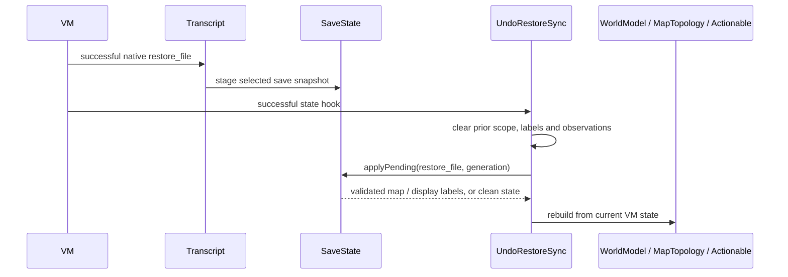

# Save-state architecture handoff for Claude

Proposed bounded addition to ARCHITECTURE_UML.md, grounded in accepted current code 8291b5f/a8364a7/36d64f6. Canonical document remains Claude-owned. Existing chapter 74 uses ar-s100, so a new chapter 75 should use the next free structural anchor, ar-s101, plus ar-ch75; update its table entry too. Decision index columns are claim/files/games, not link columns: preserve that schema and link the D215 claim to PRODUCTION_PLAN.md#pl-d215 while populating its actual owner files.

## Contract to record

- SaveState.js owns local synchronous sidecars keyed by exact executable SHA digest and native save name: PL_SaveState_<digest>_<save>. Successful Transcript.commitSave captures the working map and display labels after file_write succeeds. Successful commitRestore stages the selected snapshot; failed or cancelled attempts do not stage a timeline change.
- UndoRestoreSync.resync clears old scope, labels and observations first. SaveState.applyPending(reason, generation) then consumes a restore only for restore_file or a new game only for restart, before legacy map handling and fresh StatTracker/WorldModel/MapTopology/Actionable ticks. A handled result suppresses legacy map clearing. Actual patched ZVM success hooks own restore/undo/restart; coalesced command fallback remains for other engines and custom LOAD.
- A real new game archives the current nonempty map before clearing. Only autoArchive slots are pruned, to three; operator-created slots remain. Archive/storage failure reports an error and retains the working map. Fresh boot follows the observed Transcript autorestore decision. The first restart for a VM skips resynchronization only while Transcript._booting is true; a first-seen VM after boot is a real restart.
- Actionable labelSnapshot/applyLabelSnapshot/clearLabelSnapshot preserve display-only names. Bounded object IDs and phrases are revalidated against actual current RAM parser vocabulary; current observed prose has priority. Restored names do not teach VerifiedNouns, CommandNouns, capabilities, scope, or inferred descriptors. A save lacking a snapshot starts clean rather than borrowing the current map or names.
- PackageWithTranscripts includes snapshots only for exported saves. Qol import validates exact digest, bounded labels, ValidateMap/D54 and topology quarantine, and includes snapshot writes/deletions in the existing rollback transaction. Replacing a native save without a snapshot deletes its previous sidecar. Snapshot-write failure after native overwrite invalidates the older sidecar. Module uninstall reads its registered transcript digest before removing all matching sidecars.
- StatTracker recognizes the witnessed, framed Treasures ending YOUR BODY IS NEVER FOUND, retaining quote/probe/replay/episode gates. Counted outcomes produce an eight-second polite, nonblocking notice; resynchronization/reset clears it and its timer. CSS uses existing protected input, keyboard and exit reserves without covering the top status band or moving handles.

Evidence: focused SaveState34/0, death40/0, disambiguation51/0, native transcript15/0; save-label ownership and restore-order guards; native Zork two-save map matches and boot marks; actual Treasures native save/restore six full labels without an extra INVENTORY command, plus actual cliff death1/notice. Full audit: 2026-10-09-codex-save-state-audit.md. Bus mutual implementation acceptance2235/2236/2237; final CSS-only review2239 pending. Source shell151; delivered APK64 is still earlier shell149 and excludes this slice. No overall goal completion or physical-device claim.
